# PROVA — CÂMARA MUNICIPAL DE PIRACICABA (SP) — 2019 — AGENTE ADMINISTRATIVO / AGENTE LEGISLATIVO

## 1. Análise geral da prova

**Identificação da prova:**

- **Órgão:** Câmara Municipal de Piracicaba — Estado de São Paulo (SP)
- **Cargos:** Agente Administrativo / Agente Legislativo (prova única)
- **Banca:** CPR (código CPRC1801)
- **Concurso:** Concurso Público — CPRv1801/002, aplicada em 07.07.2019 (manhã)
- **Ano:** 2019
- **Gabarito aplicado:** Gabarito oficial — tabela "CPRC1801 CONCURSO PÚBLICO 07.07.2019 002. PROVA OBJETIVA AGENTE ADMINISTRATIVO AGENTE LEGISLATIVO"

**Composição quantitativa:**

| Item | Quantidade |
|---|---|
| Total de questões objetivas | 50 (5 alternativas: A–E) |
| Redação | 1 tema dissertativo-argumentativo com 3 textos de referência |
| Textos de apoio | 4 (Humanoide/robôs; tira de Calvin; poema de Eugênio de Castro; Super Bowl) + 1 instrução compartilhada (Informática) |
| Imagens de conteúdo | 14 (tira, esquema, figuras, gráficos, tabela, painel, atalho e alternativas-figura) |
| Gráficos e tabelas | 2 gráficos (Q29 e Q30) e 1 tabela (Q41) |
| Grupos identificados | 5 |
| Questões independentes | 29 |

**Composição por bloco:**

| Bloco | Questões | Quantidade |
|---|---|---|
| CONHECIMENTOS GERAIS — Língua Portuguesa | 01 a 15 | 15 |
| CONHECIMENTOS GERAIS — Matemática | 16 a 30 | 15 |
| CONHECIMENTOS GERAIS — Legislação | 31 a 40 | 10 |
| NOÇÕES DE INFORMÁTICA | 41 a 50 | 10 |
| Redação (discursiva) | 1 tema com 3 textos de referência | 1 |

**Observações sobre a estrutura original:**

- As seções originais usam capitulares decorativas; os cabeçalhos aparecem no PDF com letras iniciais destacadas (ex.: "CON ECIMENTOS GERAIS", "Legis ação").
- A instrução "Considere os softwares em sua configuração padrão..." vale para as questões 41 a 50 e foi repetida em cada uma delas.
- A redação foi preservada integralmente, com os 3 textos de referência e o tema.

> CPRC1801 — CONCURSO PÚBLICO — 07.07.2019 — 002. PROVA OBJETIVA — AGENTE ADMINISTRATIVO / AGENTE LEGISLATIVO
> 
> 002. Prova
> bjetiva
> agente administrativo
> agente legislativo
> 
> ocê recebeu sua folha de respostas, este caderno, contendo 50 questões objetivas e um tema de redação a ser desenvolvido,
> e a folha de redação para transcrição do texto definitivo.
> 
> onfira seus dados impressos na capa deste caderno e nas folhas de respostas e de redação.
>  Quando for permitido abrir o caderno, verifique se está completo ou se apresenta imperfeições. aso haja algum problema,
> informe ao fiscal da sala.
> 
>  folha de redação deverá ser assinada apenas no local indicado; qualquer identificação ou marca feita pelo candidato no
> verso da folha de redação, que possa permitir sua identificação, acarretará a atribuição de nota zero à redação.
> 
> edija o texto definitivo e preencha a folha de respostas com caneta de tinta preta. s rascunhos não serão considerados
> na correção.  ilegibilidade da letra acarretará prejuízo à nota do candidato.
> 
>  duração das provas objetiva e de redação é de 4 horas, já incluído o tempo para o preenchimento da folha de respostas
> e para a transcrição do texto definitivo.
> 
> ó será permitida a saída definitiva da sala e do prédio após transcorridos 75% do tempo de duração das provas.
> 
> o sair, você entregará ao fiscal a folha de redação, a folha de respostas e este caderno, podendo levar apenas o rascunho
> de gabarito, localizado em sua carteira, para futura conferência.
> 
> té que você saia do prédio, todas as proibições e orientações continuam válidas.
> guarde a ordem do fiscal ara abrir este caderno.
> 07.07.2019 | manhã
> Nome do candidato
> Prédio
> Sala
> Carteira
> Inscrição
> RG

**Gabarito oficial — tabela "CPRC1801 — CONCURSO PÚBLICO — 07.07.2019 — 002. PROVA OBJETIVA — AGENTE ADMINISTRATIVO / AGENTE LEGISLATIVO":**

| Questão | Resposta | Questão | Resposta | Questão | Resposta | Questão | Resposta | Questão | Resposta |
|---|---|---|---|---|---|---|---|---|---|
| 01 | **C** | 02 | **D** | 03 | **B** | 04 | **B** | 05 | **E** |
| 06 | **A** | 07 | **C** | 08 | **B** | 09 | **D** | 10 | **A** |
| 11 | **E** | 12 | **A** | 13 | **D** | 14 | **B** | 15 | **D** |
| 16 | **E** | 17 | **A** | 18 | **B** | 19 | **D** | 20 | **B** |
| 21 | **B** | 22 | **E** | 23 | **B** | 24 | **D** | 25 | **A** |
| 26 | **C** | 27 | **E** | 28 | **C** | 29 | **D** | 30 | **C** |
| 31 | **E** | 32 | **B** | 33 | **D** | 34 | **A** | 35 | **C** |
| 36 | **B** | 37 | **E** | 38 | **A** | 39 | **C** | 40 | **D** |
| 41 | **C** | 42 | **D** | 43 | **E** | 44 | **B** | 45 | **A** |
| 46 | **C** | 47 | **B** | 48 | **D** | 49 | **E** | 50 | **B** |

> 📌 Fonte: CPRC1801 — CONCURSO PÚBLICO — 07.07.2019 — 002. PROVA OBJETIVA — AGENTE ADMINISTRATIVO / AGENTE LEGISLATIVO

---

## 2. Questões agrupadas

### GRUPO 01 — Texto "Humanoide perde a vez entre robôs" (Cade Metz / The New York Times) — compartilhado pelas questões 01 a 07

**Questões relacionadas:** 01, 02, 03, 04, 05, 06 e 07.

**Material de apoio compartilhado:**

> Texto de referência (utilizado nas questões 01 a 07):
> 
> Leia o texto para responder às questões de números 01 a 07.
> Humanoide perde a vez entre robôs Discretamente, o Google está reformulando seu ambicioso programa de robótica. Lançado em 2013, o projeto incluía duas equipes especializadas em máquinas que pareciam e se moviam como seres humanos. No entanto, pouco sobrou desse projeto. A proposta agora é de usar robôs mais simples, que possam aprender por si mesmos certas habilidades. “O New York Times” foi o primeiro jornal a conhecer parte da tecnologia na qual a companhia vem trabalhando. Embora as máquinas não sejam tão atraentes visualmente quanto os robôs humanoides, os pesqui sadores acreditam que a tec - nologia sutilmente mais avançada no interior delas tem mais potencial no mundo real. Os robôs aprendem sozinhos habilidades como organizar um conjunto de objetos não familiares ou locomover-se no meio de obstáculos inesperados. Muitos acredita m que o aprendizado de máquinas – e não a criação de novos equipamentos extravagantes – será a chave para o desenvolvimento da robótica voltada para ma - nufatura, automação de depósitos de materiais, transporte e outras atividades. Numa tarde no novo laboratório, um braço robótico pai - rava sobre uma lata cheia de bolas de pingue-pongue, cubos de madeira, bananas de plástico e outros objetos escolhidos ao acaso. Em meio a essa confusão, o braço robótico pegou com dois dedo s uma banana de plástico e, com um suave movimento de punho, jogou-a numa lata menor que estava a vários centímetros de distância. Foi um feito admirável. Na primeira vez que viu os objetos, o braço não sabia como pegar uma única peça. Porém, equipado com uma câmera que “olhava” dentro da lata, o sistema aprendeu depois de 14 horas de tentativa e erro. O braço mais tarde aprendeu a jogar itens nas latas certas, com 85% de acerto. Quando os pesquisadores tentaram executar a mesma tarefa, a média foi de 80%. Parece uma tarefa muito simples, todavia criar um código de computador para dizer a uma máquina como fazer isso é algo extrema - mente difícil. O braço que joga objetos numa lata não é uma máquina desenhada pelos pesquisador es. Fabricado pela Universal Robots, ele é comumente usado em manufatura e outras atividades. O que o Google está fazendo é treiná-lo para que faça coisas que, de outro modo, ele não faria. “O aprendizado está nos ajudando a superar o desafio de construir robôs de baixo custo”, diz Vikash Kumar, supervisor do projeto. (Cade Metz. The New York Times. Publicado pelo jornal O Estado de São Paulo em 14.04.2019. Tradução de Roberto Muniz. Adaptado)

---

#### QUESTÃO 01

✅ **Gabarito: C** (gabarito oficial — CPRC1801, Concurso Público de 07.07.2019, 002. Prova Objetiva, cargos Agente Administrativo / Agente Legislativo)

**Material de apoio:**

> Texto de referência (utilizado nas questões 01 a 07):
> 
> Leia o texto para responder às questões de números 01 a 07.
> Humanoide perde a vez entre robôs Discretamente, o Google está reformulando seu ambicioso programa de robótica. Lançado em 2013, o projeto incluía duas equipes especializadas em máquinas que pareciam e se moviam como seres humanos. No entanto, pouco sobrou desse projeto. A proposta agora é de usar robôs mais simples, que possam aprender por si mesmos certas habilidades. “O New York Times” foi o primeiro jornal a conhecer parte da tecnologia na qual a companhia vem trabalhando. Embora as máquinas não sejam tão atraentes visualmente quanto os robôs humanoides, os pesqui sadores acreditam que a tec - nologia sutilmente mais avançada no interior delas tem mais potencial no mundo real. Os robôs aprendem sozinhos habilidades como organizar um conjunto de objetos não familiares ou locomover-se no meio de obstáculos inesperados. Muitos acredita m que o aprendizado de máquinas – e não a criação de novos equipamentos extravagantes – será a chave para o desenvolvimento da robótica voltada para ma - nufatura, automação de depósitos de materiais, transporte e outras atividades. Numa tarde no novo laboratório, um braço robótico pai - rava sobre uma lata cheia de bolas de pingue-pongue, cubos de madeira, bananas de plástico e outros objetos escolhidos ao acaso. Em meio a essa confusão, o braço robótico pegou com dois dedo s uma banana de plástico e, com um suave movimento de punho, jogou-a numa lata menor que estava a vários centímetros de distância. Foi um feito admirável. Na primeira vez que viu os objetos, o braço não sabia como pegar uma única peça. Porém, equipado com uma câmera que “olhava” dentro da lata, o sistema aprendeu depois de 14 horas de tentativa e erro. O braço mais tarde aprendeu a jogar itens nas latas certas, com 85% de acerto. Quando os pesquisadores tentaram executar a mesma tarefa, a média foi de 80%. Parece uma tarefa muito simples, todavia criar um código de computador para dizer a uma máquina como fazer isso é algo extrema - mente difícil. O braço que joga objetos numa lata não é uma máquina desenhada pelos pesquisador es. Fabricado pela Universal Robots, ele é comumente usado em manufatura e outras atividades. O que o Google está fazendo é treiná-lo para que faça coisas que, de outro modo, ele não faria. “O aprendizado está nos ajudando a superar o desafio de construir robôs de baixo custo”, diz Vikash Kumar, supervisor do projeto. (Cade Metz. The New York Times. Publicado pelo jornal O Estado de São Paulo em 14.04.2019. Tradução de Roberto Muniz. Adaptado)

**Enunciado:**

De acordo com o texto, o programa de robótica citado

**Alternativas:**

A) pretende criar robôs humanoides que sejam de bai - xo custo e visualmente chamativos a fim de atrair os consumidores.

B) investe maciçamente em especialistas cuja única função é desenhar novas máquinas, como o braço que pega os objetos.

C) está trabalhando códigos de computador para que os robôs adquiram por si mesmos certas habilidades.

D) tem divulgado enfaticamente, por meio de diversos veículos de comunicação, os resultados obtidos nos laboratórios.

E) vê com sucesso o braço que aprendeu a jogar objetos em uma lata, embora ele ainda não tenha superado os humanos nessa tarefa.

---

#### QUESTÃO 02

✅ **Gabarito: D** (gabarito oficial — CPRC1801, Concurso Público de 07.07.2019, 002. Prova Objetiva, cargos Agente Administrativo / Agente Legislativo)

**Material de apoio:**

> Texto de referência (utilizado nas questões 01 a 07):
> 
> Leia o texto para responder às questões de números 01 a 07.
> Humanoide perde a vez entre robôs Discretamente, o Google está reformulando seu ambicioso programa de robótica. Lançado em 2013, o projeto incluía duas equipes especializadas em máquinas que pareciam e se moviam como seres humanos. No entanto, pouco sobrou desse projeto. A proposta agora é de usar robôs mais simples, que possam aprender por si mesmos certas habilidades. “O New York Times” foi o primeiro jornal a conhecer parte da tecnologia na qual a companhia vem trabalhando. Embora as máquinas não sejam tão atraentes visualmente quanto os robôs humanoides, os pesqui sadores acreditam que a tec - nologia sutilmente mais avançada no interior delas tem mais potencial no mundo real. Os robôs aprendem sozinhos habilidades como organizar um conjunto de objetos não familiares ou locomover-se no meio de obstáculos inesperados. Muitos acredita m que o aprendizado de máquinas – e não a criação de novos equipamentos extravagantes – será a chave para o desenvolvimento da robótica voltada para ma - nufatura, automação de depósitos de materiais, transporte e outras atividades. Numa tarde no novo laboratório, um braço robótico pai - rava sobre uma lata cheia de bolas de pingue-pongue, cubos de madeira, bananas de plástico e outros objetos escolhidos ao acaso. Em meio a essa confusão, o braço robótico pegou com dois dedo s uma banana de plástico e, com um suave movimento de punho, jogou-a numa lata menor que estava a vários centímetros de distância. Foi um feito admirável. Na primeira vez que viu os objetos, o braço não sabia como pegar uma única peça. Porém, equipado com uma câmera que “olhava” dentro da lata, o sistema aprendeu depois de 14 horas de tentativa e erro. O braço mais tarde aprendeu a jogar itens nas latas certas, com 85% de acerto. Quando os pesquisadores tentaram executar a mesma tarefa, a média foi de 80%. Parece uma tarefa muito simples, todavia criar um código de computador para dizer a uma máquina como fazer isso é algo extrema - mente difícil. O braço que joga objetos numa lata não é uma máquina desenhada pelos pesquisador es. Fabricado pela Universal Robots, ele é comumente usado em manufatura e outras atividades. O que o Google está fazendo é treiná-lo para que faça coisas que, de outro modo, ele não faria. “O aprendizado está nos ajudando a superar o desafio de construir robôs de baixo custo”, diz Vikash Kumar, supervisor do projeto. (Cade Metz. The New York Times. Publicado pelo jornal O Estado de São Paulo em 14.04.2019. Tradução de Roberto Muniz. Adaptado)

**Enunciado:**

A respeito do texto, é correto afirmar que o autor

**Alternativas:**

A) confronta diferentes pontos de vista de especialistas que atuam na área de robótica.

B) emprega linguagem figurada para ressaltar sua admiração pelo mundo dos robôs.

C) descreve, com ceticismo, os experimentos com os robôs não humanoides.

D) é objetivo e claro ao transmitir aos leitores as informações sobre o programa de robótica.

E) expõe sua opinião crítica a respeito da validade dos projetos desenvolvidos pelo Google.

---

#### QUESTÃO 03

✅ **Gabarito: B** (gabarito oficial — CPRC1801, Concurso Público de 07.07.2019, 002. Prova Objetiva, cargos Agente Administrativo / Agente Legislativo)

**Material de apoio:**

> Texto de referência (utilizado nas questões 01 a 07):
> 
> Leia o texto para responder às questões de números 01 a 07.
> Humanoide perde a vez entre robôs Discretamente, o Google está reformulando seu ambicioso programa de robótica. Lançado em 2013, o projeto incluía duas equipes especializadas em máquinas que pareciam e se moviam como seres humanos. No entanto, pouco sobrou desse projeto. A proposta agora é de usar robôs mais simples, que possam aprender por si mesmos certas habilidades. “O New York Times” foi o primeiro jornal a conhecer parte da tecnologia na qual a companhia vem trabalhando. Embora as máquinas não sejam tão atraentes visualmente quanto os robôs humanoides, os pesqui sadores acreditam que a tec - nologia sutilmente mais avançada no interior delas tem mais potencial no mundo real. Os robôs aprendem sozinhos habilidades como organizar um conjunto de objetos não familiares ou locomover-se no meio de obstáculos inesperados. Muitos acredita m que o aprendizado de máquinas – e não a criação de novos equipamentos extravagantes – será a chave para o desenvolvimento da robótica voltada para ma - nufatura, automação de depósitos de materiais, transporte e outras atividades. Numa tarde no novo laboratório, um braço robótico pai - rava sobre uma lata cheia de bolas de pingue-pongue, cubos de madeira, bananas de plástico e outros objetos escolhidos ao acaso. Em meio a essa confusão, o braço robótico pegou com dois dedo s uma banana de plástico e, com um suave movimento de punho, jogou-a numa lata menor que estava a vários centímetros de distância. Foi um feito admirável. Na primeira vez que viu os objetos, o braço não sabia como pegar uma única peça. Porém, equipado com uma câmera que “olhava” dentro da lata, o sistema aprendeu depois de 14 horas de tentativa e erro. O braço mais tarde aprendeu a jogar itens nas latas certas, com 85% de acerto. Quando os pesquisadores tentaram executar a mesma tarefa, a média foi de 80%. Parece uma tarefa muito simples, todavia criar um código de computador para dizer a uma máquina como fazer isso é algo extrema - mente difícil. O braço que joga objetos numa lata não é uma máquina desenhada pelos pesquisador es. Fabricado pela Universal Robots, ele é comumente usado em manufatura e outras atividades. O que o Google está fazendo é treiná-lo para que faça coisas que, de outro modo, ele não faria. “O aprendizado está nos ajudando a superar o desafio de construir robôs de baixo custo”, diz Vikash Kumar, supervisor do projeto. (Cade Metz. The New York Times. Publicado pelo jornal O Estado de São Paulo em 14.04.2019. Tradução de Roberto Muniz. Adaptado)

**Enunciado:**

A expressão destacada pode ser substituída, sem alte - ração de sentido, pela expressão entre parênteses, em:

**Alternativas:**

A) Primeiro parágrafo: No entanto, pouco sobrou desse projeto. (Porque)

B) Segundo parágrafo: Embora as máquinas não sejam tão atraentes... (Mesmo que)

C) Quinto parágrafo: Quando os pesquisadores tentaram executar... (Se)

D) Quinto parágrafo: Parece uma tarefa muito simples, todavia criar um código... (já que)

E) Último parágrafo: O que o Google está fazendo é treiná-lo para que faça coisas... (ainda que)

---

#### QUESTÃO 04

✅ **Gabarito: B** (gabarito oficial — CPRC1801, Concurso Público de 07.07.2019, 002. Prova Objetiva, cargos Agente Administrativo / Agente Legislativo)

**Material de apoio:**

> Texto de referência (utilizado nas questões 01 a 07):
> 
> Leia o texto para responder às questões de números 01 a 07.
> Humanoide perde a vez entre robôs Discretamente, o Google está reformulando seu ambicioso programa de robótica. Lançado em 2013, o projeto incluía duas equipes especializadas em máquinas que pareciam e se moviam como seres humanos. No entanto, pouco sobrou desse projeto. A proposta agora é de usar robôs mais simples, que possam aprender por si mesmos certas habilidades. “O New York Times” foi o primeiro jornal a conhecer parte da tecnologia na qual a companhia vem trabalhando. Embora as máquinas não sejam tão atraentes visualmente quanto os robôs humanoides, os pesqui sadores acreditam que a tec - nologia sutilmente mais avançada no interior delas tem mais potencial no mundo real. Os robôs aprendem sozinhos habilidades como organizar um conjunto de objetos não familiares ou locomover-se no meio de obstáculos inesperados. Muitos acredita m que o aprendizado de máquinas – e não a criação de novos equipamentos extravagantes – será a chave para o desenvolvimento da robótica voltada para ma - nufatura, automação de depósitos de materiais, transporte e outras atividades. Numa tarde no novo laboratório, um braço robótico pai - rava sobre uma lata cheia de bolas de pingue-pongue, cubos de madeira, bananas de plástico e outros objetos escolhidos ao acaso. Em meio a essa confusão, o braço robótico pegou com dois dedo s uma banana de plástico e, com um suave movimento de punho, jogou-a numa lata menor que estava a vários centímetros de distância. Foi um feito admirável. Na primeira vez que viu os objetos, o braço não sabia como pegar uma única peça. Porém, equipado com uma câmera que “olhava” dentro da lata, o sistema aprendeu depois de 14 horas de tentativa e erro. O braço mais tarde aprendeu a jogar itens nas latas certas, com 85% de acerto. Quando os pesquisadores tentaram executar a mesma tarefa, a média foi de 80%. Parece uma tarefa muito simples, todavia criar um código de computador para dizer a uma máquina como fazer isso é algo extrema - mente difícil. O braço que joga objetos numa lata não é uma máquina desenhada pelos pesquisador es. Fabricado pela Universal Robots, ele é comumente usado em manufatura e outras atividades. O que o Google está fazendo é treiná-lo para que faça coisas que, de outro modo, ele não faria. “O aprendizado está nos ajudando a superar o desafio de construir robôs de baixo custo”, diz Vikash Kumar, supervisor do projeto. (Cade Metz. The New York Times. Publicado pelo jornal O Estado de São Paulo em 14.04.2019. Tradução de Roberto Muniz. Adaptado)

**Enunciado:**

Assinale a alternativa em que o trecho do quarto parágrafo está reescrito preservando-se o sentido original do texto.

**Alternativas:**

A) Em meio a essa confusão, o braço robótico pegou com dois dedos... → Em meio à negligência dos pesquisadores, o robô pegou com dois dedos

B) ... com um suave movimento de punho, jogou-a numa lata... → movimentando suavemente o punho, atirou-a em uma lata

C) ... jogou-a numa lata menor que estava a vários centímetros de distância. → jogou-a a uma certa distância em uma lata de vários centímetros

D) ... o braço não sabia como pegar uma única peça. → o braço somente conseguia pegar uma peça por vez

E) Porém, equipado com uma câmera que “olhava” dentro da lata... → Mas, equipado com uma câmera que, dentro da lata, “olhava” ao redor

---

#### QUESTÃO 05

✅ **Gabarito: E** (gabarito oficial — CPRC1801, Concurso Público de 07.07.2019, 002. Prova Objetiva, cargos Agente Administrativo / Agente Legislativo)

**Material de apoio:**

> Texto de referência (utilizado nas questões 01 a 07):
> 
> Leia o texto para responder às questões de números 01 a 07.
> Humanoide perde a vez entre robôs Discretamente, o Google está reformulando seu ambicioso programa de robótica. Lançado em 2013, o projeto incluía duas equipes especializadas em máquinas que pareciam e se moviam como seres humanos. No entanto, pouco sobrou desse projeto. A proposta agora é de usar robôs mais simples, que possam aprender por si mesmos certas habilidades. “O New York Times” foi o primeiro jornal a conhecer parte da tecnologia na qual a companhia vem trabalhando. Embora as máquinas não sejam tão atraentes visualmente quanto os robôs humanoides, os pesqui sadores acreditam que a tec - nologia sutilmente mais avançada no interior delas tem mais potencial no mundo real. Os robôs aprendem sozinhos habilidades como organizar um conjunto de objetos não familiares ou locomover-se no meio de obstáculos inesperados. Muitos acredita m que o aprendizado de máquinas – e não a criação de novos equipamentos extravagantes – será a chave para o desenvolvimento da robótica voltada para ma - nufatura, automação de depósitos de materiais, transporte e outras atividades. Numa tarde no novo laboratório, um braço robótico pai - rava sobre uma lata cheia de bolas de pingue-pongue, cubos de madeira, bananas de plástico e outros objetos escolhidos ao acaso. Em meio a essa confusão, o braço robótico pegou com dois dedo s uma banana de plástico e, com um suave movimento de punho, jogou-a numa lata menor que estava a vários centímetros de distância. Foi um feito admirável. Na primeira vez que viu os objetos, o braço não sabia como pegar uma única peça. Porém, equipado com uma câmera que “olhava” dentro da lata, o sistema aprendeu depois de 14 horas de tentativa e erro. O braço mais tarde aprendeu a jogar itens nas latas certas, com 85% de acerto. Quando os pesquisadores tentaram executar a mesma tarefa, a média foi de 80%. Parece uma tarefa muito simples, todavia criar um código de computador para dizer a uma máquina como fazer isso é algo extrema - mente difícil. O braço que joga objetos numa lata não é uma máquina desenhada pelos pesquisador es. Fabricado pela Universal Robots, ele é comumente usado em manufatura e outras atividades. O que o Google está fazendo é treiná-lo para que faça coisas que, de outro modo, ele não faria. “O aprendizado está nos ajudando a superar o desafio de construir robôs de baixo custo”, diz Vikash Kumar, supervisor do projeto. (Cade Metz. The New York Times. Publicado pelo jornal O Estado de São Paulo em 14.04.2019. Tradução de Roberto Muniz. Adaptado)

**Enunciado:**

Considere a frase do segundo parágrafo. “O New York Times” foi o primeiro jornal a conhecer parte da tecnologia na qual a companhia vem trabalhando. Em conformidade com a regência padrão da língua portuguesa, o termo destacado pode ser substituído por:

**Alternativas:**

A) estar a par em

B) estar interessado com

C) ter acesso de

D) informar-se com

E) inteirar-se de

---

#### QUESTÃO 06

✅ **Gabarito: A** (gabarito oficial — CPRC1801, Concurso Público de 07.07.2019, 002. Prova Objetiva, cargos Agente Administrativo / Agente Legislativo)

**Material de apoio:**

> Texto de referência (utilizado nas questões 01 a 07):
> 
> Leia o texto para responder às questões de números 01 a 07.
> Humanoide perde a vez entre robôs Discretamente, o Google está reformulando seu ambicioso programa de robótica. Lançado em 2013, o projeto incluía duas equipes especializadas em máquinas que pareciam e se moviam como seres humanos. No entanto, pouco sobrou desse projeto. A proposta agora é de usar robôs mais simples, que possam aprender por si mesmos certas habilidades. “O New York Times” foi o primeiro jornal a conhecer parte da tecnologia na qual a companhia vem trabalhando. Embora as máquinas não sejam tão atraentes visualmente quanto os robôs humanoides, os pesqui sadores acreditam que a tec - nologia sutilmente mais avançada no interior delas tem mais potencial no mundo real. Os robôs aprendem sozinhos habilidades como organizar um conjunto de objetos não familiares ou locomover-se no meio de obstáculos inesperados. Muitos acredita m que o aprendizado de máquinas – e não a criação de novos equipamentos extravagantes – será a chave para o desenvolvimento da robótica voltada para ma - nufatura, automação de depósitos de materiais, transporte e outras atividades. Numa tarde no novo laboratório, um braço robótico pai - rava sobre uma lata cheia de bolas de pingue-pongue, cubos de madeira, bananas de plástico e outros objetos escolhidos ao acaso. Em meio a essa confusão, o braço robótico pegou com dois dedo s uma banana de plástico e, com um suave movimento de punho, jogou-a numa lata menor que estava a vários centímetros de distância. Foi um feito admirável. Na primeira vez que viu os objetos, o braço não sabia como pegar uma única peça. Porém, equipado com uma câmera que “olhava” dentro da lata, o sistema aprendeu depois de 14 horas de tentativa e erro. O braço mais tarde aprendeu a jogar itens nas latas certas, com 85% de acerto. Quando os pesquisadores tentaram executar a mesma tarefa, a média foi de 80%. Parece uma tarefa muito simples, todavia criar um código de computador para dizer a uma máquina como fazer isso é algo extrema - mente difícil. O braço que joga objetos numa lata não é uma máquina desenhada pelos pesquisador es. Fabricado pela Universal Robots, ele é comumente usado em manufatura e outras atividades. O que o Google está fazendo é treiná-lo para que faça coisas que, de outro modo, ele não faria. “O aprendizado está nos ajudando a superar o desafio de construir robôs de baixo custo”, diz Vikash Kumar, supervisor do projeto. (Cade Metz. The New York Times. Publicado pelo jornal O Estado de São Paulo em 14.04.2019. Tradução de Roberto Muniz. Adaptado)

**Enunciado:**

Considere as frases elaboradas a partir das ideias do texto. • A empresa tem um ambicioso programa de robótica e decidiu reformular esse ambicioso programa. • Alguns robôs lidam com objetos não familiares, e os pesquisadores analisam como organizam esses objetos. De acordo com o emprego e a colocação dos pronomes estabelecidos pela norma-padrão, os trechos em desta - que podem ser substituídos por:

**Alternativas:**

A) reformulá-lo; os organizam

B) reformulá-lo; lhes organizam

C) o reformular; organizam-lhes

D) reformular-lhe; os organizam

E) lhe reformular; organizam-nos

---

#### QUESTÃO 07

✅ **Gabarito: C** (gabarito oficial — CPRC1801, Concurso Público de 07.07.2019, 002. Prova Objetiva, cargos Agente Administrativo / Agente Legislativo)

**Material de apoio:**

> Texto de referência (utilizado nas questões 01 a 07):
> 
> Leia o texto para responder às questões de números 01 a 07.
> Humanoide perde a vez entre robôs Discretamente, o Google está reformulando seu ambicioso programa de robótica. Lançado em 2013, o projeto incluía duas equipes especializadas em máquinas que pareciam e se moviam como seres humanos. No entanto, pouco sobrou desse projeto. A proposta agora é de usar robôs mais simples, que possam aprender por si mesmos certas habilidades. “O New York Times” foi o primeiro jornal a conhecer parte da tecnologia na qual a companhia vem trabalhando. Embora as máquinas não sejam tão atraentes visualmente quanto os robôs humanoides, os pesqui sadores acreditam que a tec - nologia sutilmente mais avançada no interior delas tem mais potencial no mundo real. Os robôs aprendem sozinhos habilidades como organizar um conjunto de objetos não familiares ou locomover-se no meio de obstáculos inesperados. Muitos acredita m que o aprendizado de máquinas – e não a criação de novos equipamentos extravagantes – será a chave para o desenvolvimento da robótica voltada para ma - nufatura, automação de depósitos de materiais, transporte e outras atividades. Numa tarde no novo laboratório, um braço robótico pai - rava sobre uma lata cheia de bolas de pingue-pongue, cubos de madeira, bananas de plástico e outros objetos escolhidos ao acaso. Em meio a essa confusão, o braço robótico pegou com dois dedo s uma banana de plástico e, com um suave movimento de punho, jogou-a numa lata menor que estava a vários centímetros de distância. Foi um feito admirável. Na primeira vez que viu os objetos, o braço não sabia como pegar uma única peça. Porém, equipado com uma câmera que “olhava” dentro da lata, o sistema aprendeu depois de 14 horas de tentativa e erro. O braço mais tarde aprendeu a jogar itens nas latas certas, com 85% de acerto. Quando os pesquisadores tentaram executar a mesma tarefa, a média foi de 80%. Parece uma tarefa muito simples, todavia criar um código de computador para dizer a uma máquina como fazer isso é algo extrema - mente difícil. O braço que joga objetos numa lata não é uma máquina desenhada pelos pesquisador es. Fabricado pela Universal Robots, ele é comumente usado em manufatura e outras atividades. O que o Google está fazendo é treiná-lo para que faça coisas que, de outro modo, ele não faria. “O aprendizado está nos ajudando a superar o desafio de construir robôs de baixo custo”, diz Vikash Kumar, supervisor do projeto. (Cade Metz. The New York Times. Publicado pelo jornal O Estado de São Paulo em 14.04.2019. Tradução de Roberto Muniz. Adaptado)

**Enunciado:**

Assinale a alternativa correta quanto à concordância verbal padrão.

**Alternativas:**

A) Em 2013, participando do projeto, existia duas equipes especializadas em robôs humanoides.

B) “O New York Times”, depois de entrevistar os pesquisadores, noticiaram os avanços do projeto.

C) Para os integrantes do programa, impõe-se o desafio de construir robôs a baixo custo.

D) O apren dizado das máquinas , segundo especialistas, serão a solução para a robótica voltada para a manufatura.

E) O braço robótico, que manipu lavam as bananas de plástico, gastou horas em tentativas, acertos e erros.

---

### GRUPO 02 — Tira "O melhor de Calvin" (Bill Watterson) — compartilhada pelas questões 08 e 09

**Questões relacionadas:** 08 e 09.

**Material de apoio compartilhado:**

> Referência (utilizada nas questões 08 e 09):
> 
> Leia a tira para responder às questões de números 08 e 09.
> 
> (O melhor de Calvin. Bill Watterson. O Estado de S. Paulo, 06.04.2019)

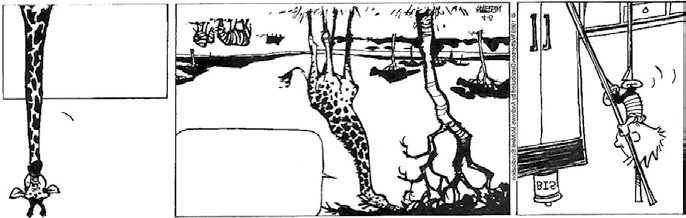

---

#### QUESTÃO 08

✅ **Gabarito: B** (gabarito oficial — CPRC1801, Concurso Público de 07.07.2019, 002. Prova Objetiva, cargos Agente Administrativo / Agente Legislativo)

**Material de apoio:**

> Referência (utilizada nas questões 08 e 09):
> 
> Leia a tira para responder às questões de números 08 e 09.
> 
> (O melhor de Calvin. Bill Watterson. O Estado de S. Paulo, 06.04.2019)

**Enunciado:**

Analisando a tira, é correto afirmar que o garoto

**Alternativas:**

A) se impressionou com a altura das girafas e fez per - nas de pau para observar objetos e familiares da mesma perspectiva desses animais.

B) se inspirou no comportamento das girafas para pe - gar o pote de Bis, os quais também considera saborosos e difíceis de alcançar.

C) aprendeu que as girafas, diferentemente de outros animais, encon tram alimentos variados e nutritivos nas florestas.

D) está proibido pelo pediatra de comer alimentos com açúcar, por isso sua mãe guardou o pote de chocolate em cima do armário.

E) não gosta de estudar sobre a vida dos animais, mas serviu-se das informações acerca das girafas para inventar brincadeiras.

---

#### QUESTÃO 09

✅ **Gabarito: D** (gabarito oficial — CPRC1801, Concurso Público de 07.07.2019, 002. Prova Objetiva, cargos Agente Administrativo / Agente Legislativo)

**Material de apoio:**

> Referência (utilizada nas questões 08 e 09):
> 
> Leia a tira para responder às questões de números 08 e 09.
> 
> (O melhor de Calvin. Bill Watterson. O Estado de S. Paulo, 06.04.2019)

**Enunciado:**

No primeiro quadrinho, os termos peculiares e adequada podem ser substituídos, sem alteração de sentido e atendendo à norma-padrão, respectivamente, por:

**Alternativas:**

A) misteriosos e adestrada.

B) elegantes e compatível.

C) exóticos e perfeita.

D) singulares e adaptada.

E) agressivos e ajustada.

---

### GRUPO 03 — Poema de Eugênio de Castro — compartilhado pelas questões 11 a 15

**Questões relacionadas:** 11, 12, 13, 14 e 15.

**Material de apoio compartilhado:**

> Texto de referência (utilizado nas questões 11 a 15):
> 
> Leia o poema de Eugênio de Castro para responder às questões de números 11 a 15.
> Tua frieza aumenta o meu desejo:
> Fecho os meus olhos para te esquecer,
> Mas quanto mais procuro não te ver,
> Quanto mais fecho os olhos mais te vejo.
> Humildemente, atrás de ti rastejo,
> humildemente, sem te convencer,
> Antes sentindo para mim crescer
> Dos teus desdéns o frígido cortejo.
> Sei que jamais hei de possuir-te, sei
> Que outro feliz, ditoso como um rei
> Enlaçará teu virgem corpo em flor.
> Meu coração no entanto não se cansa:
> Amam metade os que amam com esperança,
> Amar sem esperança é o verdadeiro amor.
> (Massaud Moisés. A literatura portuguesa através dos textos. Adaptado)

---

#### QUESTÃO 11

✅ **Gabarito: E** (gabarito oficial — CPRC1801, Concurso Público de 07.07.2019, 002. Prova Objetiva, cargos Agente Administrativo / Agente Legislativo)

**Material de apoio:**

> Texto de referência (utilizado nas questões 11 a 15):
> 
> Leia o poema de Eugênio de Castro para responder às questões de números 11 a 15.
> Tua frieza aumenta o meu desejo:
> Fecho os meus olhos para te esquecer,
> Mas quanto mais procuro não te ver,
> Quanto mais fecho os olhos mais te vejo.
> Humildemente, atrás de ti rastejo,
> humildemente, sem te convencer,
> Antes sentindo para mim crescer
> Dos teus desdéns o frígido cortejo.
> Sei que jamais hei de possuir-te, sei
> Que outro feliz, ditoso como um rei
> Enlaçará teu virgem corpo em flor.
> Meu coração no entanto não se cansa:
> Amam metade os que amam com esperança,
> Amar sem esperança é o verdadeiro amor.
> (Massaud Moisés. A literatura portuguesa através dos textos. Adaptado)

**Enunciado:**

Com base nas ideias presentes no poema, é correto afirmar que o eu poético

**Alternativas:**

A) se sente esperançoso e crê que seu amor será correspondido, apesar do desprezo da mulher amada.

B) continua a cortejá-la, sentindo que há futuro para esse amor, apesar da falsidade da mulher amada.

C) está convicto de que vai conquistá-la, idealizando esse relacionamento, apesar do egoísmo da mulher amada.

D) admite que a concretização desse amor exige sacri - fícios e aceita ser submisso, apesar da vaidade da mulher amada.

E) reconhece que não será bem-sucedido, mas pretende ser sempre fiel a esse amor, apesar da indiferença da mulher amada.

---

#### QUESTÃO 12

✅ **Gabarito: A** (gabarito oficial — CPRC1801, Concurso Público de 07.07.2019, 002. Prova Objetiva, cargos Agente Administrativo / Agente Legislativo)

**Material de apoio:**

> Texto de referência (utilizado nas questões 11 a 15):
> 
> Leia o poema de Eugênio de Castro para responder às questões de números 11 a 15.
> Tua frieza aumenta o meu desejo:
> Fecho os meus olhos para te esquecer,
> Mas quanto mais procuro não te ver,
> Quanto mais fecho os olhos mais te vejo.
> Humildemente, atrás de ti rastejo,
> humildemente, sem te convencer,
> Antes sentindo para mim crescer
> Dos teus desdéns o frígido cortejo.
> Sei que jamais hei de possuir-te, sei
> Que outro feliz, ditoso como um rei
> Enlaçará teu virgem corpo em flor.
> Meu coração no entanto não se cansa:
> Amam metade os que amam com esperança,
> Amar sem esperança é o verdadeiro amor.
> (Massaud Moisés. A literatura portuguesa através dos textos. Adaptado)

**Enunciado:**

Assinale a alternativa cujo verso expressa uma aparente contradição.

**Alternativas:**

A) Quanto mais fecho os olhos mais te vejo

B) Humildemente, atrás de ti rastejo

C) Sei que jamais hei de possuir-te, sei

D) Enlaçará teu virgem corpo em flor

E) Meu coração no entanto não se cansa

---

#### QUESTÃO 13

✅ **Gabarito: D** (gabarito oficial — CPRC1801, Concurso Público de 07.07.2019, 002. Prova Objetiva, cargos Agente Administrativo / Agente Legislativo)

**Material de apoio:**

> Texto de referência (utilizado nas questões 11 a 15):
> 
> Leia o poema de Eugênio de Castro para responder às questões de números 11 a 15.
> Tua frieza aumenta o meu desejo:
> Fecho os meus olhos para te esquecer,
> Mas quanto mais procuro não te ver,
> Quanto mais fecho os olhos mais te vejo.
> Humildemente, atrás de ti rastejo,
> humildemente, sem te convencer,
> Antes sentindo para mim crescer
> Dos teus desdéns o frígido cortejo.
> Sei que jamais hei de possuir-te, sei
> Que outro feliz, ditoso como um rei
> Enlaçará teu virgem corpo em flor.
> Meu coração no entanto não se cansa:
> Amam metade os que amam com esperança,
> Amar sem esperança é o verdadeiro amor.
> (Massaud Moisés. A literatura portuguesa através dos textos. Adaptado)

**Enunciado:**

No poema,

**Alternativas:**

A) humildemente (2 a estrofe) expressa circunstânc ia adverbial de modo, como em: Talvez ela virá à festa para encontrá-lo.

B) humildemente (2 a estrofe) expressa circunstânc ia adverbial de afirmação, como em: Foi muito prazeroso visitar esta cidade.

C) jamais (3a estrofe) expressa circunstância adverbial de negação, como em: O diretor reclamou à beça das condições do teatro.

D) jamais (3a estrofe) expressa circunstância adverbial de tempo, como em: A avó ainda guarda muitas fotos da família.

E) com esperança (4a estrofe) expressa circunstância adverbial de intensidade, como em: Ele raramente chega na hora marcada.

---

#### QUESTÃO 14

✅ **Gabarito: B** (gabarito oficial — CPRC1801, Concurso Público de 07.07.2019, 002. Prova Objetiva, cargos Agente Administrativo / Agente Legislativo)

**Material de apoio:**

> Texto de referência (utilizado nas questões 11 a 15):
> 
> Leia o poema de Eugênio de Castro para responder às questões de números 11 a 15.
> Tua frieza aumenta o meu desejo:
> Fecho os meus olhos para te esquecer,
> Mas quanto mais procuro não te ver,
> Quanto mais fecho os olhos mais te vejo.
> Humildemente, atrás de ti rastejo,
> humildemente, sem te convencer,
> Antes sentindo para mim crescer
> Dos teus desdéns o frígido cortejo.
> Sei que jamais hei de possuir-te, sei
> Que outro feliz, ditoso como um rei
> Enlaçará teu virgem corpo em flor.
> Meu coração no entanto não se cansa:
> Amam metade os que amam com esperança,
> Amar sem esperança é o verdadeiro amor.
> (Massaud Moisés. A literatura portuguesa através dos textos. Adaptado)

**Enunciado:**

Considere os versos da terceira estrofe. Que outro feliz, ditoso como um rei Enlaçará teu virgem corpo em flor. No poema, as expressões destacadas podem ser, correta e respectivamente, entendidas no sentido de:

**Alternativas:**

A) sábio; sensual.

B) afortunado; jovem.

C) astuto; perfumado.

D) poderoso; moreno.

E) temido; esguio.

---

#### QUESTÃO 15

✅ **Gabarito: D** (gabarito oficial — CPRC1801, Concurso Público de 07.07.2019, 002. Prova Objetiva, cargos Agente Administrativo / Agente Legislativo)

**Material de apoio:**

> Texto de referência (utilizado nas questões 11 a 15):
> 
> Leia o poema de Eugênio de Castro para responder às questões de números 11 a 15.
> Tua frieza aumenta o meu desejo:
> Fecho os meus olhos para te esquecer,
> Mas quanto mais procuro não te ver,
> Quanto mais fecho os olhos mais te vejo.
> Humildemente, atrás de ti rastejo,
> humildemente, sem te convencer,
> Antes sentindo para mim crescer
> Dos teus desdéns o frígido cortejo.
> Sei que jamais hei de possuir-te, sei
> Que outro feliz, ditoso como um rei
> Enlaçará teu virgem corpo em flor.
> Meu coração no entanto não se cansa:
> Amam metade os que amam com esperança,
> Amar sem esperança é o verdadeiro amor.
> (Massaud Moisés. A literatura portuguesa através dos textos. Adaptado)

**Enunciado:**

Supondo que o eu poético se dirigisse à mulher amada empregando o pronome você, na terceira estrofe ele deveria dizer, de acordo com a norma-padrão:

**Alternativas:**

A) Sei que jamais hei de possuir-lhe...

B) Sei que jamais hei de possuir ela...

C) Sei que jamais hei de possuir-vos...

D) Sei que jamais hei de possuí-la...

E) Sei que jamais hei de possuir a vós...

---

### GRUPO 04 — Texto sobre o Super Bowl — compartilhado pelas questões 17 e 18

**Questões relacionadas:** 17 e 18.

**Material de apoio compartilhado:**

> Texto de referência (utilizado nas questões 17 e 18):
> 
> Considere o texto a seguir para responder às questões de números 17 e 18.
> A final do futebol americano, chamada de Super Bowl, é um dos eventos esportivos mais assistidos no mundo. A emissora que transmitiu o evento em 2019 cobrou um preço recorde de 5,25 milhões de dólares por uma propaganda de 30 segundos. Esse valor é 75% maior do que o valor cobrado por uma propaganda com o mesmo tempo de exposição no ano de 2009.

---

#### QUESTÃO 17

✅ **Gabarito: A** (gabarito oficial — CPRC1801, Concurso Público de 07.07.2019, 002. Prova Objetiva, cargos Agente Administrativo / Agente Legislativo)

**Material de apoio:**

> Texto de referência (utilizado nas questões 17 e 18):
> 
> Considere o texto a seguir para responder às questões de números 17 e 18.
> A final do futebol americano, chamada de Super Bowl, é um dos eventos esportivos mais assistidos no mundo. A emissora que transmitiu o evento em 2019 cobrou um preço recorde de 5,25 milhões de dólares por uma propaganda de 30 segundos. Esse valor é 75% maior do que o valor cobrado por uma propaganda com o mesmo tempo de exposição no ano de 2009.

**Enunciado:**

Neste ano de 2019, o custo por segundo da propaganda de 30 segundos no Super Bowl foi igual a

**Alternativas:**

A) 175 mil dólares.

B) 165 mil dólares.

C) 17,5 mil dólares.

D) 16,5 mil dólares.

E) 5,7 mil dólares.

---

#### QUESTÃO 18

✅ **Gabarito: B** (gabarito oficial — CPRC1801, Concurso Público de 07.07.2019, 002. Prova Objetiva, cargos Agente Administrativo / Agente Legislativo)

**Material de apoio:**

> Texto de referência (utilizado nas questões 17 e 18):
> 
> Considere o texto a seguir para responder às questões de números 17 e 18.
> A final do futebol americano, chamada de Super Bowl, é um dos eventos esportivos mais assistidos no mundo. A emissora que transmitiu o evento em 2019 cobrou um preço recorde de 5,25 milhões de dólares por uma propaganda de 30 segundos. Esse valor é 75% maior do que o valor cobrado por uma propaganda com o mesmo tempo de exposição no ano de 2009.

**Enunciado:**

No ano de 2009, o custo de uma propaganda com 30 segundos de duração foi igual a

**Alternativas:**

A) 1,3 milhão de dólares.

B) 3,0 milhões de dólares.

C) 3,9 milhões de dólares.

D) 4,2 milhões de dólares.

E) 4,5 milhões de dólares.

---

### GRUPO 05 — Instrução sobre configuração padrão dos softwares — compartilhada pelas questões 41 a 50

**Questões relacionadas:** 41, 42, 43, 44, 45, 46, 47, 48, 49 e 50.

**Material de apoio compartilhado:**

> Instrução da prova (utilizada nas questões 41 a 50):
> 
> Considere os softwares em sua configuração padrão para responder às questões de número 41 a 50.

---

#### QUESTÃO 41

✅ **Gabarito: C** (gabarito oficial — CPRC1801, Concurso Público de 07.07.2019, 002. Prova Objetiva, cargos Agente Administrativo / Agente Legislativo)

**Material de apoio:**

> Instrução da prova (utilizada nas questões 41 a 50):
> 
> Considere os softwares em sua configuração padrão para responder às questões de número 41 a 50.

**Enunciado:**

Na tabela do MS-Excel 2010 exibida a seguir, um usuário está realizando um estudo com dados de idade de munícipes. A coluna C identifica se o munícipe tem 18 anos ou mais.

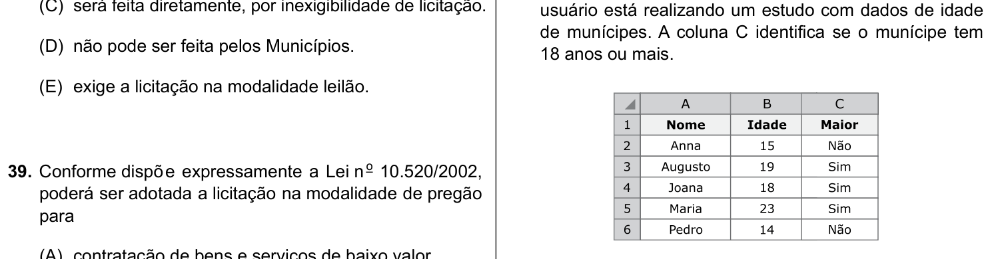 Assinale a alternativa que contém a fórmula que, quando inserida na célula C6, identifica se o munícipe Pedro tem 18 anos ou mais, tal como exibido na figura.

**Alternativas:**

A) =MAIOR(A1:B6)

B) =MAIOR(B1:C6)

C) =SE(B6>=18;"Sim";"Não")

D) =SE(C6>=18;"Sim";"Não")

E) =VERDADEIRO(B6>=18;"Sim";"Não")

---

#### QUESTÃO 42

✅ **Gabarito: D** (gabarito oficial — CPRC1801, Concurso Público de 07.07.2019, 002. Prova Objetiva, cargos Agente Administrativo / Agente Legislativo)

**Material de apoio:**

> Instrução da prova (utilizada nas questões 41 a 50):
> 
> Considere os softwares em sua configuração padrão para responder às questões de número 41 a 50.

**Enunciado:**

No MS-Excel 2010, quando o texto não é exibido por completo em uma célula, por exemplo, quando a largura da célula é menor que o comprimento do texto, é possível tornar todo o conteúdo visível em uma célula, exibindo o texto em várias linhas, com o seguinte recurso do grupo “Alinhamento”, da guia “Página Inicial”:

**Alternativas:**

A) Formatação Condicional.

B) Estilos de Célula.

C) Alinhar no Meio.

D) Quebrar Texto Automaticamente.

E) Diminuir Recuo.

---

#### QUESTÃO 43

✅ **Gabarito: E** (gabarito oficial — CPRC1801, Concurso Público de 07.07.2019, 002. Prova Objetiva, cargos Agente Administrativo / Agente Legislativo)

**Material de apoio:**

> Instrução da prova (utilizada nas questões 41 a 50):
> 
> Considere os softwares em sua configuração padrão para responder às questões de número 41 a 50.

**Enunciado:**

Um usuário está redigindo um texto de apenas um parágrafo no MS-Word 2010. A formatação do parágrafo é representada na figura a seguir, onde as linhas contínuas mostram a disposição do texto e as linhas tracejadas marcam as margens esquerda e direita do documento.

 Considerando que o texto do parágrafo está originalmente alinhado à esquerda, assinale a alternativa que contém a figura que representa o mesmo texto, logo após a aplicação do recurso “Justificar”, do grupo “Parágrafo”, da guia “Página Inicial”.

**Alternativas:**

A) 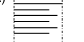

B) 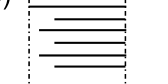

C) 

D) 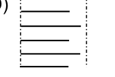

E) 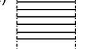

---

#### QUESTÃO 44

✅ **Gabarito: B** (gabarito oficial — CPRC1801, Concurso Público de 07.07.2019, 002. Prova Objetiva, cargos Agente Administrativo / Agente Legislativo)

**Material de apoio:**

> Instrução da prova (utilizada nas questões 41 a 50):
> 
> Considere os softwares em sua configuração padrão para responder às questões de número 41 a 50.

**Enunciado:**

Um usuário está editando um projeto de lei no MS-W ord 2010 e percebe que a formatação de um parágrafo está diferente do restante do documento, especificamente, o espaçamento entre as linhas e o tamanho da fonte. Para corrigir estas distorções, o usuário pode utilizar o recurso ____ do grupo “Área de Transferência”, da guia “Página Inicial”, que copia a formatação de um local, no caso, um parágra fo com a formatação cor - reta, e aplica esta formatação a outro local, no caso, o parágrafo com as distorções. Assinale a alternativa que preenche corretamente a lacuna do enunciado.

**Alternativas:**

A) Limpar Formatação

B) Pincel de Formatação

C) Alterar Estilos

D) Aumentar Fonte

E) Espaçamento de Linha e Parágrafo

---

#### QUESTÃO 45

✅ **Gabarito: A** (gabarito oficial — CPRC1801, Concurso Público de 07.07.2019, 002. Prova Objetiva, cargos Agente Administrativo / Agente Legislativo)

**Material de apoio:**

> Instrução da prova (utilizada nas questões 41 a 50):
> 
> Considere os softwares em sua configuração padrão para responder às questões de número 41 a 50.

**Enunciado:**

Assinale a alternativa que contém a função das aspas duplas ao se realizar uma pesquisa no site de pesqui - sa do Google, como em: “Câmara de V ereadores de Piracicaba”.

**Alternativas:**

A) Pesquisar uma correspondência exata.

B) Combinar pesquisas.

C) Pesquisar um site específico.

D) Combinar sites relacionados.

E) Pesquisar hashtags.

---

#### QUESTÃO 46

✅ **Gabarito: C** (gabarito oficial — CPRC1801, Concurso Público de 07.07.2019, 002. Prova Objetiva, cargos Agente Administrativo / Agente Legislativo)

**Material de apoio:**

> Instrução da prova (utilizada nas questões 41 a 50):
> 
> Considere os softwares em sua configuração padrão para responder às questões de número 41 a 50.

**Enunciado:**

Observe o Painel de Animação a seguir, extraído de uma apresentação do MS-PowerPoint 2010. Ele apresenta os efeitos de animação configurados para cinco formas: Retângulo 3, Elipse 4, Triângulo isósceles 5, Seta para a direita 8 e Estrela de 5 pontas 9, nessa ordem.

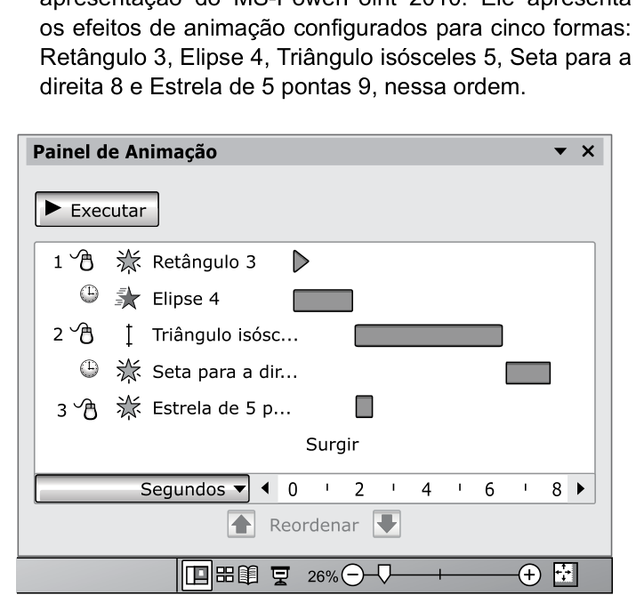 Assinale a alternativa que contém a forma associada ao efeito de animação de maior duração.

**Alternativas:**

A) Retângulo 3.

B) Elipse 4.

C) Triângulo isósceles 5.

D) Seta para a direita 8.

E) Estrela de 5 pontas 9.

---

#### QUESTÃO 47

✅ **Gabarito: B** (gabarito oficial — CPRC1801, Concurso Público de 07.07.2019, 002. Prova Objetiva, cargos Agente Administrativo / Agente Legislativo)

**Material de apoio:**

> Instrução da prova (utilizada nas questões 41 a 50):
> 
> Considere os softwares em sua configuração padrão para responder às questões de número 41 a 50.

**Enunciado:**

No MS-PowerPoint 2010, para alterar o estilo da borda de uma caixa de texto, o usuário pode selecionar a cai - xa de texto e em “Ferramentas de Desenho”, na guia “Formatar”, clicar em “Contorno da Forma” do grupo “Estilos de Forma” e depois em

**Alternativas:**

A) Espaçamento entre linhas.

B) Traços.

C) Tachado.

D) Contorno do Texto.

E) Editar Forma.

---

#### QUESTÃO 48

✅ **Gabarito: D** (gabarito oficial — CPRC1801, Concurso Público de 07.07.2019, 002. Prova Objetiva, cargos Agente Administrativo / Agente Legislativo)

**Material de apoio:**

> Instrução da prova (utilizada nas questões 41 a 50):
> 
> Considere os softwares em sua configuração padrão para responder às questões de número 41 a 50.

**Enunciado:**

Durante utilização do Windows Explorer do MS-Windows 7, o usuário decide mover um arquivo de uma pasta local para outra pasta local, que está vazia. Para realizar esse procedimento, o usuário pode utilizar os seguintes atalhos de teclado para recortar e colar o arquivo, respectivamente:

**Alternativas:**

A) Ctrl+A e Ctrl+Z

B) Ctrl+C e Ctrl+X

C) Ctrl+V e Ctrl+A

D) Ctrl+X e Ctrl+V

E) Ctrl+V e Ctrl+Z

---

#### QUESTÃO 49

✅ **Gabarito: E** (gabarito oficial — CPRC1801, Concurso Público de 07.07.2019, 002. Prova Objetiva, cargos Agente Administrativo / Agente Legislativo)

**Material de apoio:**

> Instrução da prova (utilizada nas questões 41 a 50):
> 
> Considere os softwares em sua configuração padrão para responder às questões de número 41 a 50.

**Enunciado:**

Ao utilizar computadores em locais com circulação de pessoas, recomenda-se criar uma senha para o seu usuário e bloquear a sua estação de trabalho toda vez que se ausentar da sua mesa, mesmo que por instantes, para prevenir o acesso indevido aos seus dados privados e privilégios em aplicativos. No MS-Windows 7, o usuário pode bloquear sua estação de trabalho acessando a opção “Bloquear”, do item “Desligar”, do “Menu Iniciar”, ou então, ele pode pressionar o atalho de teclado

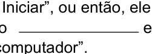

e escolher a opção “Bloquear este computador”. Assinale a alternativa que preenche corretamente a lacuna do enunciado.

**Alternativas:**

A) Esc+Shift+Del

B) Esc+Alt+Del

C) Esc+Alt+Ctrl

D) Ctrl+Shift+Del

E) Ctrl+Alt+Del

---

#### QUESTÃO 50

✅ **Gabarito: B** (gabarito oficial — CPRC1801, Concurso Público de 07.07.2019, 002. Prova Objetiva, cargos Agente Administrativo / Agente Legislativo)

**Material de apoio:**

> Instrução da prova (utilizada nas questões 41 a 50):
> 
> Considere os softwares em sua configuração padrão para responder às questões de número 41 a 50.

**Enunciado:**

Após receber uma mensagem no MS-Outlook 2010, para responder apenas ao remetente, o usuário pode escolher a opção

**Alternativas:**

A) Encaminhar.

B) Responder.

C) Responder a todos.

D) Sinalizar para acompanhamento.

E) Anexar Arquivo, do grupo Ilustrações, guia Inserir.

---

## 3. Questões independentes

#### QUESTÃO 10

✅ **Gabarito: A** (gabarito oficial — CPRC1801, Concurso Público de 07.07.2019, 002. Prova Objetiva, cargos Agente Administrativo / Agente Legislativo)

**Enunciado:**

Leia o texto. Quando você se refere ____ alguém dizendo “maria vai com as outras” significa que a pessoa não tem opinião própria. Mas quem foi essa primeira Maria? Para o pesquisador Brasil Gerson, a expressão tem origem no século 19 com a chegada da família real portuguesa. A mãe de Dom João VI, a rainha Maria I, ____ quem muitos atribuíam o nome de “A Louca”, costumava passear ____ margens do rio Carioca, acompanhada de suas damas de companhia, e o povo, vendo essa cena, comentava: “Maria vai com as outras”. (Ernani Fagundes. Aventuras na História, novembro de 2005. Adaptado) De acordo com a norma-padrão, as lacunas desse texto devem ser preenchidas, respectivamente, por:

**Alternativas:**

A) a ... a ... às

B) a ... à ... às

C) a ... a ... as

D) à ... a ... às

E) à ... à ... as

---

#### QUESTÃO 16

✅ **Gabarito: E** (gabarito oficial — CPRC1801, Concurso Público de 07.07.2019, 002. Prova Objetiva, cargos Agente Administrativo / Agente Legislativo)

**Enunciado:**

O colunista de um jornal esteve em São Paulo a trabalho e impressionou-se com a quantidade de vezes que ouviu os motoboys buzinarem. Na reportagem que escreveu, ele aponta ter contabilizado que um motoboy chegou a buzinar 40 vezes em apenas 1 minuto. Considerando essa informaçã o, se isso se repetir por 5 horas e meia, sem interrupções, esse motoboy terá buzinado

**Alternativas:**

A) 2120 vezes.

B) 2200 vezes.

C) 11000 vezes.

D) 12720 vezes.

E) 13200 vezes.

---

#### QUESTÃO 19

✅ **Gabarito: D** (gabarito oficial — CPRC1801, Concurso Público de 07.07.2019, 002. Prova Objetiva, cargos Agente Administrativo / Agente Legislativo)

**Enunciado:**

Um centro de reciclagem de produtos eletrônicos está procurando um local para armazenamento e separação desse material. Os responsáveis por esse centro encontraram quatro possíveis locais para servir de depósito, cujas áreas úteis estão representadas a seguir, com as dimensões dadas em metros.

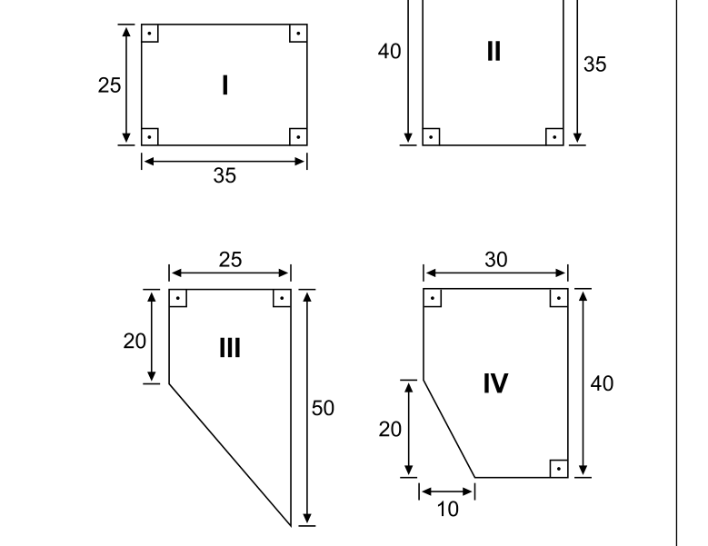 Após alguns estudos, esses responsáveis decidiram optar por um espaço que tenha área útil maior do que 000 m2. Nesse caso, eles poderão ficar com os locais

**Alternativas:**

A) I ou II.

B) I ou IV.

C) II ou III.

D) II ou IV.

E) III ou IV.

---

#### QUESTÃO 20

✅ **Gabarito: B** (gabarito oficial — CPRC1801, Concurso Público de 07.07.2019, 002. Prova Objetiva, cargos Agente Administrativo / Agente Legislativo)

**Enunciado:**

No final do ano passado, o Observatório do Clima lançou uma nota apontando que houve uma queda nas emissões de gases de efeito estufa no ano de 2017 quando comparado ao ano de 2016. Em 2017, o país emitiu 2,071 bilhões de toneladas brut desses gases, contra 2,119 bilhões de toneladas em 2016. Nesse caso, a diminuição registrada nesse perío do foi de

**Alternativas:**

A) 168,0 milhões de toneladas.

B) 48,0 milhões de toneladas.

C) 16,8 milhões de toneladas.

D) 4,8 milhões de toneladas.

E) 1,6 milhões de toneladas.

---

#### QUESTÃO 21

✅ **Gabarito: B** (gabarito oficial — CPRC1801, Concurso Público de 07.07.2019, 002. Prova Objetiva, cargos Agente Administrativo / Agente Legislativo)

**Enunciado:**

Um investidor adquiriu uma ampla sala para transformá-la em um espaço coworking. Para tanto, serão criadas ilhas de trabalho retangulares, medindo 12,0 m de comprimento por 4,8 m de largura cada. Essas ilhas serão divididas em estações quadradas, de maior área possível, de modo a ocupar todo o espaço disponível. Nesse caso, o número de estações que serão criadas em cada ilha de trabalho é igual a

**Alternativas:**

A) 5.

B) 10.

C) 15.

D) 20.

E) 24.

---

#### QUESTÃO 22

✅ **Gabarito: E** (gabarito oficial — CPRC1801, Concurso Público de 07.07.2019, 002. Prova Objetiva, cargos Agente Administrativo / Agente Legislativo)

**Enunciado:**

Há 8 anos, um profissional que reside no interior do estado de São Paulo trabalha como assessor de uma empresa instalada na capital do estado. Ao longo de um ano, ele realiza cerca de 40 visitas nessa empresa e se des loca, considerando ida e volta, 450 km por visita. Popularmente, as cidades de Oiapoque (AP) e do Chuí (RS) são consideradas os pontos mais extremos do Brasil, sendo que a distância de condução entre essas cidades é de aproximadamente 5650 km. A quilometragem total percorrida nesses 8 anos por esse profissio - nal para atender somente essa empresa equivale a ir do Oiapoque ao Chuí, aproximadamente,

**Alternativas:**

A) 3 vezes.

B) 12 vezes.

C) 19 vezes.

D) 21 vezes.

E) 25 vezes.

---

#### QUESTÃO 23

✅ **Gabarito: B** (gabarito oficial — CPRC1801, Concurso Público de 07.07.2019, 002. Prova Objetiva, cargos Agente Administrativo / Agente Legislativo)

**Enunciado:**

Segundo a Associação Brasileira da Indústria de Café (ABIC), desde 2014 o Brasil assumiu o posto de país que mais consome café no mundo. Segundo uma pesquisa divulgada no site da ABIC, cada brasileiro consome anualmente uma média de 33 litros de café. Considerando que uma xícara de café costuma ter em média 40 mL de café, para atingir a média anual de café consumida pelo brasileiro são necessárias

**Alternativas:**

A) 1320 xícaras.

B) 825 xícaras.

C) 725 xícaras.

D) 82 xícaras.

E) 72 xícaras.

---

#### QUESTÃO 24

✅ **Gabarito: D** (gabarito oficial — CPRC1801, Concurso Público de 07.07.2019, 002. Prova Objetiva, cargos Agente Administrativo / Agente Legislativo)

**Enunciado:**

Uma empresa utiliza bicicletas para entregar pequenos pacotes em locais próximos à sua sede. O preço de entrega praticado por essa empresa é definido a partir da distância, em quilômetros e em linha reta, entre a sede e o local de entrega, sendo obtido a partir da seguinte fórmula: Preço da entrega = R$ 1,80 x distância + R$ 5,00 Considere o seguinte esquema que apresenta a distância entre a sede da empresa e o local de entrega.

 Nesse caso, o valor da entrega será de

**Alternativas:**

A) R$ 44,20.

B) R$ 28,40.

C) R$ 26,60.

D) R$ 16,70.

E) R$ 15,80.

---

#### QUESTÃO 25

✅ **Gabarito: A** (gabarito oficial — CPRC1801, Concurso Público de 07.07.2019, 002. Prova Objetiva, cargos Agente Administrativo / Agente Legislativo)

**Enunciado:**

Uma montadora de carros anunciou que ampliará em 2019 a capacidade de uma de suas fábricas. Com isso, trabalhando cada dia em três turnos de 6 horas, essa fábrica irá elevar a produção atual de 36 para 42 veículos por hora. Dessa forma, a produção total dessa empresa, num período de 30 dias, terá um aumento no número de veículos igual a

**Alternativas:**

A) 3240.

B) 2160.

C) 1080.

D) 540.

E) 180.

---

#### QUESTÃO 26

✅ **Gabarito: C** (gabarito oficial — CPRC1801, Concurso Público de 07.07.2019, 002. Prova Objetiva, cargos Agente Administrativo / Agente Legislativo)

**Enunciado:**

Uma pessoa utiliza transporte rodoviário para se deslo - car para a cidade vizinha na qual trabalha. O valor da passagem do ônibus que ela utiliza é R$ 4,45, dos quais R$ 1,42 corresponde aos tributos incidentes. Nesse caso, para cada 1 real do valor da passagem, tem-se de tributos incidentes um valor entre

**Alternativas:**

A) 20 e 25 centavos.

B) 25 e 30 centavos.

C) 30 e 35 centavos.

D) 35 e 40 centavos.

E) 40 e 45 centavos.

---

#### QUESTÃO 27

✅ **Gabarito: E** (gabarito oficial — CPRC1801, Concurso Público de 07.07.2019, 002. Prova Objetiva, cargos Agente Administrativo / Agente Legislativo)

**Enunciado:**

Um profissional foi contratado para assentar piso em um estabelecimento. Ficou acordado que o profissional cobrará um valor por metro quadrado de área trabalhada e que o custo do material ficará por conta do contratante. Ao final desse serviço, o custo total da obra foi de R$ 5.200,00, sendo que desse valor correspondeu ao custo do material. Dado que o serviço foi feito em uma área de 60 m 2, o valor que o profissional cobrou por metro quadrado foi igual a

**Alternativas:**

A) R$ 45,00.

B) R$ 50,00.

C) R$ 55,00.

D) R$ 60,00.

E) R$ 65,00.

---

#### QUESTÃO 28

✅ **Gabarito: C** (gabarito oficial — CPRC1801, Concurso Público de 07.07.2019, 002. Prova Objetiva, cargos Agente Administrativo / Agente Legislativo)

**Enunciado:**

Uma professora de música trabalha em uma esco - la que oferece aos seus aluno s um contrato com aulas semanais de 30 minutos ou de 50 minutos. Ao longo de uma semana, essa professora ficou encarregada de 21 horas de aulas. Considerando que, para essa professora, o número de a ulas de 50 minutos supera o número de aulas de 30 minutos em 6 aulas ao longo da semana, tem-se que o tempo semanal destinado às aulas de 50 minutos totaliza

**Alternativas:**

A) 10 horas.

B) 12 horas.

C) 15 horas.

D) 16 horas.

E) 18 horas.

---

#### QUESTÃO 29

✅ **Gabarito: D** (gabarito oficial — CPRC1801, Concurso Público de 07.07.2019, 002. Prova Objetiva, cargos Agente Administrativo / Agente Legislativo)

**Enunciado:**

O gráfico a seguir representa o tempo necessário, em semanas, para uma pessoa conseguir emprego no estado de São Paulo de 2015 a 2018.

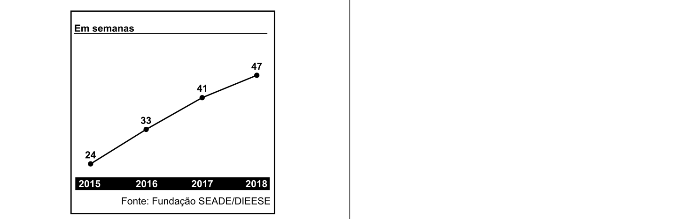

(https://www.redebrasilatual.com.br/economia. Adaptado) Com base nos dados apresentados no gráfico, tem-se que a média aritmética dos aumentos anuais, ocorridos no período apresentado, está entre

**Alternativas:**

A) 4 e 5 semanas.

B) 5 e 6 semanas.

C) 6 e 7 semanas.

D) 7 e 8 semanas.

E) 8 e 9 semanas.

---

#### QUESTÃO 30

✅ **Gabarito: C** (gabarito oficial — CPRC1801, Concurso Público de 07.07.2019, 002. Prova Objetiva, cargos Agente Administrativo / Agente Legislativo)

**Enunciado:**

O gráfico a seguir ilustra a distribuição dos usuários de uma rede social por faixa etária.

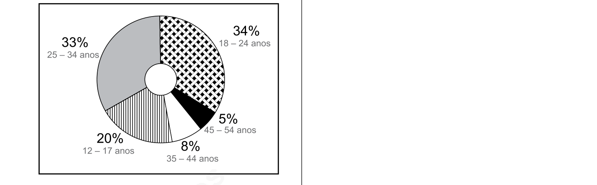 Com base nas informações dadas no gráfico, a razão do número de pessoas cuja faixa etária varia de 18 a 34 anos, para a totalidade de pessoas usuárias dessa rede social é, aproximadamente,

**Alternativas:**

A) 1 para 2.

B) 1 para 3.

C) 2 para 3.

D) 2 para 5.

E) 6 para 7.

---

#### QUESTÃO 31

✅ **Gabarito: E** (gabarito oficial — CPRC1801, Concurso Público de 07.07.2019, 002. Prova Objetiva, cargos Agente Administrativo / Agente Legislativo)

**Enunciado:**

Considerando o disposto no seu Regimento Interno, no que diz respeito às funções da Câmara Municipal de Piracicaba, assinale a alternativa correta.

**Alternativas:**

A) Dentre as suas funções administrativas, está incluí - da a conversão de medidas provisórias em lei.

B) A função de julgamento implica na vigilância dos negócios do Executivo em geral.

C) A função de fiscalização externa é exercida com auxílio do Tribunal de Contas do Município.

D) Em sua função julgadora, é vedado à Câmara proceder a julgamento político-administrativo do Prefeito.

E) A função de assessoramento consiste em sugerir medidas de interesse público ao Executivo, mediante indicações.

---

#### QUESTÃO 32

✅ **Gabarito: B** (gabarito oficial — CPRC1801, Concurso Público de 07.07.2019, 002. Prova Objetiva, cargos Agente Administrativo / Agente Legislativo)

**Enunciado:**

Na hipótese de o Prefeito enviar à Câmara Municipal de Piracicaba um projeto de lei dispondo sobre a fixação de subsídios do Prefeito, Vice-Prefeito e Secretários Municipais, o Regimento Interno dispõe que esse projeto

**Alternativas:**

A) deverá ser analisado e votado pelos Vereadores, mas somente terá validade para o mandato seguinte.

B) viola as normas regimentais, uma vez que a com - petência para esse projeto é privativa da Mesa da Câmara.

C) não pode ser conhecido, pois essa matéria deve ser tratada por meio de decreto-legislativo.

D) terá que ser analisado, debatido e votado em regime de urgência.

E) deverá ser votado em conjunto com o projeto de lei que dispõe sobre os vencimentos dos servidores púbicos do Município.

---

#### QUESTÃO 33

✅ **Gabarito: D** (gabarito oficial — CPRC1801, Concurso Público de 07.07.2019, 002. Prova Objetiva, cargos Agente Administrativo / Agente Legislativo)

**Enunciado:**

Tendo em vista o disposto no Regimento Interno da Câ - mara Municipal de Piracicaba, é correto afirmar a respeito das comissões permanentes que

**Alternativas:**

A) os seus membros serão nomeados pelo Prefeito.

B) seus membros serão indicado s para um período de três anos.

C) é vedado ao membro da Mesa e ao Líder de Governo integrarem qualquer comissão.

D) o suplente, no exercício temporário da vereança, não poderá presidí-las.

E) a votação para a sua constituição far-se-á mediante voto secreto.

---

#### QUESTÃO 34

✅ **Gabarito: A** (gabarito oficial — CPRC1801, Concurso Público de 07.07.2019, 002. Prova Objetiva, cargos Agente Administrativo / Agente Legislativo)

**Enunciado:**

As políticas públicas destinadas a reparar as distorções e desigualdades sociais e demais práticas discriminatórias em relação à população afrodescendente, adotadas nas esferas pública e privada, durante o processo de formação social do Município, conforme prevê, expressamente, a Lei Orgânica do Município, são efetivadas por meio

**Alternativas:**

A) de programas de ações afirmativas.

B) do assistencialismo.

C) de atividades beneficentes.

D) de empréstimos sociais às famílias carentes.

E) de incentivo aos mutirões de construções de moradias.

---

#### QUESTÃO 35

✅ **Gabarito: C** (gabarito oficial — CPRC1801, Concurso Público de 07.07.2019, 002. Prova Objetiva, cargos Agente Administrativo / Agente Legislativo)

**Enunciado:**

Segundo o disposto na Lei Orgânica do Município de Piracicaba, o plebiscito e o referendo são

**Alternativas:**

A) instrumentos parlamentares de fiscalização.

B) exemplos de espécies normativas.

C) expressões da soberania popular.

D) formas de propositura de projetos de lei.

E) modos de expressão normativa do Executivo.

---

#### QUESTÃO 36

✅ **Gabarito: B** (gabarito oficial — CPRC1801, Concurso Público de 07.07.2019, 002. Prova Objetiva, cargos Agente Administrativo / Agente Legislativo)

**Enunciado:**

Assinale a alternativa cujo conteúdo está em consonância com o disposto na Lei nº 8.666/1993.

**Alternativas:**

A) Num procedimento licitatório, em igualdade de condições, é vedad o estabelecer preferência aos bens e serviços produzidos ou prestados por empresas brasileiras, como critério de desempate.

B) A licitação não será sigilosa, sendo públicos e aces - síveis ao público os atos de seu procedimento, salvo quanto ao conteúdo das propostas, até a respectiva abertura.

C) Considera-se empreitada quando se ajusta mão de obra para pequenos trabalhos por preço certo, com ou sem fornecimento de materiais.

D) Subordinam-se ao regime dessa Lei os órgãos da administração direta, as autarquias e as fundações públicas, salvo as empresas públicas e as socieda - des de economia mista.

E) Os bens e serviços produzidos ou prestados por empresas que comprovem cumprimento de reserva de cargos prevista em lei para pessoa com deficiência poderão ser adquiridos sem licitação.

---

#### QUESTÃO 37

✅ **Gabarito: E** (gabarito oficial — CPRC1801, Concurso Público de 07.07.2019, 002. Prova Objetiva, cargos Agente Administrativo / Agente Legislativo)

**Enunciado:**

Ressalvada hipótese prevista na própria Lei nº 8.666/1993, a modalidade de licitação cabível, qualquer que seja o valor de seu objeto , na compra ou alienação de bens imóveis, é

**Alternativas:**

A) a tomada de preços.

B) o concurso.

C) o convite.

D) o pregão.

E) a concorrência.

---

#### QUESTÃO 38

✅ **Gabarito: A** (gabarito oficial — CPRC1801, Concurso Público de 07.07.2019, 002. Prova Objetiva, cargos Agente Administrativo / Agente Legislativo)

**Enunciado:**

A contratação de entidades privadas sem fins lucrativos, para a implementação de cisternas ou outras tecnologias sociais de acesso à água para consumo humano e produção de alimentos, para beneficiar as famílias rurais de baixa renda atingidas pela seca ou falta regular de água, nos termos da Lei nº 8.666/1993,

**Alternativas:**

A) é hipótese de licitação dispensável.

B) exige a licitação na modalidade concorrência.

C) será feita diretamente, por inexigibilidade de licitação.

D) não pode ser feita pelos Municípios.

E) exige a licitação na modalidade leilão.

---

#### QUESTÃO 39

✅ **Gabarito: C** (gabarito oficial — CPRC1801, Concurso Público de 07.07.2019, 002. Prova Objetiva, cargos Agente Administrativo / Agente Legislativo)

**Enunciado:**

Conforme dispõe expressamente a Lei nº 10.520/2002, poderá ser adotada a licitação na modalidade de pregão para

**Alternativas:**

A) contratação de bens e serviços de baixo valor.

B) alienação de bens móveis e imóveis da Administração.

C) aquisição de bens e serviços comuns.

D) compras de bens e serviços de empresas previamente cadastradas.

E) contratação de bens e serviços de empresas altamente especializadas.

---

#### QUESTÃO 40

✅ **Gabarito: D** (gabarito oficial — CPRC1801, Concurso Público de 07.07.2019, 002. Prova Objetiva, cargos Agente Administrativo / Agente Legislativo)

**Enunciado:**

Num procedimento de pregão, se a oferta do licitante não for aceitável ou se o licitante desatender às exigências habilitatórias, para que um licitante seja declarado vencedor, segundo a Lei nº 10.520/2002, o pregoeiro deverá

**Alternativas:**

A) mandar publicar um novo edital e abrir novo procedimento licitatório, com as mesmas condições do anterior.

B) abrir a oportunidade para que os licitantes apresen - tem novas propostas, independentemente das suas qualificações, até obter aquela mais vantajosa para a Administração.

C) anular o procedimento licitatório e efetivar a contratação direta do bem ou serviço, por dispensa de licitação.

D) examinar as ofertas subsequentes e a qualificação dos licitantes, na ordem de classificação, e assim sucessivamente, até a apuração de uma que atenda ao edital.

E) julgar fracassada a licitação e efetivar a contratação direta do bem ou serviço, por inexigibilidade de licitação. Considere os softwares em sua configuração padrão para responder às questões de número 41 a 50.

---

### REDAÇÃO

**Material de apoio:**

> Texto 1 Quem viaja para os Estados Unidos ou Europa e aluga um carro geralmente não sabe muito o que fazer ao parar para reabastecer pela primeira vez. Sem a figura dos frentistas, o próprio motorista manuseia a bomba e realiza o pagamento pelo cartão, diferentemente do que ocorre no Brasil, onde a profissão de frentista é protegida pela Lei nº 9.956/00, que proíbe o funcionamento de bombas de autosserviço em todo território nacional e aplica multas caso seja descumprida. “Pensando só em números, o preço do combustível poderia baixar com a automação, mas não é possível avaliar quanto”, diz o tributarista João Paulo Muntada, que afirma que a mão de obra e os encargos relacionados representam o segundo custo que mais onera a operação de empreendimentos em geral no país, atrás apenas do produto em si e dos impostos que incidem sobre ele. (Isadora Carvalho e Leo Nishihata. “Todo posto de combustível é obrigado a ter frentistas no Brasil”. https://quatrorodas.abril.com.br, 14.09.2018. Adaptado) Texto 2 O Projeto de Lei nº 2.302/19 permite o funcionamento de bombas de autosserviço – operadas pelo próprio consumidor – nos postos de abastecimento de combustíveis. Em análise na Câmara dos Deputados, o projeto revoga a Lei nº 9.956/00, que hoje proíbe essas bombas. O deputado Vinicius Poit, autor da proposta, diz que a permissão de postos com autosserviço é uma das sugestões constantes em estudo do Conselho Administrativo de Defesa Econômica (Cade) de 2018 para aumentar a concorrência no setor de combustíveis e reduzir os preços dos combustíveis. O parlamentar ressalta que o modelo existe nos Estados Unidos desde a década de 50 e permite a venda por um preço mais barato, já que reduz o custo trabalhista do empresário. (Lara Haje. “Projeto permite bombas de autosserviço em postos de combustíveis”. www2.camara.leg.br, 06.06.2019. Adaptado) Texto 3 Em 2014, o senador Blairo Maggi apresentou Projeto de Lei do Senado no 407/14, que previa a instalação de bombas de autosserviço nos postos de abastecimento de combustíveis. Representantes dos frentistas, à época, estimaram que cerca de 500 mil frentistas seriam demitidos caso a proposta se tornasse lei. O presidente da Federação dos Empregados em Postos de Combustíveis do Estado de São Paulo (Fepospetro), Luiz de Souza Arraes, afirmou que a medida visava “única e exclusivamente aumentar o lucro de quem já lucra muito”. O secretário de Relações Institucionais da União Geral dos Trabalhadores (UGT), Miguel Salaberry Filho, pediu a imediata retirada do projeto. “Para que mudar uma lei e desempregar 500 mil trabalhadores?”, questionou. (Rodrigo Baptista. “Frentistas pedem arquivamento de projeto que libera bombas de autosserviço nos postos”. www12.senado.leg.br, 07.12.2015. Adaptado)

**Enunciado:**

Com base nos textos apresentados e em seus próprios conhecimentos, escreva um texto dissertativo-argumentativo, empregando a norma-padrão da língua portuguesa, sobre o tema:

**Bombas de autosserviço: entre a redução do preço do combustível e o risco de desempregar frentistas**

> NÃO ASSINE ESTA FOLHARASCUNHO redação Em hipótese alguma será considerado o texto escrito neste espaço.

⚠️ **Gabarito: não se aplica — questão discursiva (redação)**

---

## 4. Observações e limitações da extração

- Extração automática do texto selecionável do PDF (sem OCR), com conferência integral linha a linha.
- A capa original usa capitulares decorativas: algumas letras iniciais não seguem o fluxo de texto no PDF (ex.: "ocê recebeu" = "Você recebeu"); o texto foi reproduzido conforme o fluxo extraído.
- Textos verticais laterais ("Rascunho") e letras decorativas isoladas aparecem como caracteres soltos na extração e não foram reproduzidos como conteúdo.
- As lacunas em branco dos enunciados (Q10 e Q44) foram marcadas com "____"; o traçado original não é extraível como texto.
- As figuras vetoriais (Q19, Q29, Q30, Q41, Q43, Q46 e Q49) foram recortadas das páginas originais em alta resolução.
- Marcas de origem (pcimarkpci, www.pciconcursos.com.br) e o brasão da capa não foram reproduzidos como conteúdo.
- Espaços espúrios do texto extraído (ex.: "manipu lavam", "informaçã o", "des loca") foram mantidos conforme o fluxo do PDF.
