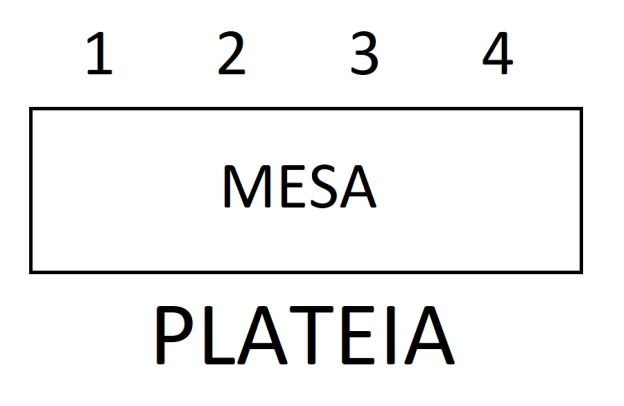

# PROVA — Câmara Municipal de São José de Mipibu (RN) — Assistente de Cerimonial (FUNCERN, 2020)

## 1. Análise geral da prova

- **Identificação:** Concurso Público — Edital Nº 002/2020 — Prefeituras/Câmara Municipais do Agreste Potiguar/RN. Banca: FUNCERN — Fundação de Apoio à Educação e ao Desenvolvimento Tecnológico do RN. Órgão: Câmara Municipal de São José de Mipibu (RN). Cargo: ASSISTENTE DE CERIMONIAL. Caderno de Provas: CPAP 109 – NM (Nível Médio). Prova de 3 (três) horas, 30 questões de múltipla escolha com 4 alternativas (A–D).
- **Quantidade total de questões:** 30 (múltipla escolha, alternativas A–D).
- **Quantidade de textos de apoio:** 1 (texto jornalístico "Metade das praias do mundo pode desaparecer até 2100", compartilhado pelas questões 1 a 10; o último parágrafo desse texto é citado como referência específica das questões 2, 3 e 4).
- **Quantidade de imagens:** 2 imagens de questão (figura das três bandeiras hasteadas na fachada da Prefeitura, questão 25; esquema de disposição da mesa de honra, questão 22). A única outra imagem do material é o logotipo FUNCERN/Agreste Potiguar da capa, descartado por ser marca institucional.
- **Quantidade de gráficos e tabelas:** 1 figura esquemática representada textualmente no OCR (esquema mesa/plateia da questão 22, preservado em forma de texto); a tabela da capa é a tabela de disciplinas/pontuação, transcrita na capa.
- **Quantidade de grupos identificados:** 1 (questões 1 a 10; as questões 2, 3 e 4 compartilham adicionalmente o último parágrafo do texto, reproduzido em cada uma delas).
- **Quantidade de questões independentes:** 20 (questões 11 a 30).
- **Estrutura de blocos (conforme o caderno original):** QUESTÕES DE MÚLTIPLA ESCOLHA – LÍNGUA PORTUGUESA – NÍVEL MÉDIO (questões 1 a 10), QUESTÕES DE MÚLTIPLA ESCOLHA – INFORMÁTICA – NÍVEL MÉDIO (questões 11 a 18), QUESTÕES DE MÚLTIPLA ESCOLHA – CONHECIMENTOS GERAIS DO MUNICÍPIO (questões 19 e 20), QUESTÕES DE MÚLTIPLA ESCOLHA – ASSISTENTE DE CERIMONIAL – NÍVEL MÉDIO (questões 21 a 30).
- **Gabarito:** preliminar (publicado em 10/11/2020), tabela do cargo 109 (Assistente de Cerimonial) — caderno 1261 do sistema de gabaritos da banca FUNCERN. O item 18 não consta na tabela impressa e foi recuperado por corroboração (ver Seção 4).

### Tabela de gabarito (preliminar — cargo 109, caderno 1261)

| Questão | Resposta | Questão | Resposta | Questão | Resposta | Questão | Resposta | Questão | Resposta |
|---|---|---|---|---|---|---|---|---|---|
| 01 | B | 07 | B | 13 | D | 19 | B | 25 | C |
| 02 | A | 08 | A | 14 | C | 20 | A | 26 | B |
| 03 | D | 09 | C | 15 | B | 21 | C | 27 | D |
| 04 | C | 10 | A | 16 | C | 22 | D | 28 | A |
| 05 | D | 11 | B | 17 | A | 23 | B | 29 | C |
| 06 | A | 12 | A | 18 | D | 24 | A | 30 | C |

### Transcrição integral da capa e das instruções da prova

> Concurso Público
> EDITAL 002/2020
> Prefeituras/Câmara Municipais
> do Agreste Potiguar
> AGRESTE
> POTIGUAR
> funcern
> Fundação de Apoio à Educação e
> ao Desenvolvimento Tecnológico do RN
> **Caderno de Provas**
> CPAP 109 – NM
> (SÃO JOSÉ DE MIPIBU)
> **ASSISTENTE DE CERIMONIAL**
> Edital Nº. 002/2020 – Prefeituras/Câmara
> Municipais do Agreste Potiguar/RN
> Data: ___/___/___
> **INSTRUÇÕES GERAIS PARA A REALIZAÇÃO DA PROVA**
> ☑ Use apenas caneta esferográfica azul ou preta.
> ☑ Escreva a data, a sua assinatura e o número do seu documento de identificação no espaço indicado nesta capa.
> ☑ A prova terá duração máxima de 3 (três) horas, incluindo o tempo para responder a todas as questões do Caderno de Provas e preencher as Folhas de Respostas.
> ☑ Antes de retirar-se definitivamente da sala, entregue as Folhas de Respostas ao fiscal.
> ☑ O Caderno de Provas só poderá ser levado pelo candidato após decorridas 03h do início da prova.
> ☑ Este Caderno de Provas contém, respectivamente, 10 (dez) questões de Conhecimentos da Língua Portuguesa, 08 (oito) questões de Informática, 02 (duas) questões de Conhecimentos Gerais do Município e 10 (dez) questões de Conhecimentos Específicos.
> ☑ Se o Caderno de Provas contiver alguma imperfeição gráfica que impeça a leitura, comunique isso imediatamente ao Fiscal.
> ☑ Cada questão de múltipla escolha apresenta apenas uma resposta correta. Para a marcação da alternativa escolhida na Folha de Respostas, pinte completamente o campo correspondente conforme a figura a seguir:
> ☑ Os rascunhos e as marcações feitas neste Caderno de Provas não serão considerados para efeito de avaliação.
> ☑ Interpretar as questões faz parte da avaliação; portanto, não é permitido solicitar esclarecimentos aos Fiscais.
> ☑ O preenchimento das Folhas de Respostas é de sua inteira responsabilidade.
> ☑ A quantidade de questões objetivas e respectivas pontuações desta prova estão apresentadas a seguir:
> |  Disciplina | Número de questões | Pontos  |
> | --- | --- | --- |
> |  Língua Portuguesa | 10 questões | 30  |
> |  Informática | 08 questões | 24  |
> |  Conhecimentos Gerais do Município | 02 questões | 06  |
> |  Conhecimentos Específicos | 10 questões | 40  |
> |  **Total de questões** | **30 questões** | **100 pontos**  |
> ASSINATURA DO CANDIDATO:
> DOCUMENTO DE IDENTIFICAÇÃO:

## 2. Questões agrupadas

### GRUPO 01 — Texto "Metade das praias do mundo pode desaparecer até 2100" — texto de interpretação compartilhado

**Questões relacionadas:** 1, 2, 3, 4, 5, 6, 7, 8, 9 e 10.

As questões de 1 a 10 referem-se ao texto reproduzido a seguir.

#### QUESTÃO 01

✅ **Gabarito: B** (gabarito preliminar)

**Material de apoio:**

**Metade das praias do mundo pode desaparecer até 2100**

De acordo com um estudo publicado na revista científica *Nature Climate Change*, quase metade das praias do mundo pode desaparecer até o final do século se nenhuma ação for tomada para limitar as emissões de gases de efeito estufa. Segundo a pesquisa, mais de um terço (37%) delas corre o risco de deixar de existir até 2100.
As mudanças climáticas estão contribuindo para o aumento do nível do mar, o que, por sua vez, cobre as areias da costa. Além da perda de ecossistemas valiosos, as implicações socioeconômicas podem ser graves, especialmente em comunidades mais pobres e dependentes do turismo, onde as praias são a principal atração.
Os pesquisadores, ligados a universidades de diversos países da Europa, analisaram imagens de satélite que mostram mudanças na linha costeira de todo o mundo entre 1984 e 2016. Eles descobriram que um quarto das praias do planeta sofre uma erosão de 0,5 metro por ano, o que significa mais de 28 mil km² de terra indo para o mar.
Além disso, eles descobriram que o nível do mar está subindo a um ritmo de cerca de 0,1 mm por ano. De acordo com o site *The Conversation*, 60% das praias da Gâmbia e Guiné-Bissau, na África, podem ser perdidas; a Austrália deverá perder quase 12 mil km de costa arenosa, e em estados insulares como Kiribati, Ilhas Marshall e Tuvalu a perda pode chegar a 300 metros de terra – o que, em alguns desses casos, pode ser catastrófico.
O estudo também destaca o Brasil, em especial praias dos estados Pará, Maranhão, Piauí e Ceará. De acordo com a pesquisa, nessas regiões do país a erosão acontece a um ritmo intenso, provavelmente por causa da exploração de terras no interior desses estados. Com isso, os rios da região levam grandes quantidades de sedimentos em direção ao mar, o que contribui para o aumento do nível do oceano.
O mesmo acontece no resto do mundo. A pesquisa estima que o aumento do nível do mar em 0,8 metro pode tomar 17 mil km² de terra e forçar até 5,3 milhões de pessoas a migrar, com um custo associado de US$ 300 milhões a US $ 1 bilhão em todo o planeta. Somente na África, até 40 mil pessoas podem ser forçadas a deixarem seus lares devido à perda de terra a cada ano.
Segundo os autores do artigo no *The Conversation*, por mais que a elevação do nível do mar seja inevitável, há possíveis soluções, como o reabastecimento das praias mais ameaçadas jogando areia sobre elas. Até 2100, isso poderia reduzir a perda de terras em 14%, além de diminuir o número de pessoas forçadas a migrar em até 68%.
Os especialistas ponderam, no entanto, que essa medida também pode gerar problemas ecológicos, e deve ser feita de forma cuidadosa e estratégica. De um jeito ou de outro, salvar as praias do planeta está nas nossas mãos.
Disponível em: <https://revistagalileu.globo.com>. Acesso em: 06 mar. 2020

**Enunciado:**

O texto, de forma preponderante, objetiva

**Alternativas:**

A) descrever a situação preocupante do desaparecimento de praias em algumas regiões do litoral brasileiro.
B) divulgar o resultado de um estudo sobre o risco de desaparecimento de parte das praias do planeta.
C) criticar a solução de reabastecimento com areia como forma de amenizar a ameaça de desaparecimento das praias.
D) apresentar soluções ecologicamente sustentáveis para conter o risco de desaparecimento das praias.

**Referências visuais:** Nenhuma.

---

#### QUESTÃO 02

✅ **Gabarito: A** (gabarito preliminar)

**Material de apoio:**

**Metade das praias do mundo pode desaparecer até 2100**

De acordo com um estudo publicado na revista científica *Nature Climate Change*, quase metade das praias do mundo pode desaparecer até o final do século se nenhuma ação for tomada para limitar as emissões de gases de efeito estufa. Segundo a pesquisa, mais de um terço (37%) delas corre o risco de deixar de existir até 2100.
As mudanças climáticas estão contribuindo para o aumento do nível do mar, o que, por sua vez, cobre as areias da costa. Além da perda de ecossistemas valiosos, as implicações socioeconômicas podem ser graves, especialmente em comunidades mais pobres e dependentes do turismo, onde as praias são a principal atração.
Os pesquisadores, ligados a universidades de diversos países da Europa, analisaram imagens de satélite que mostram mudanças na linha costeira de todo o mundo entre 1984 e 2016. Eles descobriram que um quarto das praias do planeta sofre uma erosão de 0,5 metro por ano, o que significa mais de 28 mil km² de terra indo para o mar.
Além disso, eles descobriram que o nível do mar está subindo a um ritmo de cerca de 0,1 mm por ano. De acordo com o site *The Conversation*, 60% das praias da Gâmbia e Guiné-Bissau, na África, podem ser perdidas; a Austrália deverá perder quase 12 mil km de costa arenosa, e em estados insulares como Kiribati, Ilhas Marshall e Tuvalu a perda pode chegar a 300 metros de terra – o que, em alguns desses casos, pode ser catastrófico.
O estudo também destaca o Brasil, em especial praias dos estados Pará, Maranhão, Piauí e Ceará. De acordo com a pesquisa, nessas regiões do país a erosão acontece a um ritmo intenso, provavelmente por causa da exploração de terras no interior desses estados. Com isso, os rios da região levam grandes quantidades de sedimentos em direção ao mar, o que contribui para o aumento do nível do oceano.
O mesmo acontece no resto do mundo. A pesquisa estima que o aumento do nível do mar em 0,8 metro pode tomar 17 mil km² de terra e forçar até 5,3 milhões de pessoas a migrar, com um custo associado de US$ 300 milhões a US $ 1 bilhão em todo o planeta. Somente na África, até 40 mil pessoas podem ser forçadas a deixarem seus lares devido à perda de terra a cada ano.
Segundo os autores do artigo no *The Conversation*, por mais que a elevação do nível do mar seja inevitável, há possíveis soluções, como o reabastecimento das praias mais ameaçadas jogando areia sobre elas. Até 2100, isso poderia reduzir a perda de terras em 14%, além de diminuir o número de pessoas forçadas a migrar em até 68%.
Os especialistas ponderam, no entanto, que essa medida também pode gerar problemas ecológicos, e deve ser feita de forma cuidadosa e estratégica. De um jeito ou de outro, salvar as praias do planeta está nas nossas mãos.
Disponível em: <https://revistagalileu.globo.com>. Acesso em: 06 mar. 2020

As questões 2, 3 e 4 referem-se ao último parágrafo do texto.

**Trecho de referência (último parágrafo do texto):**

Os especialistas ponderam, no entanto, que essa medida também pode gerar problemas ecológicos, e deve ser feita de forma cuidadosa e estratégica. De um jeito ou de outro, salvar as praias do planeta está nas nossas mãos.

**Enunciado:**

Há, nesse trecho,

**Alternativas:**

A) citação indireta, em que o autor não reproduz as palavras exatas da fonte citada e faz uso de verbo de dizer.
B) citação indireta, em que o autor reproduz as palavras exatas da fonte citada e não faz uso de verbo de dizer.
C) citação direta, em que o autor reproduz as palavras exatas da fonte citada e faz uso de verbo de dizer.
D) citação direta, em que o autor não reproduz as palavras exatas da fonte citada e não faz uso de verbo de dizer.

**Referências visuais:** Nenhuma.

---

#### QUESTÃO 03

✅ **Gabarito: D** (gabarito preliminar)

**Material de apoio:**

**Metade das praias do mundo pode desaparecer até 2100**

De acordo com um estudo publicado na revista científica *Nature Climate Change*, quase metade das praias do mundo pode desaparecer até o final do século se nenhuma ação for tomada para limitar as emissões de gases de efeito estufa. Segundo a pesquisa, mais de um terço (37%) delas corre o risco de deixar de existir até 2100.
As mudanças climáticas estão contribuindo para o aumento do nível do mar, o que, por sua vez, cobre as areias da costa. Além da perda de ecossistemas valiosos, as implicações socioeconômicas podem ser graves, especialmente em comunidades mais pobres e dependentes do turismo, onde as praias são a principal atração.
Os pesquisadores, ligados a universidades de diversos países da Europa, analisaram imagens de satélite que mostram mudanças na linha costeira de todo o mundo entre 1984 e 2016. Eles descobriram que um quarto das praias do planeta sofre uma erosão de 0,5 metro por ano, o que significa mais de 28 mil km² de terra indo para o mar.
Além disso, eles descobriram que o nível do mar está subindo a um ritmo de cerca de 0,1 mm por ano. De acordo com o site *The Conversation*, 60% das praias da Gâmbia e Guiné-Bissau, na África, podem ser perdidas; a Austrália deverá perder quase 12 mil km de costa arenosa, e em estados insulares como Kiribati, Ilhas Marshall e Tuvalu a perda pode chegar a 300 metros de terra – o que, em alguns desses casos, pode ser catastrófico.
O estudo também destaca o Brasil, em especial praias dos estados Pará, Maranhão, Piauí e Ceará. De acordo com a pesquisa, nessas regiões do país a erosão acontece a um ritmo intenso, provavelmente por causa da exploração de terras no interior desses estados. Com isso, os rios da região levam grandes quantidades de sedimentos em direção ao mar, o que contribui para o aumento do nível do oceano.
O mesmo acontece no resto do mundo. A pesquisa estima que o aumento do nível do mar em 0,8 metro pode tomar 17 mil km² de terra e forçar até 5,3 milhões de pessoas a migrar, com um custo associado de US$ 300 milhões a US $ 1 bilhão em todo o planeta. Somente na África, até 40 mil pessoas podem ser forçadas a deixarem seus lares devido à perda de terra a cada ano.
Segundo os autores do artigo no *The Conversation*, por mais que a elevação do nível do mar seja inevitável, há possíveis soluções, como o reabastecimento das praias mais ameaçadas jogando areia sobre elas. Até 2100, isso poderia reduzir a perda de terras em 14%, além de diminuir o número de pessoas forçadas a migrar em até 68%.
Os especialistas ponderam, no entanto, que essa medida também pode gerar problemas ecológicos, e deve ser feita de forma cuidadosa e estratégica. De um jeito ou de outro, salvar as praias do planeta está nas nossas mãos.
Disponível em: <https://revistagalileu.globo.com>. Acesso em: 06 mar. 2020

As questões 2, 3 e 4 referem-se ao último parágrafo do texto.

**Trecho de referência (último parágrafo do texto):**

Os especialistas ponderam, no entanto, que essa medida também pode gerar problemas ecológicos, e deve ser feita de forma cuidadosa e estratégica. De um jeito ou de outro, salvar as praias do planeta está nas nossas mãos.

**Enunciado:**

Sobre os elementos linguístico em destaque, é correto afirmar:

**Alternativas:**

A) o primeiro faz interligação entre períodos, por acréscimo, e o segundo faz interligação entre parágrafos por retomada de informações.
B) ambos fazem interligação entre períodos: o primeiro por retomada e o segundo por acréscimo de informações.
C) o primeiro faz interligação entre parágrafos, por retomada, e o segundo faz interligação entre períodos por acréscimo de informações.
D) ambos fazem interligação com o parágrafo anterior: o primeiro por acréscimo e o segundo por retomada de informações.

**Referências visuais:** Nenhuma.

---

#### QUESTÃO 04

✅ **Gabarito: C** (gabarito preliminar)

**Material de apoio:**

**Metade das praias do mundo pode desaparecer até 2100**

De acordo com um estudo publicado na revista científica *Nature Climate Change*, quase metade das praias do mundo pode desaparecer até o final do século se nenhuma ação for tomada para limitar as emissões de gases de efeito estufa. Segundo a pesquisa, mais de um terço (37%) delas corre o risco de deixar de existir até 2100.
As mudanças climáticas estão contribuindo para o aumento do nível do mar, o que, por sua vez, cobre as areias da costa. Além da perda de ecossistemas valiosos, as implicações socioeconômicas podem ser graves, especialmente em comunidades mais pobres e dependentes do turismo, onde as praias são a principal atração.
Os pesquisadores, ligados a universidades de diversos países da Europa, analisaram imagens de satélite que mostram mudanças na linha costeira de todo o mundo entre 1984 e 2016. Eles descobriram que um quarto das praias do planeta sofre uma erosão de 0,5 metro por ano, o que significa mais de 28 mil km² de terra indo para o mar.
Além disso, eles descobriram que o nível do mar está subindo a um ritmo de cerca de 0,1 mm por ano. De acordo com o site *The Conversation*, 60% das praias da Gâmbia e Guiné-Bissau, na África, podem ser perdidas; a Austrália deverá perder quase 12 mil km de costa arenosa, e em estados insulares como Kiribati, Ilhas Marshall e Tuvalu a perda pode chegar a 300 metros de terra – o que, em alguns desses casos, pode ser catastrófico.
O estudo também destaca o Brasil, em especial praias dos estados Pará, Maranhão, Piauí e Ceará. De acordo com a pesquisa, nessas regiões do país a erosão acontece a um ritmo intenso, provavelmente por causa da exploração de terras no interior desses estados. Com isso, os rios da região levam grandes quantidades de sedimentos em direção ao mar, o que contribui para o aumento do nível do oceano.
O mesmo acontece no resto do mundo. A pesquisa estima que o aumento do nível do mar em 0,8 metro pode tomar 17 mil km² de terra e forçar até 5,3 milhões de pessoas a migrar, com um custo associado de US$ 300 milhões a US $ 1 bilhão em todo o planeta. Somente na África, até 40 mil pessoas podem ser forçadas a deixarem seus lares devido à perda de terra a cada ano.
Segundo os autores do artigo no *The Conversation*, por mais que a elevação do nível do mar seja inevitável, há possíveis soluções, como o reabastecimento das praias mais ameaçadas jogando areia sobre elas. Até 2100, isso poderia reduzir a perda de terras em 14%, além de diminuir o número de pessoas forçadas a migrar em até 68%.
Os especialistas ponderam, no entanto, que essa medida também pode gerar problemas ecológicos, e deve ser feita de forma cuidadosa e estratégica. De um jeito ou de outro, salvar as praias do planeta está nas nossas mãos.
Disponível em: <https://revistagalileu.globo.com>. Acesso em: 06 mar. 2020

As questões 2, 3 e 4 referem-se ao último parágrafo do texto.

**Trecho de referência (último parágrafo do texto):**

Os especialistas ponderam, no entanto, que essa medida também pode gerar problemas ecológicos, e deve ser feita de forma cuidadosa e estratégica. De um jeito ou de outro, salvar as praias do planeta está nas nossas mãos.

**Enunciado:**

A palavra “ponderam”, nesse contexto linguístico, apresenta sentido equivalente a

**Alternativas:**

A) afirmam.
B) discordam.
C) avaliam.
D) divulgam.

**Referências visuais:** Nenhuma.

---

#### QUESTÃO 05

✅ **Gabarito: D** (gabarito preliminar)

**Material de apoio:**

**Metade das praias do mundo pode desaparecer até 2100**

De acordo com um estudo publicado na revista científica *Nature Climate Change*, quase metade das praias do mundo pode desaparecer até o final do século se nenhuma ação for tomada para limitar as emissões de gases de efeito estufa. Segundo a pesquisa, mais de um terço (37%) delas corre o risco de deixar de existir até 2100.
As mudanças climáticas estão contribuindo para o aumento do nível do mar, o que, por sua vez, cobre as areias da costa. Além da perda de ecossistemas valiosos, as implicações socioeconômicas podem ser graves, especialmente em comunidades mais pobres e dependentes do turismo, onde as praias são a principal atração.
Os pesquisadores, ligados a universidades de diversos países da Europa, analisaram imagens de satélite que mostram mudanças na linha costeira de todo o mundo entre 1984 e 2016. Eles descobriram que um quarto das praias do planeta sofre uma erosão de 0,5 metro por ano, o que significa mais de 28 mil km² de terra indo para o mar.
Além disso, eles descobriram que o nível do mar está subindo a um ritmo de cerca de 0,1 mm por ano. De acordo com o site *The Conversation*, 60% das praias da Gâmbia e Guiné-Bissau, na África, podem ser perdidas; a Austrália deverá perder quase 12 mil km de costa arenosa, e em estados insulares como Kiribati, Ilhas Marshall e Tuvalu a perda pode chegar a 300 metros de terra – o que, em alguns desses casos, pode ser catastrófico.
O estudo também destaca o Brasil, em especial praias dos estados Pará, Maranhão, Piauí e Ceará. De acordo com a pesquisa, nessas regiões do país a erosão acontece a um ritmo intenso, provavelmente por causa da exploração de terras no interior desses estados. Com isso, os rios da região levam grandes quantidades de sedimentos em direção ao mar, o que contribui para o aumento do nível do oceano.
O mesmo acontece no resto do mundo. A pesquisa estima que o aumento do nível do mar em 0,8 metro pode tomar 17 mil km² de terra e forçar até 5,3 milhões de pessoas a migrar, com um custo associado de US$ 300 milhões a US $ 1 bilhão em todo o planeta. Somente na África, até 40 mil pessoas podem ser forçadas a deixarem seus lares devido à perda de terra a cada ano.
Segundo os autores do artigo no *The Conversation*, por mais que a elevação do nível do mar seja inevitável, há possíveis soluções, como o reabastecimento das praias mais ameaçadas jogando areia sobre elas. Até 2100, isso poderia reduzir a perda de terras em 14%, além de diminuir o número de pessoas forçadas a migrar em até 68%.
Os especialistas ponderam, no entanto, que essa medida também pode gerar problemas ecológicos, e deve ser feita de forma cuidadosa e estratégica. De um jeito ou de outro, salvar as praias do planeta está nas nossas mãos.
Disponível em: <https://revistagalileu.globo.com>. Acesso em: 06 mar. 2020

**Enunciado:**

Considere o trecho:
[...] por mais que a elevação do nível do mar seja inevitável, há possíveis soluções[...]
Nesse trecho, há

**Alternativas:**

A) duas orações, em que a segunda é subordinada à primeira em uma relação condicional.
B) tão somente uma oração e o trecho em destaque denota uma circunstância de concessão.
C) tão somente uma oração e o trecho em destaque denota uma circunstância de condição.
D) duas orações, em que a primeira é subordinada à segunda em uma relação concessiva.

**Referências visuais:** Nenhuma.

---

#### QUESTÃO 06

✅ **Gabarito: A** (gabarito preliminar)

**Material de apoio:**

**Metade das praias do mundo pode desaparecer até 2100**

De acordo com um estudo publicado na revista científica *Nature Climate Change*, quase metade das praias do mundo pode desaparecer até o final do século se nenhuma ação for tomada para limitar as emissões de gases de efeito estufa. Segundo a pesquisa, mais de um terço (37%) delas corre o risco de deixar de existir até 2100.
As mudanças climáticas estão contribuindo para o aumento do nível do mar, o que, por sua vez, cobre as areias da costa. Além da perda de ecossistemas valiosos, as implicações socioeconômicas podem ser graves, especialmente em comunidades mais pobres e dependentes do turismo, onde as praias são a principal atração.
Os pesquisadores, ligados a universidades de diversos países da Europa, analisaram imagens de satélite que mostram mudanças na linha costeira de todo o mundo entre 1984 e 2016. Eles descobriram que um quarto das praias do planeta sofre uma erosão de 0,5 metro por ano, o que significa mais de 28 mil km² de terra indo para o mar.
Além disso, eles descobriram que o nível do mar está subindo a um ritmo de cerca de 0,1 mm por ano. De acordo com o site *The Conversation*, 60% das praias da Gâmbia e Guiné-Bissau, na África, podem ser perdidas; a Austrália deverá perder quase 12 mil km de costa arenosa, e em estados insulares como Kiribati, Ilhas Marshall e Tuvalu a perda pode chegar a 300 metros de terra – o que, em alguns desses casos, pode ser catastrófico.
O estudo também destaca o Brasil, em especial praias dos estados Pará, Maranhão, Piauí e Ceará. De acordo com a pesquisa, nessas regiões do país a erosão acontece a um ritmo intenso, provavelmente por causa da exploração de terras no interior desses estados. Com isso, os rios da região levam grandes quantidades de sedimentos em direção ao mar, o que contribui para o aumento do nível do oceano.
O mesmo acontece no resto do mundo. A pesquisa estima que o aumento do nível do mar em 0,8 metro pode tomar 17 mil km² de terra e forçar até 5,3 milhões de pessoas a migrar, com um custo associado de US$ 300 milhões a US $ 1 bilhão em todo o planeta. Somente na África, até 40 mil pessoas podem ser forçadas a deixarem seus lares devido à perda de terra a cada ano.
Segundo os autores do artigo no *The Conversation*, por mais que a elevação do nível do mar seja inevitável, há possíveis soluções, como o reabastecimento das praias mais ameaçadas jogando areia sobre elas. Até 2100, isso poderia reduzir a perda de terras em 14%, além de diminuir o número de pessoas forçadas a migrar em até 68%.
Os especialistas ponderam, no entanto, que essa medida também pode gerar problemas ecológicos, e deve ser feita de forma cuidadosa e estratégica. De um jeito ou de outro, salvar as praias do planeta está nas nossas mãos.
Disponível em: <https://revistagalileu.globo.com>. Acesso em: 06 mar. 2020

**Enunciado:**

No trecho a seguir:
[...] especialmente em comunidades mais pobres e dependentes do turismo, onde as praias são a principal atração.
A palavra em destaque está empregada com função de

**Alternativas:**

A) pronome e tem como referente um lugar.
B) pronome e traduz uma ideia de posse.
C) conjunção e pode ser substituída por “em que”.
D) conjunção e pode ser substituída por “aonde”.

**Referências visuais:** Nenhuma.

---

#### QUESTÃO 07

✅ **Gabarito: B** (gabarito preliminar)

**Material de apoio:**

**Metade das praias do mundo pode desaparecer até 2100**

De acordo com um estudo publicado na revista científica *Nature Climate Change*, quase metade das praias do mundo pode desaparecer até o final do século se nenhuma ação for tomada para limitar as emissões de gases de efeito estufa. Segundo a pesquisa, mais de um terço (37%) delas corre o risco de deixar de existir até 2100.
As mudanças climáticas estão contribuindo para o aumento do nível do mar, o que, por sua vez, cobre as areias da costa. Além da perda de ecossistemas valiosos, as implicações socioeconômicas podem ser graves, especialmente em comunidades mais pobres e dependentes do turismo, onde as praias são a principal atração.
Os pesquisadores, ligados a universidades de diversos países da Europa, analisaram imagens de satélite que mostram mudanças na linha costeira de todo o mundo entre 1984 e 2016. Eles descobriram que um quarto das praias do planeta sofre uma erosão de 0,5 metro por ano, o que significa mais de 28 mil km² de terra indo para o mar.
Além disso, eles descobriram que o nível do mar está subindo a um ritmo de cerca de 0,1 mm por ano. De acordo com o site *The Conversation*, 60% das praias da Gâmbia e Guiné-Bissau, na África, podem ser perdidas; a Austrália deverá perder quase 12 mil km de costa arenosa, e em estados insulares como Kiribati, Ilhas Marshall e Tuvalu a perda pode chegar a 300 metros de terra – o que, em alguns desses casos, pode ser catastrófico.
O estudo também destaca o Brasil, em especial praias dos estados Pará, Maranhão, Piauí e Ceará. De acordo com a pesquisa, nessas regiões do país a erosão acontece a um ritmo intenso, provavelmente por causa da exploração de terras no interior desses estados. Com isso, os rios da região levam grandes quantidades de sedimentos em direção ao mar, o que contribui para o aumento do nível do oceano.
O mesmo acontece no resto do mundo. A pesquisa estima que o aumento do nível do mar em 0,8 metro pode tomar 17 mil km² de terra e forçar até 5,3 milhões de pessoas a migrar, com um custo associado de US$ 300 milhões a US $ 1 bilhão em todo o planeta. Somente na África, até 40 mil pessoas podem ser forçadas a deixarem seus lares devido à perda de terra a cada ano.
Segundo os autores do artigo no *The Conversation*, por mais que a elevação do nível do mar seja inevitável, há possíveis soluções, como o reabastecimento das praias mais ameaçadas jogando areia sobre elas. Até 2100, isso poderia reduzir a perda de terras em 14%, além de diminuir o número de pessoas forçadas a migrar em até 68%.
Os especialistas ponderam, no entanto, que essa medida também pode gerar problemas ecológicos, e deve ser feita de forma cuidadosa e estratégica. De um jeito ou de outro, salvar as praias do planeta está nas nossas mãos.
Disponível em: <https://revistagalileu.globo.com>. Acesso em: 06 mar. 2020

**Enunciado:**

Considere o trecho:
[...] quase metade das praias do mundo pode desaparecer até o final do século se nenhuma ação for tomada para limitar as emissões de gases de efeito estufa.
Outra possibilidade de pontuação para esse trecho, considerando-se as relações sintático-semânticas da língua portuguesa é:

**Alternativas:**

A) [...] quase metade das praias do mundo pode desaparecer, até o final do século se nenhuma ação for tomada para limitar as emissões de gases de efeito estufa.
B) [...] quase metade das praias do mundo pode desaparecer, até o final do século, se nenhuma ação for tomada para limitar as emissões de gases de efeito estufa.
C) [...] quase metade das praias do mundo, pode desaparecer até o final do século se nenhuma ação for tomada para limitar as emissões de gases de efeito estufa.
D) [...] quase metade das praias do mundo pode desaparecer até o final do século se nenhuma ação for tomada para limitar, as emissões de gases de efeito estufa.

**Referências visuais:** Nenhuma.

---

#### QUESTÃO 08

✅ **Gabarito: A** (gabarito preliminar)

**Material de apoio:**

**Metade das praias do mundo pode desaparecer até 2100**

De acordo com um estudo publicado na revista científica *Nature Climate Change*, quase metade das praias do mundo pode desaparecer até o final do século se nenhuma ação for tomada para limitar as emissões de gases de efeito estufa. Segundo a pesquisa, mais de um terço (37%) delas corre o risco de deixar de existir até 2100.
As mudanças climáticas estão contribuindo para o aumento do nível do mar, o que, por sua vez, cobre as areias da costa. Além da perda de ecossistemas valiosos, as implicações socioeconômicas podem ser graves, especialmente em comunidades mais pobres e dependentes do turismo, onde as praias são a principal atração.
Os pesquisadores, ligados a universidades de diversos países da Europa, analisaram imagens de satélite que mostram mudanças na linha costeira de todo o mundo entre 1984 e 2016. Eles descobriram que um quarto das praias do planeta sofre uma erosão de 0,5 metro por ano, o que significa mais de 28 mil km² de terra indo para o mar.
Além disso, eles descobriram que o nível do mar está subindo a um ritmo de cerca de 0,1 mm por ano. De acordo com o site *The Conversation*, 60% das praias da Gâmbia e Guiné-Bissau, na África, podem ser perdidas; a Austrália deverá perder quase 12 mil km de costa arenosa, e em estados insulares como Kiribati, Ilhas Marshall e Tuvalu a perda pode chegar a 300 metros de terra – o que, em alguns desses casos, pode ser catastrófico.
O estudo também destaca o Brasil, em especial praias dos estados Pará, Maranhão, Piauí e Ceará. De acordo com a pesquisa, nessas regiões do país a erosão acontece a um ritmo intenso, provavelmente por causa da exploração de terras no interior desses estados. Com isso, os rios da região levam grandes quantidades de sedimentos em direção ao mar, o que contribui para o aumento do nível do oceano.
O mesmo acontece no resto do mundo. A pesquisa estima que o aumento do nível do mar em 0,8 metro pode tomar 17 mil km² de terra e forçar até 5,3 milhões de pessoas a migrar, com um custo associado de US$ 300 milhões a US $ 1 bilhão em todo o planeta. Somente na África, até 40 mil pessoas podem ser forçadas a deixarem seus lares devido à perda de terra a cada ano.
Segundo os autores do artigo no *The Conversation*, por mais que a elevação do nível do mar seja inevitável, há possíveis soluções, como o reabastecimento das praias mais ameaçadas jogando areia sobre elas. Até 2100, isso poderia reduzir a perda de terras em 14%, além de diminuir o número de pessoas forçadas a migrar em até 68%.
Os especialistas ponderam, no entanto, que essa medida também pode gerar problemas ecológicos, e deve ser feita de forma cuidadosa e estratégica. De um jeito ou de outro, salvar as praias do planeta está nas nossas mãos.
Disponível em: <https://revistagalileu.globo.com>. Acesso em: 06 mar. 2020

**Enunciado:**

No período o verbo em destaque está flexionado no singular porque
Segundo a pesquisa, mais de um terço (37%) delas corre o risco de deixar de existir até 2100.

**Alternativas:**

A) é uma possibilidade de concordância quando se usa a expressão “mais de um”.
B) se trata da concordância com o sujeito simples “a pesquisa”.
C) é uma possibilidade de concordância quando o verbo é antecedido por pronome.
D) se trata do caso de ocorrência do sujeito indeterminado.

**Referências visuais:** Nenhuma.

---

#### QUESTÃO 09

✅ **Gabarito: C** (gabarito preliminar)

**Material de apoio:**

**Metade das praias do mundo pode desaparecer até 2100**

De acordo com um estudo publicado na revista científica *Nature Climate Change*, quase metade das praias do mundo pode desaparecer até o final do século se nenhuma ação for tomada para limitar as emissões de gases de efeito estufa. Segundo a pesquisa, mais de um terço (37%) delas corre o risco de deixar de existir até 2100.
As mudanças climáticas estão contribuindo para o aumento do nível do mar, o que, por sua vez, cobre as areias da costa. Além da perda de ecossistemas valiosos, as implicações socioeconômicas podem ser graves, especialmente em comunidades mais pobres e dependentes do turismo, onde as praias são a principal atração.
Os pesquisadores, ligados a universidades de diversos países da Europa, analisaram imagens de satélite que mostram mudanças na linha costeira de todo o mundo entre 1984 e 2016. Eles descobriram que um quarto das praias do planeta sofre uma erosão de 0,5 metro por ano, o que significa mais de 28 mil km² de terra indo para o mar.
Além disso, eles descobriram que o nível do mar está subindo a um ritmo de cerca de 0,1 mm por ano. De acordo com o site *The Conversation*, 60% das praias da Gâmbia e Guiné-Bissau, na África, podem ser perdidas; a Austrália deverá perder quase 12 mil km de costa arenosa, e em estados insulares como Kiribati, Ilhas Marshall e Tuvalu a perda pode chegar a 300 metros de terra – o que, em alguns desses casos, pode ser catastrófico.
O estudo também destaca o Brasil, em especial praias dos estados Pará, Maranhão, Piauí e Ceará. De acordo com a pesquisa, nessas regiões do país a erosão acontece a um ritmo intenso, provavelmente por causa da exploração de terras no interior desses estados. Com isso, os rios da região levam grandes quantidades de sedimentos em direção ao mar, o que contribui para o aumento do nível do oceano.
O mesmo acontece no resto do mundo. A pesquisa estima que o aumento do nível do mar em 0,8 metro pode tomar 17 mil km² de terra e forçar até 5,3 milhões de pessoas a migrar, com um custo associado de US$ 300 milhões a US $ 1 bilhão em todo o planeta. Somente na África, até 40 mil pessoas podem ser forçadas a deixarem seus lares devido à perda de terra a cada ano.
Segundo os autores do artigo no *The Conversation*, por mais que a elevação do nível do mar seja inevitável, há possíveis soluções, como o reabastecimento das praias mais ameaçadas jogando areia sobre elas. Até 2100, isso poderia reduzir a perda de terras em 14%, além de diminuir o número de pessoas forçadas a migrar em até 68%.
Os especialistas ponderam, no entanto, que essa medida também pode gerar problemas ecológicos, e deve ser feita de forma cuidadosa e estratégica. De um jeito ou de outro, salvar as praias do planeta está nas nossas mãos.
Disponível em: <https://revistagalileu.globo.com>. Acesso em: 06 mar. 2020

**Enunciado:**

No sexto parágrafo, a ideia central

**Alternativas:**

A) encontra-se explícita no último período.
B) está implícita e precisa ser abstraída.
C) encontra-se explícita no primeiro período
D) está diluída e precisa ser reconstituída.

**Referências visuais:** Nenhuma.

---

#### QUESTÃO 10

✅ **Gabarito: A** (gabarito preliminar)

**Material de apoio:**

**Metade das praias do mundo pode desaparecer até 2100**

De acordo com um estudo publicado na revista científica *Nature Climate Change*, quase metade das praias do mundo pode desaparecer até o final do século se nenhuma ação for tomada para limitar as emissões de gases de efeito estufa. Segundo a pesquisa, mais de um terço (37%) delas corre o risco de deixar de existir até 2100.
As mudanças climáticas estão contribuindo para o aumento do nível do mar, o que, por sua vez, cobre as areias da costa. Além da perda de ecossistemas valiosos, as implicações socioeconômicas podem ser graves, especialmente em comunidades mais pobres e dependentes do turismo, onde as praias são a principal atração.
Os pesquisadores, ligados a universidades de diversos países da Europa, analisaram imagens de satélite que mostram mudanças na linha costeira de todo o mundo entre 1984 e 2016. Eles descobriram que um quarto das praias do planeta sofre uma erosão de 0,5 metro por ano, o que significa mais de 28 mil km² de terra indo para o mar.
Além disso, eles descobriram que o nível do mar está subindo a um ritmo de cerca de 0,1 mm por ano. De acordo com o site *The Conversation*, 60% das praias da Gâmbia e Guiné-Bissau, na África, podem ser perdidas; a Austrália deverá perder quase 12 mil km de costa arenosa, e em estados insulares como Kiribati, Ilhas Marshall e Tuvalu a perda pode chegar a 300 metros de terra – o que, em alguns desses casos, pode ser catastrófico.
O estudo também destaca o Brasil, em especial praias dos estados Pará, Maranhão, Piauí e Ceará. De acordo com a pesquisa, nessas regiões do país a erosão acontece a um ritmo intenso, provavelmente por causa da exploração de terras no interior desses estados. Com isso, os rios da região levam grandes quantidades de sedimentos em direção ao mar, o que contribui para o aumento do nível do oceano.
O mesmo acontece no resto do mundo. A pesquisa estima que o aumento do nível do mar em 0,8 metro pode tomar 17 mil km² de terra e forçar até 5,3 milhões de pessoas a migrar, com um custo associado de US$ 300 milhões a US $ 1 bilhão em todo o planeta. Somente na África, até 40 mil pessoas podem ser forçadas a deixarem seus lares devido à perda de terra a cada ano.
Segundo os autores do artigo no *The Conversation*, por mais que a elevação do nível do mar seja inevitável, há possíveis soluções, como o reabastecimento das praias mais ameaçadas jogando areia sobre elas. Até 2100, isso poderia reduzir a perda de terras em 14%, além de diminuir o número de pessoas forçadas a migrar em até 68%.
Os especialistas ponderam, no entanto, que essa medida também pode gerar problemas ecológicos, e deve ser feita de forma cuidadosa e estratégica. De um jeito ou de outro, salvar as praias do planeta está nas nossas mãos.
Disponível em: <https://revistagalileu.globo.com>. Acesso em: 06 mar. 2020

**Enunciado:**

Considere o trecho:
Os pesquisadores, ligados a universidades de diversos países da Europa, analisaram imagens de satélite que mostram mudanças na linha costeira de todo o mundo entre 1984 e 2016. Eles descobriram que um quarto das praias do planeta sofre uma erosão de 0,5 metro por ano, o que significa mais de 28 mil km² de terra indo para o mar.
As formas verbais em destaque

**Alternativas:**

A) estão flexionadas no pretérito perfeito e encadeiam-se estabelecendo uma relação de anterioridade e posterioridade entre as ações, o que é um traço da sequência narrativa.
B) estão flexionadas no pretérito perfeito e encadeiam-se estabelecendo uma relação de simultaneidade entre as ações, o que é um traço da sequência narrativa.
C) estão flexionadas no pretérito imperfeito e encadeiam-se estabelecendo uma relação de anterioridade e posterioridade entre as ações, o que é um traço da sequência descritiva.
D) estão flexionadas no pretérito imperfeito e encadeiam-se estabelecendo uma relação de simultaneidade entre as ações, o que é um traço da sequência descritiva.

**Referências visuais:** Nenhuma.

---

## 3. Questões independentes

**QUESTÕES DE MÚLTIPLA ESCOLHA – INFORMÁTICA – NÍVEL MÉDIO**

#### QUESTÃO 11

✅ **Gabarito: B** (gabarito preliminar)

**Enunciado:**

Em épocas de guerra civil ou pandemias, as pessoas são impedidas de saírem de casa; porém é necessário continuar o trabalho de servir à população do município. Nesse cenário, é possível que se trabalhe de casa, em planilhas do Microsoft Excel, utilizando a Internet e de forma simultânea com outros servidores da prefeitura, por meio do

**Alternativas:**

A) Microsoft Docs.
B) Google Docs.
C) Microsoft Office 365.
D) Google Office 365.

**Referências visuais:** Nenhuma.

---

#### QUESTÃO 12

✅ **Gabarito: A** (gabarito preliminar)

**Enunciado:**

No teletrabalho, além do uso de ferramentas online de edição de textos, planilhas e apresentações, é interessante que haja uma comunicação clara e eficaz. Uma das formas disso se tornar possível é através de videoconferências. Uma solução usada pela Microsoft tanto para troca de mensagens quanto para videochamadas é o

**Alternativas:**

A) Skype.
B) Dropbox.
C) Onedrive.
D) Zoom.

**Referências visuais:** Nenhuma.

---

#### QUESTÃO 13

✅ **Gabarito: D** (gabarito preliminar)

**Enunciado:**

No Microsoft Word (em português do Brasil), é possível dar destaque a uma palavra ou texto pondo-o em **negrito**. No teclado, as teclas que servem de atalho para deixar o texto em negrito, após selecionado, são

**Alternativas:**

A) Ctrl + I.
B) Ctrl + S.
C) Ctrl + D.
D) Ctrl + N.

**Referências visuais:** Nenhuma.

---

#### QUESTÃO 14

✅ **Gabarito: C** (gabarito preliminar)

**Enunciado:**

Uma das formas de compartilhar arquivos no Windows 10 é por meio do mapeamento de unidades de rede. É interessante mapear uma unidade de rede para acessá-la no Explorador de Arquivos do Windows sem precisar procurá-la ou digitar seu endereço de rede todas as vezes. No processo de mapeamento, há uma opção para que o mapeamento da unidade de rede seja conectado sempre que o usuário entrar no computador. Para isso, deve-se marcar a caixa de seleção

**Alternativas:**

A) Reconectar-se ao ligar.
B) Fazer login automático.
C) Reconectar-se na entrada.
D) Conexão instantânea.

**Referências visuais:** Nenhuma.

---

#### QUESTÃO 15

✅ **Gabarito: B** (gabarito preliminar)

**Enunciado:**

Uma dica para uma boa apresentação de slides é colocar a data e o número da página na parte inferior de cada slide. No LibreOffice Impress6.1, isso é possível por meio do caminho

**Alternativas:**

A) formatar >data e página.
B) inserir > cabeçalho e rodapé.
C) exibir >número da página e data.
D) slide >data e rodapé.

**Referências visuais:** Nenhuma.

---

#### QUESTÃO 16

✅ **Gabarito: C** (gabarito preliminar)

**Enunciado:**

Para que um computador use a Internet e esteja conectado na rede do trabalho, é necessário ter configurado, no sistema operacional, o endereço IP. No conceito de redes de computadores, a sigla IP significa, em português,

**Alternativas:**

A) protocolo de endereço.
B) protocolo de interconexão.
C) protocolo de internet.
D) protocolo de interação.

**Referências visuais:** Nenhuma.

---

#### QUESTÃO 17

✅ **Gabarito: A** (gabarito preliminar)

**Enunciado:**

Há um tipo de navegação, no Mozilla Firefox 74, que limpa o histórico de pesquisa e navegação quando o usuário sai do aplicativo ou fecha todas as abas e janelas. Apesar de não tornar o usuário anônimo para sites e para o provedor de serviços de internet, isso facilita manter o que o usuário faz online privativo para outras pessoas que usam o computador. Esse tipo de navegação é a

**Alternativas:**

A) privativa.
B) oculta.
C) anônima.
D) sem Rastros.

**Referências visuais:** Nenhuma.

---

#### QUESTÃO 18

✅ **Gabarito: D** (gabarito preliminar)

**Enunciado:**

Com o Documento Google, você pode escrever, editar e colaborar onde estiver; porém é necessário ter uma conta de e-mail com domínio

**Alternativas:**

A) Hotmail.com.
B) GBing.com.
C) Outlook.com.
D) Gmail.com.

**Referências visuais:** Nenhuma.

---

**QUESTÕES DE MÚLTIPLA ESCOLHA – CONHECIMENTOS GERAIS DO MUNICÍPIO**

#### QUESTÃO 19

✅ **Gabarito: B** (gabarito preliminar)

**Enunciado:**

O ano da elevação de vila de São José do Rio Grande à categoria de cidade e o respectivo nome adotado por tal cidade no referido ano estão apresentados corretamente na alternativa de

**Alternativas:**

A) 1758 – Barão de Mipibú.
B) 1845 – Mipibú.
C) 1845 – São José de Mipibú.
D) 1758 – São José de Mipibú.

**Referências visuais:** Nenhuma.

---

#### QUESTÃO 20

✅ **Gabarito: A** (gabarito preliminar)

**Enunciado:**

Sobre as origens históricas de São José de Mipibú nos tempos coloniais, quando a região era conhecida por outras nomenclaturas, é correto afirmar que

**Alternativas:**

A) existiam nas localidades próximas ao atual município diversas aldeias e povos nativos.
B) o povoamento da região se deu por povos nativos e outros grupos, pois grupos religiosos eram proibidos de circular juntos aos indígenas.
C) a organização dos povoados se deram pela intervenção dos frades carmelitas que se estabeleceram na localidade nos tempos coloniais.
D) a instalação da Vila de São José do Rio Grande do Rio Grande foi liderada por religiosos franciscanos.

**Referências visuais:** Nenhuma.

---

**QUESTÕES DE MÚLTIPLA ESCOLHA – ASSISTENTE DE CERIMONIAL – NÍVEL MÉDIO**

#### QUESTÃO 21

✅ **Gabarito: C** (gabarito preliminar)

**Enunciado:**

No mês de março de 2019, representantes dos nove estados nordestinos se reuniram para a assinatura do protocolo de criação do Consórcio Interestadual de Desenvolvimento Sustentável do Nordeste. A união entre os estados prevê o desenvolvimento de diversos projetos, além de parceria econômica, política, educacional e de infraestrutura entre as unidades federativas da região. De acordo com o Decreto nº 70.274, de 9 de março de 1972, o governador da Bahia tem a precedência sobre os demais governadores porque

**Alternativas:**

A) é o mais velho entre os participantes.
B) a Bahia é o estado com maior força econômica da região.
C) a Bahia foi o primeiro estado a ser constituído.
D) é governador o estado com a maior população do Nordeste.

**Referências visuais:** Nenhuma.

---

#### QUESTÃO 22

✅ **Gabarito: D** (gabarito preliminar)

**Enunciado:**

A Câmara Municipal de São José de Mipibu organizou um evento para homenagear um funcionário de uma empresa privada local, em virtude de relevantes serviços prestados à sociedade. Além do homenageado, participaram da mesa de honra: o proprietário da empresa, o Presidente da Câmara Municipal e o vereador decano. Considerando a figura abaixo, conforme Decreto nº 70.274/72, deverá ocupar o lugar de número 2

1 2 3 4
MESA
PLATEIA

Fonte: Elaboração própria.

**Alternativas:**

A) o homenageado.
B) o proprietário da empresa.
C) o vereador decano.
D) o Presidente da Câmara Municipal.

**Referências visuais:** `imagens/imagem_002.png` — esquema de disposição da mesa de honra (posições numeradas 1, 2, 3 e 4, com "MESA" na parte superior e "PLATEIA" na parte inferior), inserido inline no enunciado.

---

#### QUESTÃO 23

✅ **Gabarito: B** (gabarito preliminar)

**Enunciado:**

Conforme Decreto nº 9.758, de 11 de abril de 2019, um Ministro de Estado, ao emitir um documento escrito endereçado ao Presidente da República, deverá utilizar, como vocativo de tratamento

**Alternativas:**

A) Excelentíssimo Presidente.
B) Senhor Presidente.
C) Ilustríssimo Presidente.
D) Magnífico Presidente.

**Referências visuais:** Nenhuma.

---

#### QUESTÃO 24

✅ **Gabarito: A** (gabarito preliminar)

**Enunciado:**

Os Símbolos Nacionais são tratados na Constituição Federal de 1988. No entanto, foram instituídos anteriormente por meio da Lei 5.700, de 1º de setembro de 1971, que também regulamenta o uso de cada um deles com a especificação de padrões, formatos, significados etc. De acordo com a referida Lei, é correto afirmar:

**Alternativas:**

A) A Bandeira Nacional poderá ser hasteada em mastro ou adriças, nos edifícios públicos ou particulares, templos, campos de esporte, escritórios, salas de aula, auditórios, embarcações, ruas e praças, e em qualquer lugar em que lhe seja assegurado o devido respeito.
B) Será obrigatória a execução do Hino Nacional na abertura de sessões cívicas e nas cerimônias religiosas a que se associe sentido patriótico.
C) O Selo Nacional será constituído por um círculo representando uma esfera celeste, inspirada na Bandeira Nacional, tendo em volta as palavras “Ordem e Progresso” e uma faixa central com os dizeres “República Federativa do Brasil”.
D) As Armas Nacionais poderão ser usadas, a critério de uma Instituição Federal, nos ofícios de expediente, nos convites e nas publicações oficiais.

**Referências visuais:** Nenhuma.

---

#### QUESTÃO 25

✅ **Gabarito: C** (gabarito preliminar)

**Enunciado:**

Na fachada da Prefeitura Municipal de São José do Mipibu, há três bandeiras hasteadas, conforme figura abaixo.

Fonte: elaboração própria
Nessa situação, deverão estar dispostas nos lugares 1, 2 e 3, respectivamente, as bandeiras

**Alternativas:**

A) do Brasil, do município de São José de Mipibu e do Rio Grande do Norte.
B) do Brasil, do Rio Grande do Norte e do município de São José de Mipibu.
C) do Rio Grande do Norte, do Brasil e do município de São José de Mipibu.
D) do Município de São José de Mipibu, do Brasil e do Rio Grande do Norte.

**Referências visuais:**

---

#### QUESTÃO 26

✅ **Gabarito: B** (gabarito preliminar)

**Enunciado:**

O município de São José de Mipibu irá sediar um evento com alto grau de complexidade de organização, com visibilidade e repercussão nacional, com a participação de um número significativo de público e de profissionais para sua realização. De acordo com a NBR 16004:2016, da Associação Brasileira de Normas Técnicas (ABNT), trata-se de um

**Alternativas:**

A) megaevento.
B) evento de grande porte.
C) evento de médio porte.
D) superevento.

**Referências visuais:** Nenhuma.

---

#### QUESTÃO 27

✅ **Gabarito: D** (gabarito preliminar)

**Enunciado:**

A Câmara Municipal de São José de Mipibu, por meio do Projeto Câmara Cultural, irá promover uma exposição coletiva com obras de artistas locais. Para a noite de lançamento, foram convidadas autoridades do município, familiares e amigos dos artistas. Esse evento será uma

**Alternativas:**

A) Assembleia.
B) Audiência Pública.
C) Conferência.
D) Vernissagem.

**Referências visuais:** Nenhuma.

---

#### QUESTÃO 28

✅ **Gabarito: A** (gabarito preliminar)

**Enunciado:**

O planejamento é fundamental para o processo de organização de um evento, que pode ser dividido em etapas. O período de execução ou de acontecimento do evento programado é denominado de

**Alternativas:**

A) transevento.
B) briefing.
C) etiqueta.
D) protocolo.

**Referências visuais:** Nenhuma.

---

#### QUESTÃO 29

✅ **Gabarito: C** (gabarito preliminar)

**Enunciado:**

A realização de um evento depende da atuação conjunta de vários profissionais. Entre eles, aquele que ficará responsável pela apresentação e pelo comando da sequência de acontecimentos, por meio da leitura do roteiro da solenidade. Essas são responsabilidades próprias do

**Alternativas:**

A) cerimonialista.
B) orador.
C) mestre de cerimônias.
D) locutor.

**Referências visuais:** Nenhuma.

---

#### QUESTÃO 30

✅ **Gabarito: C** (gabarito preliminar)

**Enunciado:**

Após a solenidade de abertura de um evento de pequeno porte, os participantes e a equipe organizadora se reuniram para um jantar de cunho social. Sem muitas formalidades, observou-se que o local estava organizado com mesas postas, devidamente decoradas, e os pratos foram servidos em travessas dispostas sobre um aparador. Os convidados serviram-se e depois ocuparam os seus lugares à mesa. Conforme normas de etiqueta, na situação descrita, foi oferecido um serviço

**Alternativas:**

A) à francesa.
B) à americana.
C) à inglesa.
D) à portuguesa.

**Referências visuais:** Nenhuma.

---

## 4. Observações e limitações da extração

1. **Item 18 do gabarito ausente no print oficial:** a tabela impressa do caderno 1261 (cargo 109) salta do item 17 para o item 19. A resposta do item 18 (D) foi recuperada por corroboração: a questão 18 de Informática é idêntica nas provas do mesmo concurso e os cadernos 1242/1243 — que compartilham o mesmo bloco de Informática (itens 11 a 16 com letras idênticas em todos os cadernos: B/A/D/C/B/C) — apresentam 18 = D. Registro transparente: trata-se de resposta corroborada, não lida diretamente no print.
2. **Imagem da questão 25:** figura das três bandeiras hasteadas na fachada da Prefeitura Municipal de São José de Mipibu ("Fonte: elaboração própria") extraída para `imagens/imagem_001.jpg` e referenciada dentro da questão 25.
3. **Figura da questão 22 (RESOLVIDO no pente fino com o original reenviado):** o esquema de disposição da mesa de honra (posições "1 2 3 4", "MESA" e "PLATEIA") não havia sido isolado como imagem na extração inicial e constava apenas como texto. Com o reenvio do PDF original do caderno CPAP 109, a figura foi localizada na página 9 (xref 71, 624×406 px), extraída para `imagens/imagem_002.png`, conferida por OCR (rótulos 1, 2, 3, 4, MESA, PLATEIA — idênticos à transcrição textual anterior) e inserida inline no enunciado da questão 22, com a transcrição textual preservada.
4. **Logotipo da capa:** o logotipo FUNCERN/Agreste Potiguar da capa foi descartado de `imagens/` por ser marca institucional, não conteúdo da prova.
5. **Destaques tipográficos não sinalizados pelo OCR:** os enunciados das questões 3, 6, 8 e 10 referem-se a "elementos/palavra/verbo em destaque" e as questões 2, 5, 7 e 10 citam trechos do texto dentro do enunciado; os trechos citados foram preservados integralmente (os itálicos do texto de apoio, como *Nature Climate Change* e *The Conversation*, foram preservados como capturados).
6. **Figura da marcação da Folha de Respostas:** a capa menciona "conforme a figura a seguir" (marcação do campo na Folha de Respostas), mas a figura não foi isolada pelo OCR por se tratar de elemento gráfico simples da capa; a instrução foi transcrita integralmente.
7. **Gabarito preliminar:** respostas extraídas da tabela do cargo 109 (Assistente de Cerimonial) do gabarito preliminar oficial da FUNCERN (caderno 1261 do sistema); os demais cargos constam no mesmo PDF e não pertencem a esta prova.
