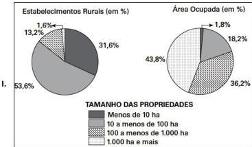
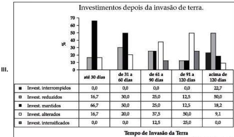
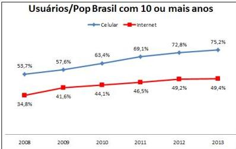
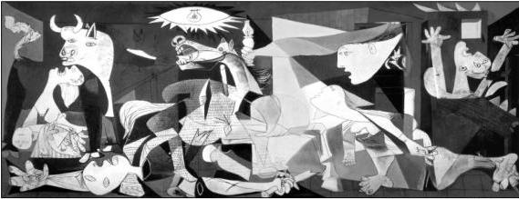

# PROVA — Camara_Serra_2014_Agente_Legislativo

## 1. Análise geral da prova

- **Identificação:** Camara_Serra_2014_Agente_Legislativo
- **Quantidade total de questões:** 40
- **Quantidade de textos de apoio (grupos):** 1
- **Quantidade de imagens:** 4
- **Quantidade de gráficos e tabelas:** incluídos nas imagens e no texto extraído, quando presentes no PDF original
- **Quantidade de grupos identificados:** 1
- **Quantidade de questões independentes:** 30
- **Questões que compartilham materiais:** texto-base das questões 01 a 10 → questões 01, 02, 03, 04, 05, 06, 07, 08, 09, 10

### Transcrição integral da capa/instruções (conforme extraída do PDF)

> [!NOTE]
> Conteúdo integral das páginas anteriores à primeira questão, sem cortes.

> Câmara Municipal da Serra – Espírito Santo
> CONCURSO PÚBLICO Nº 001/2014
> Agente Legislativo
> Manhã
> Organizadora:

## 2. Questões agrupadas

### GRUPO 01 — Texto-base compartilhado pelas questões 01 a 10

**Questões relacionadas:** 01, 02, 03, 04, 05, 06, 07, 08, 09, 10.

#### QUESTÃO 01

**Material de apoio:**

**A casa do futuro**
*Quando explodir, a busca será por florestas, montanhas, até lugares isolados. Estou nessa.*
Meu sonho sempre foi trabalhar em casa e acordar tarde. Este último realizei jovenzinho, quando comecei a trabalhar em jornalismo. Minha família teve dificuldade para compreender meu novo estilo de vida – na época, eu morava com meus pais. Trabalhava numa revista semanal e, muitas vezes, ficava até 5, 6 da manhã na redação. Tomava café da manhã na rua e só ia dormir depois. Às 9, minha mãe gritava:
– Acorda, preguiçoso!
Pois é. Nunca entrou em sua cabeça que eu trabalhava mesmo até amanhecer. Certamente, me imaginava na esbórnia. Vivo esse problema até hoje. As pessoas tentam marcar reuniões de manhã, almoços. Se explico que escrevo a novela de madrugada e, portanto, não assumo compromissos antes das 13, 14 horas, me encaram como se eu fosse um inútil.
Outro desejo realizei há alguns anos, quando passei a escrever novelas. Autor trabalha em casa! Hoje, o que era uma exceção tornou-se tendência. Graças à *internet*, o número de pessoas que trabalham em casa é crescente.
Meu terceiro sonho é morar longe. Por que viver numa cidade poluída, com um trânsito infernal, se poderia morar num sítio, com galinhas, árvores frutíferas, quem sabe uma cascata? Acordar e dormir no silêncio das estrelas? Ou viver numa cidade pequena, bem pequena, onde as pessoas se cumprimentam na rua? Esse é o caminho que a população das cidades grandes deverá tomar, nos próximos anos.
Já andei pesquisando cidades próximas de São Paulo e do Rio. Ou até mais longe, como na região de Bonito, pela qual me apaixonei. Havia casas lindas, com riozinhos próximos e floresta exuberante. Quase fiz negócio. Só desisti ao refletir melhor. Poderia encontrar uma sucuri no riozinho tão lindo. Ou dormir com uma onça rondando a casa. É lindo preservar a vida selvagem, mas os animais caçam! Mesmo assim, seria menos perigoso viver entre sucuris e onças do que em grande parte das cidades pequenas. A violência virou uma loucura.
O estilo de vida na grande cidade subsiste por causa da violência. São Paulo, entre outras cidades brasileiras, ainda permite que alguém viva num certo anonimato que, de certa forma, protege. Mas o futuro é irreversível: as grandes cidades serão lugares onde as pessoas irão para comparecer ao dentista ou assistir à opera. Elas viverão num pequeno círculo, de amigos próximos. E, no enorme círculo das redes sociais, para fazer contatos, encontrar amigos e namorar. Sim, o homem do futuro será paradoxalmente mais sozinho, mas também mais conectado, com relacionamentos duradouros que nunca viu pessoalmente. Pense bem: com uma paisagem tão linda como a deste país, por que passar os dias longe dela?
Viver fora da cidade será mais saudável e mais barato, com hortas domésticas, quem sabe até uma vaca leiteira? Coisas inéditas podem acontecer.
Não acredito em Papai Noel, mas acredito que, um dia, a violência diminuirá. Será possível morar na floresta sem dormir de carabina na mão. A grande cidade também se tornará mais agradável, com menos pessoas no trânsito para ir trabalhar. O voo migratório já começou, mas não é ousado. Temerosas, as pessoas preferem condomínios fechados próximos às grandes cidades. Quando explodir, a busca será por florestas, montanhas, lugares até isolados. Estou nessa. Um dia ainda vou escrever logo depois de tirar o leite da vaca.
*(Walcyr Carrasco. Disponível em: http://epoca.globo.com/colunas-e-blogs/walcyr-carrasco/noticia/2013/07/casa-do-bfuturob.html. Adaptado.)*

**Enunciado:**

# **Com base na leitura do texto, é correto inferir que o autor**

**Alternativas:**

A) sempre trabalhou em casa.
B) prefere marcar compromissos na parte da manhã.
C) apesar da violência na cidade grande, não pensa em se mudar.
D) era considerado um indolente, por ter horários diferentes de outras pessoas.

**Referências visuais:**

Nenhuma.

---

#### QUESTÃO 02

**Material de apoio:**

**A casa do futuro**
*Quando explodir, a busca será por florestas, montanhas, até lugares isolados. Estou nessa.*
Meu sonho sempre foi trabalhar em casa e acordar tarde. Este último realizei jovenzinho, quando comecei a trabalhar em jornalismo. Minha família teve dificuldade para compreender meu novo estilo de vida – na época, eu morava com meus pais. Trabalhava numa revista semanal e, muitas vezes, ficava até 5, 6 da manhã na redação. Tomava café da manhã na rua e só ia dormir depois. Às 9, minha mãe gritava:
– Acorda, preguiçoso!
Pois é. Nunca entrou em sua cabeça que eu trabalhava mesmo até amanhecer. Certamente, me imaginava na esbórnia. Vivo esse problema até hoje. As pessoas tentam marcar reuniões de manhã, almoços. Se explico que escrevo a novela de madrugada e, portanto, não assumo compromissos antes das 13, 14 horas, me encaram como se eu fosse um inútil.
Outro desejo realizei há alguns anos, quando passei a escrever novelas. Autor trabalha em casa! Hoje, o que era uma exceção tornou-se tendência. Graças à *internet*, o número de pessoas que trabalham em casa é crescente.
Meu terceiro sonho é morar longe. Por que viver numa cidade poluída, com um trânsito infernal, se poderia morar num sítio, com galinhas, árvores frutíferas, quem sabe uma cascata? Acordar e dormir no silêncio das estrelas? Ou viver numa cidade pequena, bem pequena, onde as pessoas se cumprimentam na rua? Esse é o caminho que a população das cidades grandes deverá tomar, nos próximos anos.
Já andei pesquisando cidades próximas de São Paulo e do Rio. Ou até mais longe, como na região de Bonito, pela qual me apaixonei. Havia casas lindas, com riozinhos próximos e floresta exuberante. Quase fiz negócio. Só desisti ao refletir melhor. Poderia encontrar uma sucuri no riozinho tão lindo. Ou dormir com uma onça rondando a casa. É lindo preservar a vida selvagem, mas os animais caçam! Mesmo assim, seria menos perigoso viver entre sucuris e onças do que em grande parte das cidades pequenas. A violência virou uma loucura.
O estilo de vida na grande cidade subsiste por causa da violência. São Paulo, entre outras cidades brasileiras, ainda permite que alguém viva num certo anonimato que, de certa forma, protege. Mas o futuro é irreversível: as grandes cidades serão lugares onde as pessoas irão para comparecer ao dentista ou assistir à opera. Elas viverão num pequeno círculo, de amigos próximos. E, no enorme círculo das redes sociais, para fazer contatos, encontrar amigos e namorar. Sim, o homem do futuro será paradoxalmente mais sozinho, mas também mais conectado, com relacionamentos duradouros que nunca viu pessoalmente. Pense bem: com uma paisagem tão linda como a deste país, por que passar os dias longe dela?
Viver fora da cidade será mais saudável e mais barato, com hortas domésticas, quem sabe até uma vaca leiteira? Coisas inéditas podem acontecer.
Não acredito em Papai Noel, mas acredito que, um dia, a violência diminuirá. Será possível morar na floresta sem dormir de carabina na mão. A grande cidade também se tornará mais agradável, com menos pessoas no trânsito para ir trabalhar. O voo migratório já começou, mas não é ousado. Temerosas, as pessoas preferem condomínios fechados próximos às grandes cidades. Quando explodir, a busca será por florestas, montanhas, lugares até isolados. Estou nessa. Um dia ainda vou escrever logo depois de tirar o leite da vaca.
*(Walcyr Carrasco. Disponível em: http://epoca.globo.com/colunas-e-blogs/walcyr-carrasco/noticia/2013/07/casa-do-bfuturob.html. Adaptado.)*

**Enunciado:**

**No trecho “Sim, o homem do futuro será paradoxalmente mais sozinho, mas também mais conectado, com relacionamentos duradouros que nunca viu pessoalmente.” (7º§), a relação de sentido estabelecida entre as orações pela conjunção destacada é**

**Alternativas:**

A) aditiva.
B) conclusiva.
C) explicativa.
D) adversativa.

**Referências visuais:**

Nenhuma.

---

#### QUESTÃO 03

**Material de apoio:**

**A casa do futuro**
*Quando explodir, a busca será por florestas, montanhas, até lugares isolados. Estou nessa.*
Meu sonho sempre foi trabalhar em casa e acordar tarde. Este último realizei jovenzinho, quando comecei a trabalhar em jornalismo. Minha família teve dificuldade para compreender meu novo estilo de vida – na época, eu morava com meus pais. Trabalhava numa revista semanal e, muitas vezes, ficava até 5, 6 da manhã na redação. Tomava café da manhã na rua e só ia dormir depois. Às 9, minha mãe gritava:
– Acorda, preguiçoso!
Pois é. Nunca entrou em sua cabeça que eu trabalhava mesmo até amanhecer. Certamente, me imaginava na esbórnia. Vivo esse problema até hoje. As pessoas tentam marcar reuniões de manhã, almoços. Se explico que escrevo a novela de madrugada e, portanto, não assumo compromissos antes das 13, 14 horas, me encaram como se eu fosse um inútil.
Outro desejo realizei há alguns anos, quando passei a escrever novelas. Autor trabalha em casa! Hoje, o que era uma exceção tornou-se tendência. Graças à *internet*, o número de pessoas que trabalham em casa é crescente.
Meu terceiro sonho é morar longe. Por que viver numa cidade poluída, com um trânsito infernal, se poderia morar num sítio, com galinhas, árvores frutíferas, quem sabe uma cascata? Acordar e dormir no silêncio das estrelas? Ou viver numa cidade pequena, bem pequena, onde as pessoas se cumprimentam na rua? Esse é o caminho que a população das cidades grandes deverá tomar, nos próximos anos.
Já andei pesquisando cidades próximas de São Paulo e do Rio. Ou até mais longe, como na região de Bonito, pela qual me apaixonei. Havia casas lindas, com riozinhos próximos e floresta exuberante. Quase fiz negócio. Só desisti ao refletir melhor. Poderia encontrar uma sucuri no riozinho tão lindo. Ou dormir com uma onça rondando a casa. É lindo preservar a vida selvagem, mas os animais caçam! Mesmo assim, seria menos perigoso viver entre sucuris e onças do que em grande parte das cidades pequenas. A violência virou uma loucura.
O estilo de vida na grande cidade subsiste por causa da violência. São Paulo, entre outras cidades brasileiras, ainda permite que alguém viva num certo anonimato que, de certa forma, protege. Mas o futuro é irreversível: as grandes cidades serão lugares onde as pessoas irão para comparecer ao dentista ou assistir à opera. Elas viverão num pequeno círculo, de amigos próximos. E, no enorme círculo das redes sociais, para fazer contatos, encontrar amigos e namorar. Sim, o homem do futuro será paradoxalmente mais sozinho, mas também mais conectado, com relacionamentos duradouros que nunca viu pessoalmente. Pense bem: com uma paisagem tão linda como a deste país, por que passar os dias longe dela?
Viver fora da cidade será mais saudável e mais barato, com hortas domésticas, quem sabe até uma vaca leiteira? Coisas inéditas podem acontecer.
Não acredito em Papai Noel, mas acredito que, um dia, a violência diminuirá. Será possível morar na floresta sem dormir de carabina na mão. A grande cidade também se tornará mais agradável, com menos pessoas no trânsito para ir trabalhar. O voo migratório já começou, mas não é ousado. Temerosas, as pessoas preferem condomínios fechados próximos às grandes cidades. Quando explodir, a busca será por florestas, montanhas, lugares até isolados. Estou nessa. Um dia ainda vou escrever logo depois de tirar o leite da vaca.
*(Walcyr Carrasco. Disponível em: http://epoca.globo.com/colunas-e-blogs/walcyr-carrasco/noticia/2013/07/casa-do-bfuturob.html. Adaptado.)*

**Enunciado:**

Sobre a cidade em que o autor vive, de acordo com o disposto no texto, é INCORRETO afirmar que

**Alternativas:**

A) tem poluição.
B) há muito barulho.
C) o tráfego é intenso.
D) todos se cumprimentam.

**Referências visuais:**

Nenhuma.

---

#### QUESTÃO 04

**Material de apoio:**

**A casa do futuro**
*Quando explodir, a busca será por florestas, montanhas, até lugares isolados. Estou nessa.*
Meu sonho sempre foi trabalhar em casa e acordar tarde. Este último realizei jovenzinho, quando comecei a trabalhar em jornalismo. Minha família teve dificuldade para compreender meu novo estilo de vida – na época, eu morava com meus pais. Trabalhava numa revista semanal e, muitas vezes, ficava até 5, 6 da manhã na redação. Tomava café da manhã na rua e só ia dormir depois. Às 9, minha mãe gritava:
– Acorda, preguiçoso!
Pois é. Nunca entrou em sua cabeça que eu trabalhava mesmo até amanhecer. Certamente, me imaginava na esbórnia. Vivo esse problema até hoje. As pessoas tentam marcar reuniões de manhã, almoços. Se explico que escrevo a novela de madrugada e, portanto, não assumo compromissos antes das 13, 14 horas, me encaram como se eu fosse um inútil.
Outro desejo realizei há alguns anos, quando passei a escrever novelas. Autor trabalha em casa! Hoje, o que era uma exceção tornou-se tendência. Graças à *internet*, o número de pessoas que trabalham em casa é crescente.
Meu terceiro sonho é morar longe. Por que viver numa cidade poluída, com um trânsito infernal, se poderia morar num sítio, com galinhas, árvores frutíferas, quem sabe uma cascata? Acordar e dormir no silêncio das estrelas? Ou viver numa cidade pequena, bem pequena, onde as pessoas se cumprimentam na rua? Esse é o caminho que a população das cidades grandes deverá tomar, nos próximos anos.
Já andei pesquisando cidades próximas de São Paulo e do Rio. Ou até mais longe, como na região de Bonito, pela qual me apaixonei. Havia casas lindas, com riozinhos próximos e floresta exuberante. Quase fiz negócio. Só desisti ao refletir melhor. Poderia encontrar uma sucuri no riozinho tão lindo. Ou dormir com uma onça rondando a casa. É lindo preservar a vida selvagem, mas os animais caçam! Mesmo assim, seria menos perigoso viver entre sucuris e onças do que em grande parte das cidades pequenas. A violência virou uma loucura.
O estilo de vida na grande cidade subsiste por causa da violência. São Paulo, entre outras cidades brasileiras, ainda permite que alguém viva num certo anonimato que, de certa forma, protege. Mas o futuro é irreversível: as grandes cidades serão lugares onde as pessoas irão para comparecer ao dentista ou assistir à opera. Elas viverão num pequeno círculo, de amigos próximos. E, no enorme círculo das redes sociais, para fazer contatos, encontrar amigos e namorar. Sim, o homem do futuro será paradoxalmente mais sozinho, mas também mais conectado, com relacionamentos duradouros que nunca viu pessoalmente. Pense bem: com uma paisagem tão linda como a deste país, por que passar os dias longe dela?
Viver fora da cidade será mais saudável e mais barato, com hortas domésticas, quem sabe até uma vaca leiteira? Coisas inéditas podem acontecer.
Não acredito em Papai Noel, mas acredito que, um dia, a violência diminuirá. Será possível morar na floresta sem dormir de carabina na mão. A grande cidade também se tornará mais agradável, com menos pessoas no trânsito para ir trabalhar. O voo migratório já começou, mas não é ousado. Temerosas, as pessoas preferem condomínios fechados próximos às grandes cidades. Quando explodir, a busca será por florestas, montanhas, lugares até isolados. Estou nessa. Um dia ainda vou escrever logo depois de tirar o leite da vaca.
*(Walcyr Carrasco. Disponível em: http://epoca.globo.com/colunas-e-blogs/walcyr-carrasco/noticia/2013/07/casa-do-bfuturob.html. Adaptado.)*

**Enunciado:**

Assinale a alternativa em que a disposição dos termos da oração encontra-se na ordem indireta.

**Alternativas:**

A) “Autor trabalha em casa!” (4º§)
B) “O voo migratório já começou, mas não é ousado.” (9º§)
C) “Elas viverão num pequeno círculo, de amigos próximos.” (7º§)
D) “Quando explodir, a busca será por florestas, montanhas, lugares até isolados.” (9º§)

**Referências visuais:**

Nenhuma.

---

#### QUESTÃO 05

**Material de apoio:**

**A casa do futuro**
*Quando explodir, a busca será por florestas, montanhas, até lugares isolados. Estou nessa.*
Meu sonho sempre foi trabalhar em casa e acordar tarde. Este último realizei jovenzinho, quando comecei a trabalhar em jornalismo. Minha família teve dificuldade para compreender meu novo estilo de vida – na época, eu morava com meus pais. Trabalhava numa revista semanal e, muitas vezes, ficava até 5, 6 da manhã na redação. Tomava café da manhã na rua e só ia dormir depois. Às 9, minha mãe gritava:
– Acorda, preguiçoso!
Pois é. Nunca entrou em sua cabeça que eu trabalhava mesmo até amanhecer. Certamente, me imaginava na esbórnia. Vivo esse problema até hoje. As pessoas tentam marcar reuniões de manhã, almoços. Se explico que escrevo a novela de madrugada e, portanto, não assumo compromissos antes das 13, 14 horas, me encaram como se eu fosse um inútil.
Outro desejo realizei há alguns anos, quando passei a escrever novelas. Autor trabalha em casa! Hoje, o que era uma exceção tornou-se tendência. Graças à *internet*, o número de pessoas que trabalham em casa é crescente.
Meu terceiro sonho é morar longe. Por que viver numa cidade poluída, com um trânsito infernal, se poderia morar num sítio, com galinhas, árvores frutíferas, quem sabe uma cascata? Acordar e dormir no silêncio das estrelas? Ou viver numa cidade pequena, bem pequena, onde as pessoas se cumprimentam na rua? Esse é o caminho que a população das cidades grandes deverá tomar, nos próximos anos.
Já andei pesquisando cidades próximas de São Paulo e do Rio. Ou até mais longe, como na região de Bonito, pela qual me apaixonei. Havia casas lindas, com riozinhos próximos e floresta exuberante. Quase fiz negócio. Só desisti ao refletir melhor. Poderia encontrar uma sucuri no riozinho tão lindo. Ou dormir com uma onça rondando a casa. É lindo preservar a vida selvagem, mas os animais caçam! Mesmo assim, seria menos perigoso viver entre sucuris e onças do que em grande parte das cidades pequenas. A violência virou uma loucura.
O estilo de vida na grande cidade subsiste por causa da violência. São Paulo, entre outras cidades brasileiras, ainda permite que alguém viva num certo anonimato que, de certa forma, protege. Mas o futuro é irreversível: as grandes cidades serão lugares onde as pessoas irão para comparecer ao dentista ou assistir à opera. Elas viverão num pequeno círculo, de amigos próximos. E, no enorme círculo das redes sociais, para fazer contatos, encontrar amigos e namorar. Sim, o homem do futuro será paradoxalmente mais sozinho, mas também mais conectado, com relacionamentos duradouros que nunca viu pessoalmente. Pense bem: com uma paisagem tão linda como a deste país, por que passar os dias longe dela?
Viver fora da cidade será mais saudável e mais barato, com hortas domésticas, quem sabe até uma vaca leiteira? Coisas inéditas podem acontecer.
Não acredito em Papai Noel, mas acredito que, um dia, a violência diminuirá. Será possível morar na floresta sem dormir de carabina na mão. A grande cidade também se tornará mais agradável, com menos pessoas no trânsito para ir trabalhar. O voo migratório já começou, mas não é ousado. Temerosas, as pessoas preferem condomínios fechados próximos às grandes cidades. Quando explodir, a busca será por florestas, montanhas, lugares até isolados. Estou nessa. Um dia ainda vou escrever logo depois de tirar o leite da vaca.
*(Walcyr Carrasco. Disponível em: http://epoca.globo.com/colunas-e-blogs/walcyr-carrasco/noticia/2013/07/casa-do-bfuturob.html. Adaptado.)*

**Enunciado:**

O vocábulo destacado em “Certamente, me imaginava na esbórnia.” (3º§) pode ser substituído, sem que haja alteração de sentido, por

**Alternativas:**

A) farra.
B) lassidão.
C) displicência.
D) monotonia.

**Referências visuais:**

Nenhuma.

---

#### QUESTÃO 06

**Material de apoio:**

**A casa do futuro**
*Quando explodir, a busca será por florestas, montanhas, até lugares isolados. Estou nessa.*
Meu sonho sempre foi trabalhar em casa e acordar tarde. Este último realizei jovenzinho, quando comecei a trabalhar em jornalismo. Minha família teve dificuldade para compreender meu novo estilo de vida – na época, eu morava com meus pais. Trabalhava numa revista semanal e, muitas vezes, ficava até 5, 6 da manhã na redação. Tomava café da manhã na rua e só ia dormir depois. Às 9, minha mãe gritava:
– Acorda, preguiçoso!
Pois é. Nunca entrou em sua cabeça que eu trabalhava mesmo até amanhecer. Certamente, me imaginava na esbórnia. Vivo esse problema até hoje. As pessoas tentam marcar reuniões de manhã, almoços. Se explico que escrevo a novela de madrugada e, portanto, não assumo compromissos antes das 13, 14 horas, me encaram como se eu fosse um inútil.
Outro desejo realizei há alguns anos, quando passei a escrever novelas. Autor trabalha em casa! Hoje, o que era uma exceção tornou-se tendência. Graças à *internet*, o número de pessoas que trabalham em casa é crescente.
Meu terceiro sonho é morar longe. Por que viver numa cidade poluída, com um trânsito infernal, se poderia morar num sítio, com galinhas, árvores frutíferas, quem sabe uma cascata? Acordar e dormir no silêncio das estrelas? Ou viver numa cidade pequena, bem pequena, onde as pessoas se cumprimentam na rua? Esse é o caminho que a população das cidades grandes deverá tomar, nos próximos anos.
Já andei pesquisando cidades próximas de São Paulo e do Rio. Ou até mais longe, como na região de Bonito, pela qual me apaixonei. Havia casas lindas, com riozinhos próximos e floresta exuberante. Quase fiz negócio. Só desisti ao refletir melhor. Poderia encontrar uma sucuri no riozinho tão lindo. Ou dormir com uma onça rondando a casa. É lindo preservar a vida selvagem, mas os animais caçam! Mesmo assim, seria menos perigoso viver entre sucuris e onças do que em grande parte das cidades pequenas. A violência virou uma loucura.
O estilo de vida na grande cidade subsiste por causa da violência. São Paulo, entre outras cidades brasileiras, ainda permite que alguém viva num certo anonimato que, de certa forma, protege. Mas o futuro é irreversível: as grandes cidades serão lugares onde as pessoas irão para comparecer ao dentista ou assistir à opera. Elas viverão num pequeno círculo, de amigos próximos. E, no enorme círculo das redes sociais, para fazer contatos, encontrar amigos e namorar. Sim, o homem do futuro será paradoxalmente mais sozinho, mas também mais conectado, com relacionamentos duradouros que nunca viu pessoalmente. Pense bem: com uma paisagem tão linda como a deste país, por que passar os dias longe dela?
Viver fora da cidade será mais saudável e mais barato, com hortas domésticas, quem sabe até uma vaca leiteira? Coisas inéditas podem acontecer.
Não acredito em Papai Noel, mas acredito que, um dia, a violência diminuirá. Será possível morar na floresta sem dormir de carabina na mão. A grande cidade também se tornará mais agradável, com menos pessoas no trânsito para ir trabalhar. O voo migratório já começou, mas não é ousado. Temerosas, as pessoas preferem condomínios fechados próximos às grandes cidades. Quando explodir, a busca será por florestas, montanhas, lugares até isolados. Estou nessa. Um dia ainda vou escrever logo depois de tirar o leite da vaca.
*(Walcyr Carrasco. Disponível em: http://epoca.globo.com/colunas-e-blogs/walcyr-carrasco/noticia/2013/07/casa-do-bfuturob.html. Adaptado.)*

**Enunciado:**

Os termos sublinhados nas seguintes orações pertencem à mesma classe de palavras, EXCETO:

**Alternativas:**

A) “Meu sonho sempre foi trabalhar em casa e acordar tarde.” (1º§)
B) “[...] com relacionamentos duradouros que nunca viu pessoalmente.” (7º§)
C) “Ou até mais longe, como na região de Bonito, pela qual me apaixonei.” (6º§)
D) “Outro desejo realizei há alguns anos, quando passei a escrever novelas.” (4º§)

**Referências visuais:**

Nenhuma.

---

#### QUESTÃO 07

**Material de apoio:**

**A casa do futuro**
*Quando explodir, a busca será por florestas, montanhas, até lugares isolados. Estou nessa.*
Meu sonho sempre foi trabalhar em casa e acordar tarde. Este último realizei jovenzinho, quando comecei a trabalhar em jornalismo. Minha família teve dificuldade para compreender meu novo estilo de vida – na época, eu morava com meus pais. Trabalhava numa revista semanal e, muitas vezes, ficava até 5, 6 da manhã na redação. Tomava café da manhã na rua e só ia dormir depois. Às 9, minha mãe gritava:
– Acorda, preguiçoso!
Pois é. Nunca entrou em sua cabeça que eu trabalhava mesmo até amanhecer. Certamente, me imaginava na esbórnia. Vivo esse problema até hoje. As pessoas tentam marcar reuniões de manhã, almoços. Se explico que escrevo a novela de madrugada e, portanto, não assumo compromissos antes das 13, 14 horas, me encaram como se eu fosse um inútil.
Outro desejo realizei há alguns anos, quando passei a escrever novelas. Autor trabalha em casa! Hoje, o que era uma exceção tornou-se tendência. Graças à *internet*, o número de pessoas que trabalham em casa é crescente.
Meu terceiro sonho é morar longe. Por que viver numa cidade poluída, com um trânsito infernal, se poderia morar num sítio, com galinhas, árvores frutíferas, quem sabe uma cascata? Acordar e dormir no silêncio das estrelas? Ou viver numa cidade pequena, bem pequena, onde as pessoas se cumprimentam na rua? Esse é o caminho que a população das cidades grandes deverá tomar, nos próximos anos.
Já andei pesquisando cidades próximas de São Paulo e do Rio. Ou até mais longe, como na região de Bonito, pela qual me apaixonei. Havia casas lindas, com riozinhos próximos e floresta exuberante. Quase fiz negócio. Só desisti ao refletir melhor. Poderia encontrar uma sucuri no riozinho tão lindo. Ou dormir com uma onça rondando a casa. É lindo preservar a vida selvagem, mas os animais caçam! Mesmo assim, seria menos perigoso viver entre sucuris e onças do que em grande parte das cidades pequenas. A violência virou uma loucura.
O estilo de vida na grande cidade subsiste por causa da violência. São Paulo, entre outras cidades brasileiras, ainda permite que alguém viva num certo anonimato que, de certa forma, protege. Mas o futuro é irreversível: as grandes cidades serão lugares onde as pessoas irão para comparecer ao dentista ou assistir à opera. Elas viverão num pequeno círculo, de amigos próximos. E, no enorme círculo das redes sociais, para fazer contatos, encontrar amigos e namorar. Sim, o homem do futuro será paradoxalmente mais sozinho, mas também mais conectado, com relacionamentos duradouros que nunca viu pessoalmente. Pense bem: com uma paisagem tão linda como a deste país, por que passar os dias longe dela?
Viver fora da cidade será mais saudável e mais barato, com hortas domésticas, quem sabe até uma vaca leiteira? Coisas inéditas podem acontecer.
Não acredito em Papai Noel, mas acredito que, um dia, a violência diminuirá. Será possível morar na floresta sem dormir de carabina na mão. A grande cidade também se tornará mais agradável, com menos pessoas no trânsito para ir trabalhar. O voo migratório já começou, mas não é ousado. Temerosas, as pessoas preferem condomínios fechados próximos às grandes cidades. Quando explodir, a busca será por florestas, montanhas, lugares até isolados. Estou nessa. Um dia ainda vou escrever logo depois de tirar o leite da vaca.
*(Walcyr Carrasco. Disponível em: http://epoca.globo.com/colunas-e-blogs/walcyr-carrasco/noticia/2013/07/casa-do-bfuturob.html. Adaptado.)*

**Enunciado:**

Acerca do emprego do acento indicativo de crase, marque V para as afirmativas verdadeiras e F para as falsas.

( ) Em “Às 9, minha mãe gritava” (1º§), o emprego da crase é obrigatório, pois encontra-se diante de numeral que se refere a horas.
( ) O uso em “assistir à opera” (7º§) é facultativo, pois o verbo “assistir”, no sentido empregado, é transitivo direto.
( ) Na oração “Temerosas, as pessoas preferem condomínios fechados próximos às grandes cidades.” (9º§), a crase é obrigatória devido à regência verbal de “preferir”.

A sequência está correta em

**Alternativas:**

A) V, V, V.
B) F, F, V.
C) V, F, F.
D) F, V, V.

**Referências visuais:**

Nenhuma.

---

#### QUESTÃO 08

**Material de apoio:**

**A casa do futuro**
*Quando explodir, a busca será por florestas, montanhas, até lugares isolados. Estou nessa.*
Meu sonho sempre foi trabalhar em casa e acordar tarde. Este último realizei jovenzinho, quando comecei a trabalhar em jornalismo. Minha família teve dificuldade para compreender meu novo estilo de vida – na época, eu morava com meus pais. Trabalhava numa revista semanal e, muitas vezes, ficava até 5, 6 da manhã na redação. Tomava café da manhã na rua e só ia dormir depois. Às 9, minha mãe gritava:
– Acorda, preguiçoso!
Pois é. Nunca entrou em sua cabeça que eu trabalhava mesmo até amanhecer. Certamente, me imaginava na esbórnia. Vivo esse problema até hoje. As pessoas tentam marcar reuniões de manhã, almoços. Se explico que escrevo a novela de madrugada e, portanto, não assumo compromissos antes das 13, 14 horas, me encaram como se eu fosse um inútil.
Outro desejo realizei há alguns anos, quando passei a escrever novelas. Autor trabalha em casa! Hoje, o que era uma exceção tornou-se tendência. Graças à *internet*, o número de pessoas que trabalham em casa é crescente.
Meu terceiro sonho é morar longe. Por que viver numa cidade poluída, com um trânsito infernal, se poderia morar num sítio, com galinhas, árvores frutíferas, quem sabe uma cascata? Acordar e dormir no silêncio das estrelas? Ou viver numa cidade pequena, bem pequena, onde as pessoas se cumprimentam na rua? Esse é o caminho que a população das cidades grandes deverá tomar, nos próximos anos.
Já andei pesquisando cidades próximas de São Paulo e do Rio. Ou até mais longe, como na região de Bonito, pela qual me apaixonei. Havia casas lindas, com riozinhos próximos e floresta exuberante. Quase fiz negócio. Só desisti ao refletir melhor. Poderia encontrar uma sucuri no riozinho tão lindo. Ou dormir com uma onça rondando a casa. É lindo preservar a vida selvagem, mas os animais caçam! Mesmo assim, seria menos perigoso viver entre sucuris e onças do que em grande parte das cidades pequenas. A violência virou uma loucura.
O estilo de vida na grande cidade subsiste por causa da violência. São Paulo, entre outras cidades brasileiras, ainda permite que alguém viva num certo anonimato que, de certa forma, protege. Mas o futuro é irreversível: as grandes cidades serão lugares onde as pessoas irão para comparecer ao dentista ou assistir à opera. Elas viverão num pequeno círculo, de amigos próximos. E, no enorme círculo das redes sociais, para fazer contatos, encontrar amigos e namorar. Sim, o homem do futuro será paradoxalmente mais sozinho, mas também mais conectado, com relacionamentos duradouros que nunca viu pessoalmente. Pense bem: com uma paisagem tão linda como a deste país, por que passar os dias longe dela?
Viver fora da cidade será mais saudável e mais barato, com hortas domésticas, quem sabe até uma vaca leiteira? Coisas inéditas podem acontecer.
Não acredito em Papai Noel, mas acredito que, um dia, a violência diminuirá. Será possível morar na floresta sem dormir de carabina na mão. A grande cidade também se tornará mais agradável, com menos pessoas no trânsito para ir trabalhar. O voo migratório já começou, mas não é ousado. Temerosas, as pessoas preferem condomínios fechados próximos às grandes cidades. Quando explodir, a busca será por florestas, montanhas, lugares até isolados. Estou nessa. Um dia ainda vou escrever logo depois de tirar o leite da vaca.
*(Walcyr Carrasco. Disponível em: http://epoca.globo.com/colunas-e-blogs/walcyr-carrasco/noticia/2013/07/casa-do-bfuturob.html. Adaptado.)*

**Enunciado:**

Em relação ao verbo em destaque na oração “O estilo de vida na grande cidade subsiste por causa da violência.” (7º§), é INCORRETO afirmar que

**Alternativas:**

A) é intransitivo.
B) pertence à 3ª conjugação.
C) encontra-se na voz passiva.
D) está conjugado no presente do indicativo.

**Referências visuais:**

Nenhuma.

---

#### QUESTÃO 09

**Material de apoio:**

**A casa do futuro**
*Quando explodir, a busca será por florestas, montanhas, até lugares isolados. Estou nessa.*
Meu sonho sempre foi trabalhar em casa e acordar tarde. Este último realizei jovenzinho, quando comecei a trabalhar em jornalismo. Minha família teve dificuldade para compreender meu novo estilo de vida – na época, eu morava com meus pais. Trabalhava numa revista semanal e, muitas vezes, ficava até 5, 6 da manhã na redação. Tomava café da manhã na rua e só ia dormir depois. Às 9, minha mãe gritava:
– Acorda, preguiçoso!
Pois é. Nunca entrou em sua cabeça que eu trabalhava mesmo até amanhecer. Certamente, me imaginava na esbórnia. Vivo esse problema até hoje. As pessoas tentam marcar reuniões de manhã, almoços. Se explico que escrevo a novela de madrugada e, portanto, não assumo compromissos antes das 13, 14 horas, me encaram como se eu fosse um inútil.
Outro desejo realizei há alguns anos, quando passei a escrever novelas. Autor trabalha em casa! Hoje, o que era uma exceção tornou-se tendência. Graças à *internet*, o número de pessoas que trabalham em casa é crescente.
Meu terceiro sonho é morar longe. Por que viver numa cidade poluída, com um trânsito infernal, se poderia morar num sítio, com galinhas, árvores frutíferas, quem sabe uma cascata? Acordar e dormir no silêncio das estrelas? Ou viver numa cidade pequena, bem pequena, onde as pessoas se cumprimentam na rua? Esse é o caminho que a população das cidades grandes deverá tomar, nos próximos anos.
Já andei pesquisando cidades próximas de São Paulo e do Rio. Ou até mais longe, como na região de Bonito, pela qual me apaixonei. Havia casas lindas, com riozinhos próximos e floresta exuberante. Quase fiz negócio. Só desisti ao refletir melhor. Poderia encontrar uma sucuri no riozinho tão lindo. Ou dormir com uma onça rondando a casa. É lindo preservar a vida selvagem, mas os animais caçam! Mesmo assim, seria menos perigoso viver entre sucuris e onças do que em grande parte das cidades pequenas. A violência virou uma loucura.
O estilo de vida na grande cidade subsiste por causa da violência. São Paulo, entre outras cidades brasileiras, ainda permite que alguém viva num certo anonimato que, de certa forma, protege. Mas o futuro é irreversível: as grandes cidades serão lugares onde as pessoas irão para comparecer ao dentista ou assistir à opera. Elas viverão num pequeno círculo, de amigos próximos. E, no enorme círculo das redes sociais, para fazer contatos, encontrar amigos e namorar. Sim, o homem do futuro será paradoxalmente mais sozinho, mas também mais conectado, com relacionamentos duradouros que nunca viu pessoalmente. Pense bem: com uma paisagem tão linda como a deste país, por que passar os dias longe dela?
Viver fora da cidade será mais saudável e mais barato, com hortas domésticas, quem sabe até uma vaca leiteira? Coisas inéditas podem acontecer.
Não acredito em Papai Noel, mas acredito que, um dia, a violência diminuirá. Será possível morar na floresta sem dormir de carabina na mão. A grande cidade também se tornará mais agradável, com menos pessoas no trânsito para ir trabalhar. O voo migratório já começou, mas não é ousado. Temerosas, as pessoas preferem condomínios fechados próximos às grandes cidades. Quando explodir, a busca será por florestas, montanhas, lugares até isolados. Estou nessa. Um dia ainda vou escrever logo depois de tirar o leite da vaca.
*(Walcyr Carrasco. Disponível em: http://epoca.globo.com/colunas-e-blogs/walcyr-carrasco/noticia/2013/07/casa-do-bfuturob.html. Adaptado.)*

**Enunciado:**

Com base na divisão silábica, as palavras a seguir, quanto ao número de sílabas, classificam-se como monossílabas.

Assinale a alternativa em que nem todas as palavras apresentam essa classificação.

**Alternativas:**

A) não – ou – já
B) se – por – bem
C) que – rua – sim
D) meus – pais – mãe

**Referências visuais:**

Nenhuma.

---

#### QUESTÃO 10

**Material de apoio:**

**A casa do futuro**
*Quando explodir, a busca será por florestas, montanhas, até lugares isolados. Estou nessa.*
Meu sonho sempre foi trabalhar em casa e acordar tarde. Este último realizei jovenzinho, quando comecei a trabalhar em jornalismo. Minha família teve dificuldade para compreender meu novo estilo de vida – na época, eu morava com meus pais. Trabalhava numa revista semanal e, muitas vezes, ficava até 5, 6 da manhã na redação. Tomava café da manhã na rua e só ia dormir depois. Às 9, minha mãe gritava:
– Acorda, preguiçoso!
Pois é. Nunca entrou em sua cabeça que eu trabalhava mesmo até amanhecer. Certamente, me imaginava na esbórnia. Vivo esse problema até hoje. As pessoas tentam marcar reuniões de manhã, almoços. Se explico que escrevo a novela de madrugada e, portanto, não assumo compromissos antes das 13, 14 horas, me encaram como se eu fosse um inútil.
Outro desejo realizei há alguns anos, quando passei a escrever novelas. Autor trabalha em casa! Hoje, o que era uma exceção tornou-se tendência. Graças à *internet*, o número de pessoas que trabalham em casa é crescente.
Meu terceiro sonho é morar longe. Por que viver numa cidade poluída, com um trânsito infernal, se poderia morar num sítio, com galinhas, árvores frutíferas, quem sabe uma cascata? Acordar e dormir no silêncio das estrelas? Ou viver numa cidade pequena, bem pequena, onde as pessoas se cumprimentam na rua? Esse é o caminho que a população das cidades grandes deverá tomar, nos próximos anos.
Já andei pesquisando cidades próximas de São Paulo e do Rio. Ou até mais longe, como na região de Bonito, pela qual me apaixonei. Havia casas lindas, com riozinhos próximos e floresta exuberante. Quase fiz negócio. Só desisti ao refletir melhor. Poderia encontrar uma sucuri no riozinho tão lindo. Ou dormir com uma onça rondando a casa. É lindo preservar a vida selvagem, mas os animais caçam! Mesmo assim, seria menos perigoso viver entre sucuris e onças do que em grande parte das cidades pequenas. A violência virou uma loucura.
O estilo de vida na grande cidade subsiste por causa da violência. São Paulo, entre outras cidades brasileiras, ainda permite que alguém viva num certo anonimato que, de certa forma, protege. Mas o futuro é irreversível: as grandes cidades serão lugares onde as pessoas irão para comparecer ao dentista ou assistir à opera. Elas viverão num pequeno círculo, de amigos próximos. E, no enorme círculo das redes sociais, para fazer contatos, encontrar amigos e namorar. Sim, o homem do futuro será paradoxalmente mais sozinho, mas também mais conectado, com relacionamentos duradouros que nunca viu pessoalmente. Pense bem: com uma paisagem tão linda como a deste país, por que passar os dias longe dela?
Viver fora da cidade será mais saudável e mais barato, com hortas domésticas, quem sabe até uma vaca leiteira? Coisas inéditas podem acontecer.
Não acredito em Papai Noel, mas acredito que, um dia, a violência diminuirá. Será possível morar na floresta sem dormir de carabina na mão. A grande cidade também se tornará mais agradável, com menos pessoas no trânsito para ir trabalhar. O voo migratório já começou, mas não é ousado. Temerosas, as pessoas preferem condomínios fechados próximos às grandes cidades. Quando explodir, a busca será por florestas, montanhas, lugares até isolados. Estou nessa. Um dia ainda vou escrever logo depois de tirar o leite da vaca.
*(Walcyr Carrasco. Disponível em: http://epoca.globo.com/colunas-e-blogs/walcyr-carrasco/noticia/2013/07/casa-do-bfuturob.html. Adaptado.)*

**Enunciado:**

Assinale a alternativa em que todas as palavras, transcritas do texto, apresentam ditongos nasais.

**Alternativas:**

A) família – sítio – meu
B) autor – silêncio – saudável
C) pessoas – brasileiras – pais
D) quando – redação – região

**Referências visuais:**

Nenhuma.

---

## 3. Questões independentes

#### QUESTÃO 11

**Enunciado:**

Na ferramenta Microsoft Office Excel 2007 (configuração padrão), uma forma de selecionar uma célula específica é digitar o seu endereço na

**Alternativas:**

A) caixa de nome.
B) barra de status.
C) barra de fórmulas.
D) caixa de endereços.

**Referências visuais:**

Nenhuma.

---

#### QUESTÃO 12

**Enunciado:**

Na ferramenta Microsoft Office Excel 2007 (configuração padrão), o botão pode ser utilizado para inserir

**Alternativas:**

A) marca d'água.
B) caixa de texto.
C) linhas na planilha.
D) fórmulas e funções.

**Referências visuais:**

Nenhuma.

---

#### QUESTÃO 13

**Enunciado:**

Considere que um usuário digitou em uma célula da ferramenta Microsoft Office Excel 2007 (configuração padrão) a seguinte fórmula:

=SUBSTITUIR("SERRA ES";"ESO";"ESPÍRITO SANTO")

Pode-se afirmar que o resultado desta função retornará o valor

**Alternativas:**

A) SERRA.
B) SERRA ES.
C) ESPÍRITO SANTO.
D) SERRA ESPÍRITO SANTO.

**Referências visuais:**

Nenhuma.

---

#### QUESTÃO 14

**Enunciado:**

Considere a planilha produzida com a ferramenta Microsoft Office Excel 2007 (configuração padrão):

| | A | B | C |
| --- | --- | --- | --- |
| 1 | COD | DESCRICAO | VALOR |
| 2 | 1 | PARAFUSO | R$ 3.500,00 |
| 3 | 2 | PREGO | R$ 2.000,00 |
| 4 | 3 | ARAME | R$ 1.500,00 |
| 5 | 4 | PORCA | R$ 500,00 |
| 6 | | | |

Sabe-se que o total gasto com os produtos relacionados na tabela é R$ 7.500,00. Para chegar a este valor, é correto aplicar na célula C6 a fórmula

**Alternativas:**

A) =SOMA(B2:B5).
B) =SOMA(C2:C5).
C) =MÁXIMO(B2:B5).
D) =MÁXIMO(C2:C5).

**Referências visuais:**

Nenhuma.

---

#### QUESTÃO 15

**Enunciado:**

Se na ferramenta Microsoft Office Excel 2007 (configuração padrão) for inserida a fórmula =MÉDIA(SE(10>2;10;5);2), o resultado será

**Alternativas:**

A) 5.
B) 6.
C) 8.
D) 10.

**Referências visuais:**

Nenhuma.

---

#### QUESTÃO 16

**Enunciado:**

No Sistema Operacional Microsoft Windows 7 (configuração padrão), é função da barra de tarefas exibir

**Alternativas:**

A) quais são os aplicativos em uso.
B) as propriedades dos arquivos selecionados.
C) o status de funcionamento do sistema operacional.
D) os programas e arquivos armazenados no computador.

**Referências visuais:**

Nenhuma.

---

#### QUESTÃO 17

**Enunciado:**

No Sistema Operacional Microsoft Windows 7 (configuração padrão – idioma português Brasil), o Windows Explorer é utilizado para gerenciar os arquivos existentes no computador. As teclas de atalho que acessam este recurso são:

**Alternativas:**

A) Ctrl + J.
B) Ctrl + D.
C) Logotipo do Windows + W.
D) Logotipo do Windows + E.

**Referências visuais:**

Nenhuma.

---

#### QUESTÃO 18

**Enunciado:**

Um funcionário de uma empresa de comércio varejista produzirá um relatório mensal de vendas na ferramenta Microsoft Office Word 2007 (configuração padrão) e deverá formatar o seu texto em duas colunas para ser publicado no jornal mensal. A ação para realizar esse procedimento é: selecionar todo o texto, clicar na guia

**Alternativas:**

A) Layout da Página e, no grupo Configurar Página, clicar em Colunas e selecionar a opção Dois.
B) Início (Página Inicial) e, no grupo Opções de Página, clicar em Colunas e selecionar a opção Dois.
C) Layout da Página e, no grupo Opções de Página, clicar em Layout e selecionar a opção Duas colunas.
D) Início (Página Inicial) e, no grupo Configurar Página, clicar em Dividir Colunas e selecionar a opção Duas colunas.

**Referências visuais:**

Nenhuma.

---

#### QUESTÃO 19

**Enunciado:**

Na ferramenta Microsoft Office Word 2007 (configuração padrão), os recursos de revisão de texto como ortografia e gramática, dicionário de sinônimos e contar palavras estão localizados na guia:

**Alternativas:**

A) Revisão.
B) Exibição.
C) Referências.
D) Ferramentas.

**Referências visuais:**

Nenhuma.

---

#### QUESTÃO 20

**Enunciado:**

“Na ferramenta Microsoft Office PowerPoint 2007 (configuração padrão), o slide _______________ é o principal em uma hierarquia de slides que armazena informações sobre o tema e os layouts dos slides de uma apresentação, incluindo o plano de fundo, a cor, as fontes, os efeitos, os tamanhos dos espaços reservados e o posicionamento.”

Assinale a alternativa que completa corretamente a afirmativa anterior.

**Alternativas:**

A) pai
B) raiz
C) mestre
D) padrão

**Referências visuais:**

Nenhuma.

---

#### QUESTÃO 21

**Enunciado:**

“Pode-se afirmar que complexos metropolitanos são macrorregiões em que duas ou mais regiões metropolitanas estão altamente integradas em suas dinâmicas econômicas, como na prestação de serviços, circulação de mercadorias, bem como na produção e consumo. No Brasil, pode-se destacar o complexo metropolitano do Sudeste que é composto pela grande _______________ e grande _______________.” Assinale a alternativa que completa correta e sequencialmente a afirmativa anterior.

**Alternativas:**

A) BH / Rio
B) BH / Vitória
C) São Paulo / Rio
D) São Paulo / Vitória

**Referências visuais:**

Nenhuma.

---

#### QUESTÃO 22

**Enunciado:**

Analise as manchetes de jornais do segundo semestre de 2014:

• “Moradores reclamam de falta d’água e pedem ‘racionamento oficial’ em SP.”
(Disponível em: g1.globo.com.)
• “São Paulo tem 2,1 milhões de pessoas sob racionamento.”
(Disponível em: www1.folha.uol.com.br.)
• “Nível do Cantareira atinge novo recorde de baixa.”
(Disponível em: topicos.estadao.com.br.)

Essas manchetes jornalísticas retratam a crise do abastecimento de água que ocorre em São Paulo. Milhões de pessoas estão correndo risco de ficar sem um recurso natural, fundamental para a sobrevivência humana. Que ação humana pode contribuir diretamente para a solução de problemas como esse?

**Alternativas:**

A) Mudança de hábitos culturais.
B) Elevação da produção agrícola.
C) Crescimento da produção industrial.
D) Expansão do desmatamento da Amazônia.

**Referências visuais:**

Nenhuma.

---

#### QUESTÃO 23

**Enunciado:**

Na organização política do Brasil, os poderes de Estado nunca estão nas mãos de uma pessoa só, pois são divididos em: poder executivo, que executa as leis e administra o Estado; poder legislativo, que fiscaliza e cria as leis; e, poder judiciário, que julga o cumprimento da lei. Cada um dos poderes é organizado em três esferas: federal, estadual e municipal. No caso do poder executivo, são cargos exercidos pelos chefes desse poder em cada esfera administrativa do país na respectiva ordem: federal, estadual e municipal.

**Alternativas:**

A) Juiz, Desembargador e Ministro.
B) Governador, Presidente e Prefeito.
C) Presidente, Governador e Prefeito.
D) Deputado Federal, Deputado Estadual e Vereador.

**Referências visuais:**

Nenhuma.

---

#### QUESTÃO 24

**Enunciado:**

A distribuição da terra no Brasil é historicamente concentrada, situação cujas origens remontam ao tempo das capitanias hereditárias. Esse padrão que vem se mantendo ao longo dos anos e, conforme evidenciam as pesquisas sobre esse tema, tem se agravado com o avanço da modernização da agricultura.

(Disponível em: www.bnb.gov.br.)

Observe os gráficos e a tabela a seguir.

(Disponível em: Winkler, 2012. p. 08.)

Evolução da intensidade energética dos países componentes do G20 entre 1990 e 2005

| País | Variação | País | Variação | País | Variação | País | Variação |
| --- | --- | --- | --- | --- | --- | --- | --- |
| Argentina | -41,2% | França | -33,0% | Japão | -28,8% | Coréia do Sul | -26,5% |
| Austrália | -40,1% | Alemanha | -44,8% | México | -37,1% | Turquia | -33,3% |
| Brasil | -22,7% | Índia | -44,9% | Rússia | — | Reino Unido | -44,0% |
| Canadá | -37,2% | Indonésia | -34,7% | Arábia Saudita | 11,0% | Estados Unidos | -43,6% |
| China | -66,0% | Itália | -24,6% | África do Sul | -29,0% | da América | |

(Disponível em: OECD/IEA, 2008.)

(Disponível em: www.scielo.br. Adaptado.)

Expressa(m) diretamente a realidade descrita no enunciado

**Alternativas:**

A) I, II e III.
B) I, apenas.
C) II, apenas.
D) III, apenas.

**Referências visuais:**

---

#### QUESTÃO 25

**Enunciado:**

A terra, há muito tempo, é motivo de conflitos em todo o Brasil, mas, principalmente, nas regiões Norte e Centro-Oeste, onde atualmente essa questão se intensifica e é motivo de grande quantidade de homicídios. Mas, antes disso, terra é fonte de vida e de recursos para a sobrevivência humana. É um bem natural que deve cumprir uma função social constitucional ao ser usada pelo homem. De acordo com a Constituição Federal de 1988, essa função é alcançada quando respeita os seguintes requisitos, EXCETO:

**Alternativas:**

A) Aproveitamento racional e adequado.
B) Favorecimento do bem-estar dos proprietários e trabalhadores.
C) Utilização dos recursos naturais disponíveis e preservação do ambiente.
D) Valorização do grande produtor rural e consequente aumento de exportações.

**Referências visuais:**

Nenhuma.

---

#### QUESTÃO 26

**Enunciado:**

Analise a tabela e o gráfico a seguir.

Brasil: Assinantes/conexões

| Milhões | 2009 | 2010 | 2011 | 2012 | 2013 |
| --- | --- | --- | --- | --- | --- |
| Celulares | 174,0 | 202,9 | 242,2 | 261,8 | 271,1 |
| Telefones Fixos | 41,5 | 42,0 | 43,0 | 44,3 | 44,8 |
| Banda larga | 11,4 | 13,8 | 16,3 | 19,0 | 21,3 |
| TV por Assinatura | 7,5 | 9,8 | 12,7 | 16,2 | 18,0 |
| Usuários de Internet (PNAD) | 67,8 | 73,9 | 77,7 | 84,2 | 85,6 |

(Tabela e gráfico. Disponíveis em: www.teleco.com.br.)

Considerando a relação entre as informações trazidas no gráfico e na tabela e o desenvolvimento de infraestrutura no Brasil, analise.

I. A cada ano a infraestrutura do país tem aumentado sua abrangência, como evidenciam os resultados positivos da expansão da telefonia.
II. Esses dados são indicadores de crescimento e modernização do país.
III. Os dados demonstrados na tabela e no gráfico não se relacionam diretamente com melhoria e expansão de infraestrutura.

Estão corretas as afirmativas

**Alternativas:**

A) I, II e III.
B) I e II, apenas.
C) I e III, apenas.
D) II e III, apenas.

**Referências visuais:**

---

#### QUESTÃO 27

**Enunciado:**

A energia, sem dúvida, é um setor estratégico para o desenvolvimento de uma economia e o consequente crescimento de um país e da qualidade de vida de sua população. Sobre a infraestrutura de energia no Brasil, marque V para as afirmativas verdadeiras e F para as falsas.

( ) Na matriz energética brasileira predomina o uso de hidrocarbonetos não renováveis.
( ) A energia eólica é considerada uma fonte esgotável.
( ) A Bolívia é um fornecedor fundamental de gás natural ao Brasil.
( ) Os biocombustíveis ainda são quase inexistentes na realidade brasileira.

A sequência está correta em

**Alternativas:**

A) F, F, V, F.
B) V, F, F, V.
C) V, F, V, F.
D) F, V, F, V.

**Referências visuais:**

Nenhuma.

---

#### QUESTÃO 28

**Enunciado:**

A palavra “transporte” vem do latim trans (de um lado a outro) e portare (carregar). Podemos dizer que, em síntese, transporte é o movimento de pessoas ou coisas de um lugar para outro. Os transportes podem se distinguir pela possessão, onde o transporte público é destinado a qualquer pessoa e o privado é restringido somente a quem os adquiriu. Os transportes contêm três elementos: infraestrutura, veículos e operações comerciais. Infraestrutura é a malha de transporte: rodoviária, férrea, aérea, fluvial, tubular etc. Os veículos são automóveis, bicicletas, ônibus, trens e aeronaves, que utilizam essa malha. As operações são as formas como esses veículos utilizam a rede, como leis, diretrizes, códigos etc.

Sobre o sistema de transporte no Brasil, assinale a alternativa que completa correta e respectivamente as afirmações a seguir.

• “No Brasil, o transporte ________________ é o mais utilizado, o que representa um problema de infraestrutura, pois, além de ser o mais caro, está associado a diversos acidentes, muitos deles fatais.”
• “________________ é uma unidade da federação no Norte do país que se destaca pela grande dimensão espacial e pela pouca infraestrutura de transporte.”
• “Em relação a transporte de carga pesada, os mais eficientes e baratos são o ________________ e o ________________.”

**Alternativas:**

A) dutoviário / Rondônia / marítimo / aéreo
B) ferroviário / Acre / rodoviário / dutoviário
C) rodoviário / Amazonas / ferroviário / hidroviário
D) hidroviário / Rio Grande do Sul / dutoviário / aéreo

**Referências visuais:**

Nenhuma.

---

#### QUESTÃO 29

**Enunciado:**

(Guernica, 1937 – Pablo Picasso.)

A obra Guernica, de Pablo Picasso, pode ser relacionada a qual conflito ocorrido no mundo?

**Alternativas:**

A) Guerra do Vietnã.
B) Guerra Civil Espanhola.
C) Primeira Guerra Mundial.
D) Conflito Árabe-Israelense.

**Referências visuais:**

---

#### QUESTÃO 30

**Enunciado:**

Analise o poema.

# **Poema de sete faces**

Quando nasci, um anjo torto
desses que vivem na sombra
disse: Vai, Carlos! ser gauche na vida.

As casas espiam os homens
que correm atrás de mulheres.

A tarde talvez fosse azul,
não houvesse tantos desejos.

O bonde passa cheio de pernas:
pernas brancas pretas amarelas.

Para que tanta perna, meu Deus, pergunta meu coração.

Porém meus olhos
não perguntam nada.

O homem atrás do bigode
é sério, simples e forte.

Quase não conversa.

Tem poucos, raros amigos
o homem atrás dos óculos e do bigode.

Meu Deus, por que me abandonaste
se sabias que eu não era Deus
se sabias que eu era fraco.

Mundo mundo vasto mundo,
se eu me chamasse Raimundo
seria uma rima, não seria uma solução.

Mundo mundo vasto mundo,
mais vasto é meu coração.

Eu não devia te dizer

mas essa lua

mas esse conhaque

botam a gente comovido como o diabo.

(Disponível em: www.revistabula.com)

O poema é de autoria de

# **CONHECIMENTOS ESPECÍFICOS**

**Alternativas:**

A) Ziraldo.
B) Fernando Pessoa.
C) Vinicius de Moraes.
D) Carlos Drummond de Andrade.

**Referências visuais:**

Nenhuma.

---

#### QUESTÃO 31

**Enunciado:**

A Constituição Federal estabelece procedimento específico para sua reforma. Assim, é correto afirmar que a proposta de emenda constitucional será discutida e votada em cada Casa do Congresso Nacional em

**Alternativas:**

A) um único turno, considerando-se aprovada se obtiver a maioria absoluta dos membros presentes.
B) um único turno, considerando-se aprovada se obtiver três quintos dos votos dos respectivos membros.
C) dois turnos, considerando-se aprovada se obtiver, em ambos, a maioria dos votos dos respetivos membros.
D) dois turnos, considerando-se aprovada se obtiver, em ambos, três quintos dos votos dos respectivos membros.

**Referências visuais:**

Nenhuma.

---

#### QUESTÃO 32

**Enunciado:**

A Constituição Federal traz expressamente alguns princípios que regem a administração pública, dos quais NÃO se inclui:

**Alternativas:**

A) Eficiência.
B) Moralidade.
C) Eventualidade.
D) Impessoalidade.

**Referências visuais:**

Nenhuma.

---

#### QUESTÃO 33

**Enunciado:**

Acerca dos poderes do Estado e das respectivas funções, é correto afirmar que o Poder Legislativo atua em

**Alternativas:**

A) função atípica, quando inova o ordenamento jurídico criando leis.
B) abuso de poder, quando elabora os regimentos internos de seus órgãos.
C) função típica, quando realiza o julgamento dos casos constitucionalmente previstos.
D) função típica, quando desempenha atividade fiscalizatória em relação ao Poder Executivo.

**Referências visuais:**

Nenhuma.

---

#### QUESTÃO 34

**Enunciado:**

Dispõe a CRFB/88 que: “XIII – é livre o exercício de qualquer trabalho, ofício ou profissão, atendidas as qualificações profissionais que a lei estabelecer”. Considerando a aplicabilidade das normas constitucionais, o trecho anterior é típico exemplo de norma

**Alternativas:**

A) sem eficácia.
B) de eficácia plena.
C) de eficácia contida.
D) de eficácia limitada.

**Referências visuais:**

Nenhuma.

---

#### QUESTÃO 35

**Enunciado:**

De acordo com a Constituição Federal, NÃO indica um dos fundamentos da República Federativa do Brasil:

**Alternativas:**

A) O pluralismo político.
B) A dignidade da pessoa humana.
C) A prevalência dos direitos humanos.
D) Os valores sociais do trabalho e da livre iniciativa.

**Referências visuais:**

Nenhuma.

---

#### QUESTÃO 36

**Enunciado:**

Considere os direitos e as garantias fundamentais previstos no texto constitucional e assinale a afirmativa INCORRETA.

**Alternativas:**

A) É assegurado a todos o acesso à informação e resguardado o sigilo da fonte, quando necessário ao exercício profissional.
B) São assegurados, nos termos da lei, a proteção às participações individuais em obras coletivas e à reprodução da imagem e voz humanas, inclusive nas atividades desportivas.
C) São a todos assegurados, mediante o pagamento das respectivas taxas, a obtenção de certidões em repartições públicas, para defesa de direitos e esclarecimento de situações de interesse pessoal.
D) Todos têm direito a receber dos órgãos públicos informações de seu interesse particular, ou de interesse coletivo ou geral, que serão prestadas no prazo da lei, sob pena de responsabilidade, ressalvadas aquelas cujo sigilo seja imprescindível à segurança da sociedade e do Estado.

**Referências visuais:**

Nenhuma.

---

#### QUESTÃO 37

**Enunciado:**

O fato gerador do Imposto sobre Propriedade Predial e Territorial Urbana (IPTU) ocorre no dia 1º de janeiro de cada ano. Dessa forma, é gerado o seguinte lançamento contábil para reconhecimento do direito e da variação patrimonial, considerando o fato gerador e não a efetiva arrecadação:

D – 1.1.2.2.x.xx.xx – Créditos Tributários a Receber
C – 4.1.1.2.x.xx.xx – Impostos Sobre o Patrimônio e a Renda

Trata-se da variação patrimonial

**Alternativas:**

A) qualitativa.
B) extraorçamentária.
C) quantitativa diminutiva.
D) quantitativa aumentativa.

**Referências visuais:**

Nenhuma.

---

#### QUESTÃO 38

**Enunciado:**

O plano de contas aplicado ao setor público está dividido em 8 classes:

1. Ativo;
2. Passivo e Patrimônio Líquido;
3. Variações Patrimoniais Diminutivas;
4. Variações Patrimoniais Aumentativas;
5. Controles da Aprovação do Planejamento e Orçamento;
6. Controles da Execução do Planejamento e Orçamento;
7. Controles Devedores; e,
8. Controles Credores.

É correto afirmar que as 4 primeiras classes são utilizadas para o registro de informações de natureza

**Alternativas:**

A) patrimonial.
B) de controle.
C) orçamentária.
D) extraorçamentária.

**Referências visuais:**

Nenhuma.

---

#### QUESTÃO 39

**Enunciado:**

Empenho, segundo o art. 58 da Lei nº 4.320/1964, é o ato emanado de autoridade competente que cria para o Estado obrigação de pagamento pendente ou não de implemento de condição. Em relação ao empenho, é INCORRETO afirmar que

**Alternativas:**

A) será totalmente anulado quando o objeto do contrato não tiver sido cumprido, ou no caso de ter sido emitido incorretamente.
B) consiste na reserva de dotação orçamentária para um fim e é formalizado mediante a emissão de um documento denominado “nota de empenho”.
C) no ato de sua emissão, sob a ótica orçamentária, constitui-se em despesa orçamentária e passivo financeiro para fins de cálculo do superávit financeiro.
D) sendo o valor empenhado insuficiente para atender à despesa a ser realizada, esta terá que se limitar ao mesmo, já que o empenho não pode ser reforçado.

**Referências visuais:**

Nenhuma.

---

#### QUESTÃO 40

**Enunciado:**

“Modalidade de licitação em que a participação de quaisquer interessados, cadastrados ou não, que comprovem na fase inicial de habilitação preliminar possuir os requisitos de qualificação exigidos no edital. Deve ser realizada quando os valores estimados para obras e serviços de engenharia forem superiores a R$ 1.500.000,00 e para compras e serviços superiores a R$ 650.000,00.” Trata-se da seguinte modalidade de licitação:

**Alternativas:**

A) Convite.
B) Concurso.
C) Concorrência.
D) Tomada de Preços.

**Referências visuais:**

Nenhuma.

---

## 4. Observações e limitações da extração

- Conteúdo extraído via OCR de PDF escaneado (imagem), transcrito integralmente e conferido contra o original.
- Imagens repetidas (logos/marcas d'água) foram descartadas; as imagens de conteúdo foram salvas em `imagens/` com nomenclatura `imagem_00N`.
- A detecção de grupos usa os avisos padrão das bancas ("o texto seguinte servirá de base..."). Bancas sem esse aviso podem ter grupos não identificados — o conteúdo, porém, permanece integral.
- Se houver divergência entre esta versão e o PDF original, vale o PDF original; corrija manualmente o Markdown.
- Gabarito oficial não disponível/pareado — nenhuma resposta foi preenchida.
- A prova é um PDF com layout de colunas processado via OCR; o conteúdo foi transcrito integralmente e conferido contra o original.
- Gabarito oficial não disponível: o PDF de gabarito fornecido contém apenas a página de instruções do concurso, sem a grade de respostas. Nenhuma resposta foi inventada.
- Na questão 12, o enunciado original refere-se a um botão da faixa de opções do Excel exibido por um pequeno ícone, que não pôde ser extraído como imagem.
- Na questão 24, o material original (dois gráficos e a tabela de evolução da intensidade energética dos países do G20) foi reproduzido na íntegra.
- Logos/brasões da capa foram descartados; as imagens de conteúdo (questões 24, 26 e 29) foram preservadas em `imagens/`.
